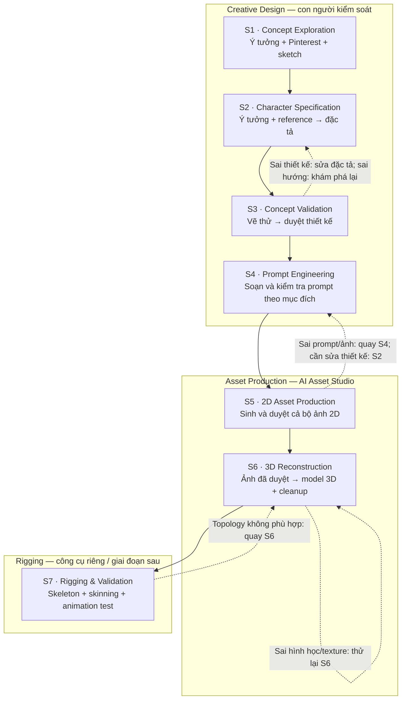

# CHARACTER PRODUCTION WORKFLOW — 7 STAGES

**Phiên bản:** 1.0 (bản thiết kế để chạy thử)  
**Đối tượng:** Người sáng tạo nhân vật fantasy/game; dùng được với ChatGPT, Claude, Gemini và AI Asset Studio.  
**Đầu ra cuối:** Nhân vật 3D có rig, được kiểm tra chuyển động và có thể nhập vào game engine.  
**Nguyên tắc:** *Con người quyết định thiết kế; AI đặt câu hỏi, đề xuất, tạo bản thử, vận hành model và ghi nhận kết quả. Không chuyển stage khi chưa được phê duyệt.*

> **Phân biệt phạm vi hiện tại:** Stage 1–4 là quy trình thiết kế có thể làm bằng tài liệu Markdown + hội thoại; Stage 5 tương ứng sản xuất 2D (AI Asset Studio M4); Stage 6 là 2D→3D (M5); Stage 7 là mở rộng rigging/Unity **ngoài phạm vi M4/M5 hiện tại**, chưa được coi là tính năng đã triển khai. Theo `PRODUCT_SPEC.md`, rigging/animation/Unity nằm ngoài MVP. Không tự đổi `CONTRACTS.md v1.0` để khớp workflow mới.

---

## A. Bản đồ module / stage



**Dòng chảy mặc định:** `S1 → S2 → S3 → S4 → S5 → S6 → S7`.  
**Quality gates:** Sau S2, S3, S4, S5, S6 và S7 đều có quyết định **DUYỆT / SỬA / TẠM DỪNG**. Stage 1 hoàn thành khi người dùng xác nhận đã đủ tư liệu để soạn đặc tả; không buộc phải có bản phác họa đẹp.

### Ai chịu trách nhiệm?

| Stage | Chủ thể quyết định | AI hỗ trợ | Artifact bắt buộc |
|---|---|---|---|
| S1 Khám phá | Bạn | Gợi ý, phân loại reference, phát hiện chỗ còn mơ hồ | `concept_notes.md`, `moodboard/`, sketch nếu có |
| S2 Đặc tả | Bạn | Hỏi có chọn lọc, tổng hợp, kiểm tra mâu thuẫn | `character_spec.md` |
| S3 Duyệt concept | Bạn | Đề xuất ảnh thử, phân tích khác biệt | `concept_approved.png` + `concept_review.md` |
| S4 Soạn prompt | Bạn | Biên soạn prompt theo model, kiểm tra tính đầy đủ | `prompts/*.md` |
| S5 Duyệt tập 2D | Bạn | Sinh ảnh, quản lý phiên bản, lập contact sheet | `2d/approved/` + `2d_review.md` |
| S6 Dựng 3D | Bạn phê duyệt kỹ thuật | Benchmark model 3D, kiểm tra mesh/texture | `3d/model_approved.glb` + `3d_review.md` |
| S7 Gắn rig | Bạn phê duyệt sản phẩm | Gắn xương, skinning, import/test | `rigged/` + `rig_review.md` |

### Sáu quy tắc vận hành

1. **Không tự suy diễn chi tiết quan trọng.** Thiếu thông tin thực sự ảnh hưởng kết quả thì hỏi; chi tiết tùy ý được đề xuất và gắn nhãn “đề xuất”.
2. **Hỏi theo đợt nhỏ:** tối đa **3–5 câu quan trọng** mỗi lượt, không ném cả bộ câu hỏi bên dưới cho người dùng. Cho phép trả lời “chưa biết / tùy AI / bỏ qua”.
3. **Reference có vai trò**, không phải ảnh nào cũng là toàn bộ thiết kế. Một ảnh có thể chỉ tham chiếu mắt, áo, bảng màu, silhouette, chất liệu hoặc bố cục. Ghi rõ cái gì **không được sao chép**.
4. **Thông tin chuẩn nằm ở `character_spec.md`.** `prompt` là bản triển khai, ảnh là bản hiện thực hóa, không được âm thầm thay đổi thông tin đã khóa.
5. **Duyệt bằng bằng chứng.** Phê duyệt ảnh bằng hình thực tế; phê duyệt 3D bằng model xoay được và báo cáo mesh; phê duyệt rig bằng thử chuyển động. “Prompt có vẻ hay” không chứng minh ảnh đẹp.
6. **Quay về bước gây lỗi gần nhất** để tiết kiệm công. Khi sửa thuộc tính khóa của nhân vật, đánh dấu các artifact phía sau liên quan là cần kiểm tra lại, không xóa lịch sử.

---

## B. Mẫu câu hỏi và nội dung từng stage

### STAGE 1 — Concept Exploration / Khám phá ý tưởng

**Mục tiêu:** Biến một ý tưởng thô thành hướng thiết kế có hình dung rõ ràng, do **bạn** kiểm soát. Pinterest, ảnh chụp, phác thảo tay và ví dụ từ game đều có thể dùng để định hướng.

**Đầu vào:** Một hoặc vài câu ý tưởng thô; ảnh có thể chưa có; không bắt buộc kỹ năng vẽ.  
**Thao tác:** Brainstorm → sưu tầm reference → đặt nhãn cho từng ảnh → phác silhouette / bố cục nếu cần → chọn 1–2 hướng tiềm năng.

**Bộ câu hỏi AI dùng để khai thác (chỉ hỏi câu chưa có đáp án):**

**Cốt lõi**
1. Nhân vật này là ai trong thế giới game? Vai trò: nhân vật chính, đồng minh, phản diện, NPC, linh thú…?
2. Cảm giác đầu tiên bạn muốn người chơi nhận được khi nhìn nhân vật: lạnh lùng, ấm áp, uy nghi, bí ẩn, năng động…?
3. Bạn hình dung nhân vật theo hướng nam/nữ/phi giới tính hoặc không có giới tính? Độ tuổi biểu hiện và tỷ lệ cơ thể ra sao?
4. Thế giới của nhân vật thuộc thể loại nào: modern xianxia, wuxia, anime fantasy, Korean RPG, khoa học giả tưởng, pha trộn…?
5. Điều gì là *không thể thay đổi* trong ý tưởng ban đầu?
6. Bạn có hình Pinterest, ảnh tự vẽ, ảnh tham chiếu nào? **Với từng ảnh**, bạn thích chính xác đặc điểm nào?

**Đào sâu khi cần**
7. Muốn tỷ lệ realistic, semi-realistic anime, anime, stylized hay chibi?
8. Có motif nổi bật không: băng, sen, hạc, kiếm, linh thú, ánh sáng, công nghệ…?
9. Bảng màu mong muốn và những màu cần tránh?
10. Silhouette nhìn từ xa: mảnh, rộng vai, tay áo lớn, áo choàng dài, giáp nặng…?
11. Các vật dụng biểu tượng: quạt, kiếm, pháp trượng, vòng tay, mũ…?
12. Nhân vật dành cho game 3D, game 2D, splash art hay cả ba? Quyết định này ảnh hưởng mức độ cầu kỳ của chi tiết.
13. Có cần phác thảo hình dáng trước khi viết đặc tả không? Nếu không biết vẽ, AI có thể gợi ý sketch đơn giản theo khối.

**Cách xử lý ảnh tham chiếu:** Ghi bảng `Tên ảnh | nguồn | vai trò | thích gì | KHÔNG lấy gì`. Tránh xem một ảnh là yêu cầu sao chép nguyên vẹn. Lưu nguồn và lưu ý quyền sử dụng nếu sau này dùng trong sản phẩm thương mại.

**Artifact:** `concept_notes.md` (tóm tắt tầm nhìn, các reference đã gắn vai trò, lựa chọn mở, sketch nếu có).  
**Điều kiện qua S2:** Bạn trả lời **“Đủ hướng để đặc tả”**. Không cần mọi chi tiết đã chốt.

---

### STAGE 2 — Character Specification / Đặc tả nhân vật

**Mục tiêu:** Tổng hợp **ý tưởng thô + ảnh/sketch tham chiếu** thành `character_spec.md` — nguồn thông tin chuẩn, không còn khoảng trống gây hiểu lầm ở các đặc điểm quan trọng.

**Đầu vào:** `concept_notes.md`, moodboard có chú thích, sketch nếu có.  
**Thao tác:** Tách dữ kiện đã biết và giả định; phát hiện xung đột giữa mô tả/reference; chọn đặc điểm; đánh dấu `LOCKED`, `PREFERRED`, `FLEXIBLE`; chốt danh sách cần xác nhận.

**Câu hỏi cốt lõi**
1. Tên hoặc mã nhân vật là gì? Vai trò và bối cảnh ngắn gọn?
2. Những dấu hiệu nhận diện nào phải giữ ở mọi ảnh? (mặt, tóc, mắt, sẹo, hoa văn, phụ kiện…)
3. Ngoại hình cụ thể: chiều cao/tỷ lệ tương đối, vóc dáng, tông da, khuôn mặt, mắt, kiểu tóc, màu tóc?
4. Trang phục gồm những lớp nào? Phần nào nằm trong/phần nào phủ bên ngoài? Độ dài và hướng rủ của vải?
5. Vũ khí và phụ kiện: hình dáng, vị trí đeo/cầm, số lượng, tỷ lệ so với người?
6. Style đích là gì? Nét vẽ, độ chân thực, chất liệu, đổ bóng, phối màu, cảm giác thẩm mỹ?
7. Reference nào chi phối *bộ phận nào*? Có đặc điểm nào trái ngược giữa các reference không, chọn phương án nào?
8. Ở các góc mặt trước, cạnh, sau, những chi tiết nào **phải xuất hiện đúng vị trí**?
9. Các đặc điểm nào được quyền thử nhiều phương án, những gì tuyệt đối không đổi?

**Câu hỏi bổ sung**
10. Nhân vật có biến thể trang phục, trạng thái chiến đấu hoặc dạng tiến hóa không? Nếu có, bản nào là **base design**?
11. Tóc, áo choàng, dây tua và phụ kiện có cần vận động khi rigging không? Hay chỉ cần tạo hình tĩnh trước?
12. Có hạn chế nào về độ phức tạp để thuận lợi dựng 3D/rigging? Ví dụ phần áo không che toàn bộ chân, hạn chế chi tiết bay tự do.
13. Có yêu cầu tỉ lệ, chiều cao, tỷ lệ đầu:thân hoặc thước chuẩn game engine không?
14. Định nghĩa “không đúng nhân vật” là gì? Kể 2–3 lỗi mà bạn sẽ không chấp nhận.

**Bản đặc tả tối thiểu phải chứa:**

```yaml
character_id: ice-mage-01
version: 1.0
status: draft  # draft | approved | needs_revision
concept: "Tóm tắt 2-4 câu"
identity:
  role: "..."
  apparent_age: "..."
  body_proportions: "..."
appearance:
  face: "..."
  hair: "..."
  eyes: "..."
costume:
  silhouette: "..."
  layers: ["..."]
  palette: ["..."]
props: ["..."]
style:
  art_direction: "..."
  rendering: "..."
reference_map:
  - file: "moodboard/ref-01.png"
    use_for: ["hair", "linework"]
    do_not_copy: ["entire costume"]
locked: ["..."]
preferred: ["..."]
flexible: ["..."]
open_questions: []
```

*Đây là mẫu ghi chép cho workflow, không phải hợp đồng API hiện tại của AI Asset Studio.*

**Artifact:** `character_spec.md` + nguồn tham chiếu đã phân loại.  
**Điều kiện qua S3:** Bạn duyệt bản đặc tả. Mục `LOCKED` được chốt, những gì chưa biết được ghi rõ `unknown` hoặc `flexible`, không tự bịa.

---

### STAGE 3 — Visual Concept Validation / Vẽ thử và duyệt ngoại hình

**Mục tiêu:** Kiểm tra bằng **hình ảnh thật** rằng thiết kế đang đi đúng hướng **trước** khi đầu tư tạo bộ asset hoàn chỉnh.

**Đầu vào:** `character_spec.md` đã duyệt.  
**Thao tác:** Tạo 1–3 bản concept nhanh bằng phác họa tay, AI vẽ thử hoặc kết hợp; so sánh với đặc tả và moodboard; ghi nhận chỗ đúng/sai; chốt một bản concept chuẩn.

**Câu hỏi trước khi vẽ**
1. Bản đầu tiên cần ưu tiên nhìn rõ phần nào: tổng thể, khuôn mặt, trang phục hay silhouette?
2. Dùng góc đứng chính diện, 3/4 hay hình minh họa động để thấy rõ thiết kế?
3. Có muốn AI đưa 2–3 phương án khác nhau của **một** chi tiết chưa khóa không?
4. Điều kiện nào khiến bạn bác bỏ ngay một bản vẽ (sai mặt, sai form áo, thiếu phụ kiện…)?

**Câu hỏi khi duyệt hình**
5. Đây đã “đúng nhân vật trong đầu bạn” chưa? Nếu chưa, **sai ở bộ phận nào**?
6. Khuôn mặt, tóc, tỷ lệ, khí chất có đúng như mong đợi không?
7. Silhouette có đủ đặc trưng khi thu nhỏ ảnh không?
8. Màu sắc và trang phục có đúng với đặc tả `LOCKED` không?
9. Chi tiết nào đẹp nhưng không đúng thiết kế, cần sửa thay vì giữ lại?
10. Có cần thay đổi thiết kế gốc không, hay chỉ cần vẽ lại để thể hiện đúng thiết kế đã có?

**Artifact:** `concept_approved.png` hoặc ảnh phác chính được chọn; `concept_review.md` ghi những gì đã duyệt và các lỗi bị loại.  
**Điều kiện qua S4:** Bạn chấp nhận diện mạo và art direction. Nếu **lỗi diễn đạt hình**, thử vẽ lại S3; nếu **đặc tả chưa đúng**, quay S2; nếu **thay đổi toàn bộ hướng thẩm mỹ**, quay S1.

---

### STAGE 4 — Prompt Engineering / Thiết kế và duyệt prompt

**Mục tiêu:** Chuyển đặc tả đã duyệt thành **bộ prompt theo từng mục đích**, không để prompt trở thành bản thiết kế riêng độc lập.

**Đầu vào:** `character_spec.md`, `concept_approved.png`, nhu cầu 2D.  
**Thao tác:** Tạo prompt theo `Character + Style + Composition + Constraints`, ghi canonical prompt, prompt dành riêng từng model (nếu cần), negative prompt chỉ với model hỗ trợ; tự kiểm tra nội dung rồi xin duyệt.

**Câu hỏi cốt lõi**
1. Cần những loại ảnh nào **bây giờ**, loại nào để sau? (full-body, portrait, key visual, turnarounds, chibi, icon, biểu cảm)
2. Ảnh nào dùng cho **đầu vào dựng 3D**, ảnh nào chỉ dùng cho giới thiệu/truyền thông?
3. Cần góc nhìn nào: `front`, `side`, `back`, `three_quarter`, `detail`? Tư thế trung tính hay hành động?
4. Độ phân giải, tỷ lệ khung hình, nền trơn hay cảnh vật? Có yêu cầu nhìn rõ bàn tay, chân và phụ kiện?
5. Style có giữ như S2/S3 hay cần một **biến thể trình bày** (ví dụ chibi chỉ cho icon)?
6. Những từ khóa nào không được bỏ sót, chi tiết nào không nên nhắc vì dễ khiến model vẽ sai?
7. Model nào sẽ được chạy? Nó hiểu prose hay tag; có hỗ trợ negative prompt, ảnh tham chiếu, multi-image hay không?
8. Có yêu cầu prompt bằng tiếng Anh? (Khuyến nghị cho benchmark; vẫn lưu lời giải thích tiếng Việt.)

**Câu hỏi kiểm tra chất lượng prompt trước khi duyệt**
9. Prompt có mô tả **một** nhân vật nhất quán, hay lẫn nhiều ý tưởng trái ngược?
10. Prompt có vô tình ra lệnh model **sáng tạo thêm** phụ kiện/trang phục đã khóa không?
11. Đối với turnarounds, có yêu cầu ánh sáng trung tính, kích thước nhân vật ổn định, không bị VFX che khuất không?
12. Prompt có đặc tả đủ rõ kiểu ảnh hay chỉ lặp lại tính từ “beautiful, masterpiece”?
13. Tham số nào thuộc prompt, tham số nào thuộc cấu hình model (`seed`, `steps`, `width`, `height`, `guidance`)?
14. Có bất kỳ yếu tố nào model không hỗ trợ? **Không âm thầm bỏ qua**.

**Các loại output:**

| Loại | Mục đích | Yêu cầu chính |
|---|---|---|
| `full_body` | Chốt diện mạo tổng thể | Toàn thân, không bị cắt, hình dáng rõ |
| `portrait` | Quan sát mặt/tóc/mắt | Cận mặt; giữ dấu hiệu nhận diện |
| `key_visual` | Ảnh nghệ thuật / cốt truyện | Bố cục có cảm xúc; không thay đổi thiết kế |
| `turnaround_front/side/back` | Bộ ảnh dựng 3D | Tư thế trung tính, tỷ lệ ổn định, đủ chi tiết |
| `detail` | Cận phụ kiện, giày, vải, vũ khí | Chỉ rõ bộ phận cần phóng lớn |
| `chibi` | Icon / asset phụ sau này | Là biến thể phong cách, **không trộn** với benchmark character chính |

**Mẫu cấu trúc prompt**

```text
CHARACTER (bắt buộc): [Ngoại hình + trang phục + phụ kiện nhận diện đã khóa]
ART STYLE (bắt buộc): [Anime / soft painterly / modern xianxia ...]
COMPOSITION (theo mục đích): [full-body standing front view ...]
VISIBILITY / CONSTRAINTS: [hands/feet visible, clean background, no heavy VFX ...]
MODEL-SPECIFIC FORM: [natural-language hoặc tag, chỉ khi model hỗ trợ]
NEGATIVE (tùy model): [chỉ khi pipeline hỗ trợ rõ ràng]
```

**Quy tắc benchmark công bằng:** Giữ **nội dung ngữ nghĩa** không đổi giữa các model. Có thể chuyển cú pháp (tag/prose) nhưng lưu cả `canonical_prompt` và `actual_prompt`, cùng cấu hình/seed. Không thể suy ra hai model giống nhau chỉ vì dùng cùng số seed.

**Artifact:** `prompts/full_body.md`, `portrait.md`, `key_visual.md`, `turnaround.md` (chỉ tạo loại thực sự cần) + `prompt_review.md`.  
**Điều kiện qua S5:** Bạn đã đọc, kiểm tra các đặc điểm `LOCKED`, duyệt prompt. **Duyệt prompt không có nghĩa là đã duyệt ảnh**.

---

### STAGE 5 — 2D Asset Production / Sinh và nghiệm thu bộ ảnh 2D

**Mục tiêu:** Tạo và **duyệt cả tập ảnh** đúng Character Specification, đặc biệt là bộ multiview sẽ đi vào Stage 6.

**Đầu vào:** Các prompt đã duyệt; model 2D được lựa chọn hoặc đang thử nghiệm; cấu hình generation.  
**Thao tác:** Chạy sinh ảnh → lưu phiên bản + metadata → xem từng ảnh → kiểm tra đồng nhất **giữa các góc** → chọn bản tốt nhất / sửa prompt / tạo lại → khóa bộ ảnh được duyệt.

**Câu hỏi chuẩn bị**
1. Hôm nay sản xuất loại ảnh nào, mức ưu tiên ra sao? Không bắt buộc phải có chibi/key visual trước khi 3D.
2. Dùng model nào? Benchmark M4 đã cho thấy model nào hợp style và concept không?
3. Cần bao nhiêu ứng viên/ảnh và mức quota GPU tối đa được phép dùng?
4. Có model nào thực sự hỗ trợ tham chiếu ảnh để **giữ identity**? Nếu không, phải đánh giá thủ công và không hứa nhất quán.
5. Ghi lại seed, checkpoint, actual prompt, steps, CFG, sampler, size để tái lập chưa?

**Câu hỏi nghiệm thu từng ảnh**
6. Gương mặt, mắt, tóc, tỷ lệ, trang phục, palette có đúng `LOCKED` không?
7. Tay/chân/vũ khí có đủ và rõ; có lỗi giải phẫu hay chi tiết vô lý không?
8. Ảnh có bị crop, bị VFX/đạo cụ che mất bộ phận quan trọng không?
9. Đây là ảnh “đẹp” hay là ảnh “đúng thiết kế”? Ưu tiên đúng thiết kế trước.

**Câu hỏi nghiệm thu toàn bộ bộ multiview**
10. Front / side / back có cùng **một** nhân vật, cùng lớp trang phục, chiều dài tóc, vị trí phụ kiện và bảng màu không?
11. Tỷ lệ đầu, vai, eo, chân và kích thước nhân vật có ổn định giữa các góc không?
12. Có thông tin nào trong thiết kế 3D cần thiết nhưng vẫn chưa được minh họa rõ? (Nếu có: bổ sung ảnh chi tiết hoặc góc cần thiết **ở S5**, trước khi duyệt.)
13. Có thể xác định phần trước/sau của áo, độ rủ tóc, vị trí vũ khí/phụ kiện từ các ảnh đã duyệt không?
14. Bạn có duyệt **toàn bộ tập ảnh một lần** cho S6, thay vì duyệt lẻ từng tấm không?

**Quality gate quan trọng:** S5 **chỉ hoàn thành** khi bộ ảnh multiview đã đủ yêu cầu và **không có mâu thuẫn thiết kế chưa giải quyết**. Chốt ảnh và đóng băng phiên bản (`2d_set_v1`). Đây là điều kiện bạn đã khẳng định; Stage 6 sẽ **không mặc định quy lỗi cho ảnh 2D**.

**Artifact:** `2d/approved/front.png`, `side.png`, `back.png` và các ảnh `detail` cần thiết, `2d_manifest.md`, `2d_review.md`. Các ảnh khác (portrait/key visual/chibi) nằm ở thư mục riêng và không nhất thiết là đầu vào dựng 3D.  
**Điều kiện qua S6:** Bạn phê duyệt **cả bộ**. Nếu sai chất lượng hình: thử model khác/S5; sai prompt: S4; sai đặc tả: S2.

> **Giới hạn sản phẩm:** M4 theo tài liệu hiện tại là `text_to_2d`. Nếu sau này muốn đưa ảnh vào model để chỉnh identity/đa góc, cần model hỗ trợ image-conditioned generation và thiết kế hợp đồng phù hợp. Không mặc định M4 T2I đã hỗ trợ việc này.

---

### STAGE 6 — 3D Reconstruction / Dựng model 3D

**Mục tiêu:** Chuyển **bộ ảnh 2D đã nghiệm thu** thành model 3D đúng diện mạo, có geometry/material/texture đủ chất lượng và sẵn sàng cho rigging.

**Đầu vào:** `2d_set_v1` đã khóa và đặc tả được duyệt. **Không tiếp nhận bộ ảnh chưa qua S5.**  
**Thao tác:** Chọn model 3D theo khả năng 1 ảnh / multiview → inference → xem model xoay 360° → đánh giá mesh/UV/texture → cleanup/retopology khi cần → xuất GLB và báo cáo.

**Câu hỏi trước khi dựng**
1. Model hiện tại hỗ trợ đúng số ảnh/góc nhìn chưa, hay chỉ hỗ trợ 1 ảnh? Không giả định nó xử lý multiview.
2. Cấu hình nào phù hợp với bộ ảnh đã khóa: độ phân giải texture, số mặt, tốc độ/VRAM, định dạng export?
3. Tỷ lệ thế giới thực hoặc chiều cao mục tiêu của model là bao nhiêu? Đơn vị theo engine?
4. Phần nào cần độ chi tiết ưu tiên: mặt, tóc, áo, tay, vũ khí?
5. Mục đích của model: chỉ xem 3D, hay **bắt buộc rig và animation**? (Ở workflow này: bắt buộc.)

**Câu hỏi sau khi dựng**
6. Silhouette 360°, tỷ lệ cơ thể, mặt, tóc, trang phục và phụ kiện có khớp bộ ảnh không?
7. Texture có đúng màu, hoa văn, chất liệu; có seam hoặc vùng bị smear rõ không?
8. Mesh có lỗi hở, floating parts, self-intersection đáng kể, geometry dính vào nhau hoặc mesh không thể sử dụng không?
9. Topology hiện tại có đủ để skinning; có cần retopology, tách tóc, áo choàng, dây tua không?
10. UV, normals, scale, axis, origin, transform và export GLB đã hợp lệ chưa?
11. Nếu sai, **đổi model, cấu hình, đầu ra, hoặc cleanup tại S6** có giải quyết được không?
12. Có thiếu góc/chi tiết cần thiết *dù bộ ảnh đã được duyệt* không? Đây là phát hiện nhu cầu mới: chỉ khi thật sự cần mới đề xuất bổ sung S5, không nói bộ ảnh đã duyệt “mâu thuẫn”.
13. Có thật sự hỗ trợ chỉnh 3D bằng text trong model được chọn không? Nếu không, đánh dấu là **không khả dụng**; không xây workflow dựa vào giả định.

**Artifact:** `3d/model_approved.glb`, preview xoay nhiều góc, `3d_review.md` (có nguồn model, VRAM/time, mesh/texture QA và các chỉnh sửa thủ công).  
**Điều kiện qua S7:** Model trông đúng thiết kế và **sẵn sàng rig**, không chỉ là GLB mở được. Nếu lỗi do model 3D thì thử lại S6; nếu cần reference thêm, yêu cầu **thay đổi có phê duyệt** về S5.

---

### STAGE 7 — Rigging & Final Validation / Gắn xương và nghiệm thu

**Mục tiêu:** Biến model 3D tĩnh thành nhân vật có thể điều khiển/animate trong game engine.

**Đầu vào:** `3d/model_approved.glb` có geometry phù hợp.  
**Thao tác:** Chuẩn hóa mesh → skeleton/armature → skinning/weight painting → test các pose khó → export → kiểm tra trong Blender và Unity (hoặc engine khác do bạn chọn).

**Câu hỏi trước khi rig**
1. Rig dùng cho humanoid, creature hay non-humanoid? Engine đích là Unity hay công cụ khác?
2. Mức chuyển động cần có bây giờ: idle, walk, run, turn, attack, gesture, jump?
3. Tóc/áo choàng/dây tua cần xương phụ, mô phỏng physics, hay để bản đầu đơn giản?
4. Yêu cầu rig dạng humanoid retargetable hay rig tùy chỉnh?
5. Những phụ kiện cầm tay hoặc gắn vào xương nào? Có weapon socket/attachment point không?

**Câu hỏi khi nghiệm thu**
6. Skeleton đúng thứ tự khớp và không bị lệch hướng hoặc scale không?
7. Skinning có làm biến dạng nghiêm trọng ở khuỷu, đầu gối, vai, cổ tay, hông, cổ và trang phục không?
8. Các pose biên độ lớn có bị clipping tóc/áo/phụ kiện không?
9. Model có hoạt động với idle, walk, run, turn và một animation thử cơ bản không?
10. Import vào Unity: Avatar/rig mapping, vật liệu, orientation, scale và animation có hoạt động không?
11. FPS/CPU/RAM/mesh complexity có phù hợp mục tiêu game không? Đo trên bản build mục tiêu, không suy đoán.
12. Lỗi bắt nguồn từ weight/skeleton (sửa S7) hay từ mesh/topology (quay S6)?

**Artifact:** nhân vật có armature và skin weights, file xuất (ví dụ FBX hoặc GLB/glTF có skinning khi công cụ hỗ trợ), demo animation, `rig_review.md`.  
**Điều kiện hoàn tất:** Chạy được test animation và import vào engine mục tiêu mà không có lỗi biến dạng nghiêm trọng; bạn duyệt.

---

## C. Cơ chế quay lại / sửa lỗi

| Triệu chứng | Stage sửa trước | Khi nào quay xa hơn? |
|---|---|---|
| Ý tưởng chưa định hình, đổi hẳn gu thẩm mỹ | S1 | — |
| Mô tả sai màu tóc, form áo, nhận diện | S2 | Chỉ về S1 nếu đổi toàn bộ hướng |
| Ảnh phác chưa đẹp nhưng spec đúng | S3 | S2 nếu chính bản đặc tả chưa đúng |
| Prompt sai cú pháp, thiếu mô tả bắt buộc | S4 | S2 nếu spec thiếu/không nhất quán |
| Sinh 2D sai prompt hoặc không đẹp | S5 → S4 | S2/S3 khi thiết kế gốc thực sự thay đổi |
| Multiview không cùng nhân vật | **Giải quyết tại S5** | S4 nếu cách ra prompt gây khác biệt |
| 3D sai mesh, texture, màu, silhouette | **S6** | S5 chỉ khi thật sự cần dữ liệu góc/chi tiết mới |
| Skeleton/weights/animation sai | **S7** | S6 nếu topology/mesh là nguyên nhân |

**Phân loại quyết định sau mỗi stage:** `APPROVED` · `REVISION_REQUIRED` · `ON_HOLD`. Người dùng phải quyết định; AI không tự chuyển stage.

### Mẫu phê duyệt ngắn

```text
CHARACTER: [character_id]
STAGE: [S1..S7]
ARTIFACT VERSION: [v1 / v2...]
STATUS: APPROVED | REVISION_REQUIRED | ON_HOLD
LOCKED FEATURES CHECKED: [list]
ACCEPTED EXCEPTIONS: [list or none]
FEEDBACK / NEXT ACTION: [...]
APPROVED BY: user
```

---

## D. Bộ hướng dẫn cho một LLM bất kỳ (dán cùng tài liệu này)

Bạn có thể gửi phần sau cho ChatGPT, Gemini hoặc Claude ở một cuộc trò chuyện mới, kèm file này và tài liệu/ảnh của nhân vật:

> **Bạn là Interactive Character Art Director, không phải người tự quyết định thiết kế thay tôi.** Hãy tuân thủ `CHARACTER_PRODUCTION_WORKFLOW.md`, dùng đúng 7 stage. Trước tiên hỏi tôi đang ở stage nào và ý tưởng/tài liệu đã có; không hỏi lại thông tin tôi đã cung cấp. Mỗi lượt chỉ hỏi tối đa 3–5 câu thực sự quan trọng, ưu tiên câu ảnh hưởng trực tiếp tới kết quả; cho phép “chưa biết” hoặc “AI đề xuất”. Với mỗi ảnh tham chiếu, phải hỏi hoặc xác nhận tôi muốn lấy chi tiết nào, không tự sao chép toàn ảnh. Sau mỗi stage, xuất artifact theo hướng dẫn, liệt kê điều đã biết/chưa biết và yêu cầu tôi phê duyệt trước khi tiếp tục. Nếu phát hiện không đúng, chỉ đề nghị quay về stage gây lỗi gần nhất. Khi có Character Specification đã duyệt, mọi prompt/ảnh/3D phải đối chiếu các thuộc tính `LOCKED`. Không chạy model, chi tiền hoặc sử dụng GPU khi chưa có lệnh rõ ràng. Không tuyên bố chất lượng đạt khi chưa kiểm tra artifact thật.

**Lưu ý về tính phổ quát:** Đây là hướng dẫn hội thoại tái sử dụng, không phải tính năng tự động thực thi có sẵn của mọi LLM. Một số LLM không thể tự vẽ/chạy model/kiểm tra GLB; khi thiếu công cụ, chúng phải dừng ở tài liệu hoặc hướng dẫn thực hiện, không giả vờ đã chạy.

---

## E. Áp dụng vào AI Asset Studio, không phá cấu trúc hiện tại

- **S1–S4:** Tài liệu và hội thoại; chưa cần một module backend mới. Có thể lưu trong `data/characters/<id>/` hoặc ngoài project và chỉ đưa các prompt đã duyệt vào Studio.
- **S5:** Gắn với `text_to_2d` M4. Dữ liệu ảnh đầu ra + manifest và lịch sử job. Để dùng ảnh tham chiếu *làm input model*, phải có model hỗ trợ đúng capability và quy trình được phê duyệt; đừng đánh đồng với T2I thường.
- **S6:** Gắn với `image_to_3d` M5; model chỉ được nhận số ảnh/role đã khai báo. Báo cáo rõ giới hạn vùng không được nhìn thấy. 3D cleanup là bước thao tác sau inference, không bắt buộc phải là một dịch vụ mới.
- **S7:** Rigging/Unity nằm ngoài phạm vi M4–M6 hiện có. Dùng Blender/Unity hay công cụ phù hợp trước; tích hợp sau nếu thật sự cần. Không âm thầm thêm stage rigging thành một trong 3 pipeline theo hợp đồng v1.0.
- **Không đổi 3 module business** (`Interface`, `Models`, `Kaggle`); 7 stage là **workflow nghiệp vụ ở lớp trên**, không phải 7 microservices.
- **Hồ sơ prompt** giữ nguyên văn bản gốc + prompt đã chuyển theo model. Không bịa runtime, VRAM, khả năng text-edit 3D hay mức tự động hóa.

### Cấu trúc thư mục tham khảo (tối giản)

```text
characters/
└── ice-mage-01/
    ├── concept_notes.md
    ├── moodboard/
    ├── character_spec.md
    ├── concept_approved.png
    ├── concept_review.md
    ├── prompts/
    │   ├── full_body.md
    │   ├── portrait.md
    │   ├── key_visual.md
    │   └── turnaround.md
    ├── 2d/
    │   ├── approved/            # front, side, back, detail...
    │   ├── 2d_manifest.md
    │   └── 2d_review.md
    ├── 3d/
    │   ├── model_approved.glb
    │   └── 3d_review.md
    └── rigged/
        ├── final_character.fbx  # ví dụ; format tùy tool/engine
        └── rig_review.md
```

Không cần tạo file rỗng cho tất cả các mục ngay từ ngày đầu. Tạo khi đến stage tương ứng.

---

## F. Checklist trước khi gọi một nhân vật là “hoàn thành”

- [ ] **S1:** Tôi tự xác nhận hướng nhân vật và những reference mình thật sự thích.
- [ ] **S2:** Có `character_spec.md` được duyệt; `LOCKED` không mơ hồ.
- [ ] **S3:** Có concept vẽ thử được duyệt bằng hình ảnh thực tế.
- [ ] **S4:** Các prompt dùng thật đã được kiểm tra so với spec và khả năng model.
- [ ] **S5:** Toàn bộ ảnh 2D cần thiết, đặc biệt multiview, đồng nhất và được duyệt **theo tập**.
- [ ] **S6:** Model 3D có mesh, texture, tỷ lệ và cấu trúc đủ để rig.
- [ ] **S7:** Rig/weight và animation test đạt; import engine thành công.

**Nguyên tắc nghiệm thu:** *Stage hoàn thành bởi sự chấp thuận có căn cứ, không phải vì AI đã sinh ra một file.*
