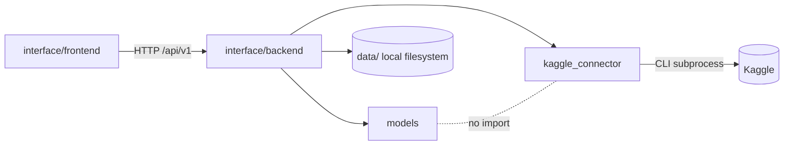
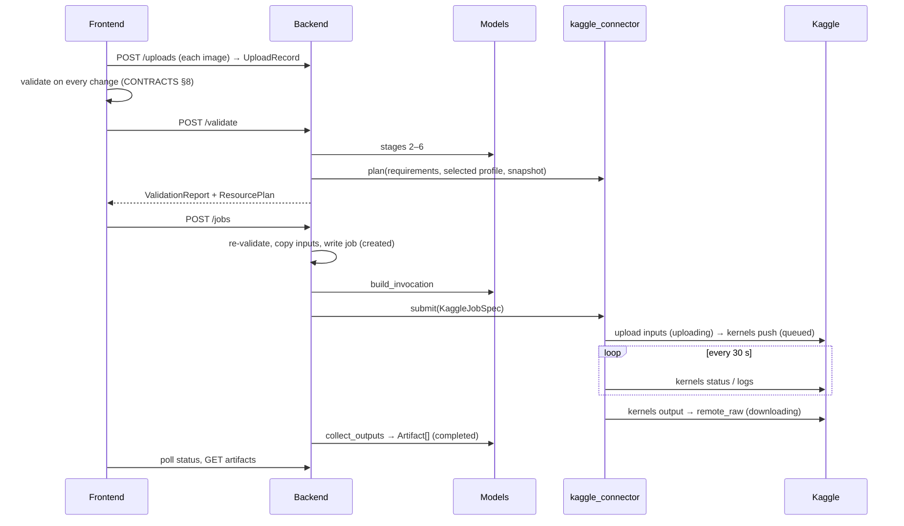
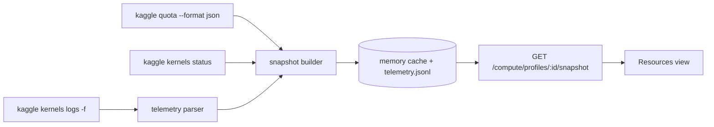
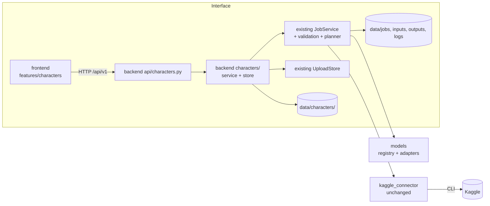

# Architecture

This is a local-first **modular monolith** with exactly three business modules: **Interface**, **Models** and **Kaggle**.
Schemas are in [CONTRACTS.md](CONTRACTS.md). Rationale is in [DECISIONS.md](DECISIONS.md).

## 1. Modules

| Module | Path | Owns | Must not |
|---|---|---|---|
| Interface: frontend | `interface/frontend/` | UI, Three.js GLB preview, client-side validation (same rules as the backend), polling | Touch Kaggle, credentials or files; call anything except the REST API |
| Interface: backend | `interface/backend/aas_backend/` | FastAPI API, orchestration, authoritative validation, job lifecycle, worker, **all of `data/`**, config and secrets | Contain model-specific logic or Kaggle CLI calls |
| Models | `models/` | Contracts (Pydantic), capability registry, validation rules, adapters | Import `interface` or `kaggle_connector`; know about Kaggle, HTTP or storage |
| Kaggle | `kaggle_connector/` | Profiles, auth, quota, job packaging, submit/poll/logs/download, telemetry, resource planning, notebook runtime | Import `interface` or `models`; know about pipelines, categories or models |

- The package is named `kaggle_connector` so it does not shadow the official `kaggle` package (D-002).
- AI agents are development-time tools, not a module. Any future in-app agent would live inside Interface (DF-10).

### 1.1 Dependency rules



- The backend is the only integration point. It maps `ModelInvocation` to `KaggleJobSpec`, and `ModelCapabilities.runtime` to `ResourceRequirements`.
- Third-party dependencies are limited to:
  - `models`: pydantic, Pillow
  - `kaggle_connector`: pydantic and the `kaggle` CLI; the notebook runtime may also use psutil and nvidia-ml-py
- An import-boundary test enforces these rules.

## 2. Directory structure

```
AI Asset Studio/
├── interface/
│   ├── frontend/src/            # api/ (ApiClient, Http/Mock clients, types), validation/, i18n/, theme/,
│   │                            # features/{generate,jobs,library,resources,characters}/, components/
│   └── backend/aas_backend/     # api/, orchestrator/ (validation, worker, state machine), storage/,
│                                # characters/ (V2, §8), profiles.py, settings.py
├── models/
│   ├── contracts/               # Pydantic schemas + JSON Schema export
│   ├── registry/                # capability registry (mocks.py, real.py) + validation stages 2–6
│   └── adapters/                # mock_text_to_2d, mock_image_to_3d, diffusers_text_to_2d (M4)
├── kaggle_connector/
│   ├── client/                  # ComputeClient protocol, MockKaggleClient, KaggleCliClient + CLI parsers
│   ├── jobs/                    # packaging, submit, poll, logs, download
│   ├── resources/               # profiles, accelerator catalog, quota, telemetry parsing, planner
│   └── runtime/                 # runs INSIDE the notebook: runner, telemetry reporter, manifest (no backend imports)
├── data/                        # gitignored (CONTRACTS §9)
├── design/stitch/               # Stitch design reference (layout, typography) and screen exports; v2/ for V2
├── docs/                        # v2/ = Character Production workflow and test plan; sources/ = owner source material
├── tests/{unit,integration,contract,live,fixtures}/   # live = opt-in `pytest -m kaggle`
├── pyproject.toml               # one Python project (models, kaggle_connector, aas_backend)
└── .env.example  .gitignore  open.bat  stop.bat  CLAUDE.md  AGENTS.md  README.md
```

## 3. Technology

| Layer | Choice |
|---|---|
| Frontend | Node 22.12+, React 18, TypeScript strict, Vite, `three` (GLTFLoader, OrbitControls), TanStack Query, react-router, Vitest + Testing Library |
| Backend | Python 3.11+, FastAPI, uvicorn, pydantic v2, pydantic-settings, python-multipart, Pillow, pytest + httpx, ruff |
| Kaggle | Official `kaggle` CLI ≥ 2.2.1 (2.2.4 installed), run as a subprocess |
| Storage | Local files + JSON. No database |
| Execution | One in-process worker per profile (concurrency 1). No queue broker |

Exact versions are pinned in `pyproject.toml` and `package.json`.

## 4. Runtime modes

- `AAS_COMPUTE_MODE=mock` selects `MockKaggleClient`. It runs the job package locally and produces the same status sequence, `AAS_*` log lines and manifest as Kaggle, with configurable quota and telemetry scenarios. It is used by every automated test; the frontend's `VITE_API_MODE=mock` uses `MockApiClient` instead of the backend.
- `kaggle` selects `KaggleCliClient`.
- Contracts are identical in both modes. Only `/health.compute_mode` tells them apart.

## 5. Data flow

### 5.1 Generation job



### 5.2 Resource monitoring



Each snapshot group (quota, session, host, gpu) carries its own source, timestamp and freshness. Live metrics exist only while a cooperating notebook is running (D-028).

## 6. Kaggle connector

Built in M3 (`KaggleCliClient`); the reasons are in DECISIONS D-026…D-031.

| Concern | Design |
|---|---|
| Auth | One profile = one account. Only the profile named by `AAS_ACTIVE_PROFILE` is enabled; the others are listed as disabled and their credentials are never read. The token goes only into the CLI subprocess env (`KAGGLE_API_TOKEN`), with an isolated, empty `KAGGLE_CONFIG_DIR`. `kaggle config view` must report the configured username. Auth and quota refresh in the background every 5 min (D-030) |
| Inputs | Image jobs: one private dataset per job, `aas-in-<job id>`, deleted when the job ends (D-029). Text-only jobs skip this step |
| Submit | One private kernel per job, `aas-<job id>`: a generated `aas_kernel.py` embeds the runner, the adapter entrypoint and `job.json`, with no secrets → `kaggle kernels push` with an explicit `--timeout`. Accelerators: `cpu` and `gpu_t4x2` (D-031). Internet is off, except for jobs whose adapter sets `requires_internet` (the real models, which download pinned weights; D-032, D-034) |
| Poll | `kaggle kernels status` every 30 s, mapped to CONTRACTS §4 (D-030) |
| Logs | `kaggle kernels logs -f` while running (live telemetry, D-028). `kaggle kernels logs` after the run fills gaps. Lines are redacted before storage |
| Artifacts | `kaggle kernels output` → `outputs/<job_id>/remote_raw` → manifest check → `collect_outputs` |
| Cleanup | The dataset is deleted when the job ends. The kernel is deleted when the job completes and kept when it fails, so the run can be inspected (D-031) |
| Retries | CONTRACTS §4. Never auto-resubmit, never switch profile |
| Quota | `kaggle quota --format json` (D-026). A failed call gives `null` + `unavailable` |
| Test switch | `AAS_KAGGLE_TEST_FAILURE=kernel_error` makes every Kaggle job fail on purpose, to check error handling (D-031) |
| Stance | Kaggle is a limited batch platform. No persistent sessions or real-time inference |

## 7. Frontend routes

- `/generate/{text-to-2d|image-to-3d|text-to-3d}`: category → model (filtered) → dynamic form built from `inputs` and `options_schema` → profile, accelerator (Auto or a compatible one) and ResourcePlan panel → Generate. Text→3D is visible but disabled while `planned`.
- `/jobs`, `/jobs/:jobId`: history, status timeline, logs, image or GLB preview, downloads.
- `/resources`: the Kaggle Resources view (FR-R1–FR-R8).
- `/library`: generated artifacts.
- `/characters`, `/characters/:characterId`, `/characters/:characterId/stages/:stageId`: Character Production (§8.6).

The validation module is pure (no React) and is tested against V-01…V-20.

## 8. Character Production (V2)

Approved by the owner on 2026-11-06 (D-035). Requirements: [PRODUCT_SPEC.md §8](PRODUCT_SPEC.md#8-character-production-v2); stages: [v2/CHARACTER_WORKFLOW.md](v2/CHARACTER_WORKFLOW.md); contracts: [CONTRACTS.md §13](CONTRACTS.md#13-character-production-v11).

### 8.1 Principles

- **Same modular monolith, same three business modules** (Interface, Models, Kaggle). Character Production is a
  **feature of Interface**: a backend package and a frontend feature folder. It is not a fourth module.
- **Reuse first.**
  - Jobs, uploads, validation, the resource planner, storage helpers and the Kaggle connector are used as they are.
  - A batch is a set of ordinary v1 jobs.
  - Character data references job data; it never copies it (an approved image is the one exception, §8.4.3).
- **No new infrastructure:** no database, broker, queue, scheduler, workflow engine, AI agent or compute system.
  Files under `data/` remain the only storage.
- **Honesty (NFR-3):** every number shown comes from a stored value or a v1 payload; there is no derived "AI score",
  no fake progress and no fake telemetry.

### 8.2 Boundaries and dependencies



| Part | Path | Owns | Must not |
|---|---|---|---|
| Character API | `interface/backend/aas_backend/api/characters.py` | The 19 routes (CONTRACTS §13.6), HTTP mapping | Contain workflow rules |
| Character service | `interface/backend/aas_backend/characters/` (`contracts.py`, `config.py`, `workflow.py`, `service.py`, `store.py`, `batches.py`) | Stage configs, drafts, revisions, approval rules, staleness, freezing, manifests, reconciliation | Call the Kaggle CLI; import `kaggle_connector`; change job records |
| Existing job service | `orchestrator/service.py` | Creates and runs jobs. Gains one internal entry point: create a job from a batch group | — |
| Models | `models/` | `GenerationRequest.tasks` (optional), batch support in `DiffusersTextTo2DAdapter` and its remote entrypoint | Know about characters or stages |
| Kaggle connector | `kaggle_connector/` | **No change** | — |
| Frontend | `interface/frontend/src/features/characters/` + `src/api/characterTypes.ts` | 3 page templates, the components in §8.6 | Touch files; compute statuses itself; invent metrics |

The character service may call the job service; the job service never imports the character service. A batch job
knows its `request.batch` reference, but job processing does not depend on it.

### 8.3 Components and integration

| V2 need | Implemented by | New code |
|---|---|---|
| Image references | `POST /uploads` (v1), then promotion into the character folder | Promotion (copy + JSON) |
| Concept candidates, production images | v1 jobs: Studio jobs linked by `job_id`, and batch jobs | `JobReference` resolution |
| Preview and production batches | One v1 job per task group | Manifest build, grouping, submit, reconcile |
| Option checks | v1 `check_option` and validation stages 2–7 | Per-task calls |
| Time and fit estimates | v1 resource planner (`required_seconds`, quota, session limit) | Per-group `estimated_runtime_seconds` |
| Status display | v1 `GET /jobs/{id}/status` | — |
| Atomic writes, path safety | v1 `atomic_write_json`, `safe_path`, ID regexes | New ID regexes |
| Themes, languages | UI.md tokens and i18n | New i18n keys only |

### 8.4 Storage

#### 8.4.1 Layout

```
data/
├── characters/<character_id>/            # NEW. character_id is immutable; renaming changes character.json only
│   ├── character.json                    # Character
│   ├── history.jsonl                     # StageHistory, append-only
│   ├── stages/<stage_id>/
│   │   ├── draft.json                    # StageDraft (mutable, versioned)
│   │   ├── state.json                    # stored part of StageState: latest/pending/approved revision, last decision
│   │   └── revisions/<nnnn>.json         # StageRevision, immutable after creation (only decision fields change while pending)
│   ├── references/<reference_id>.<ext>   # promoted upload (png/jpg/webp)
│   ├── references/<reference_id>.json    # ReferenceAsset (url references have no file)
│   ├── assets/<asset_id>.png             # frozen approved image (S3, S5)
│   ├── assets/<asset_id>.json            # ArtifactReference
│   └── batches/<manifest_id>.json        # BatchManifest (tasks, groups, attempts, reconciled results)
├── inputs/  outputs/  jobs/  logs/       # v1, unchanged
```

#### 8.4.2 Rules

- **IDs only.** Every path is built from validated IDs, roles and fixed names (`safe_path`, v1 §9). User text never
  becomes part of a path. Reference uploads are re-sniffed for their type from the bytes.
- **Atomic writes** use the existing temp-file + fsync + rename. **Revisions** are created with exclusive create, so
  they can never be overwritten. **History** is append-only; a torn last line is ignored on read.
- **One writer.** A per-character lock in the backend serializes writes. Optimistic versions (`version`,
  `draft_version`) detect stale browser tabs (CONTRACTS §13.5.1).
- **Job data is not duplicated.** Drafts, candidates and manifests store `job_id`/`artifact_id`. Jobs remain owned by
  the v1 job store and are deleted only by `DELETE /jobs/{id}`.
- **Approved data is protected.** Approval copies the selected images into `assets/` after checking their
  `sha256`. Nothing deletes a single revision, a frozen asset or a referenced reference; only deleting the whole character (route 19, D-038) removes them, after renaming its folder to `characters/.deleted-<id>-<random>` so a crash never leaves half a character.
- **Startup:** like v1 jobs, no repair is needed. Staleness and batch status are derived on read; interrupted writes
  leave only temp files, which are swept, and an interrupted character delete leaves a `.deleted-*` folder, which is removed.
- **Size:** a character with a full S5 set adds roughly the selected PNGs (a few MB each) plus small JSON files.

#### 8.4.3 Why approved images are copied

`DELETE /jobs/{id}` (v1 §9) removes a job's outputs. Without the copy, an approved S3 concept or S5 set would vanish
when the owner cleans up jobs. Only **selected** images are copied, and only on approval.

### 8.5 Data flows

#### 8.5.1 Draft → review → approval

```mermaid
sequenceDiagram
  participant UI as StageDetailPage
  participant API as /characters API
  participant S as CharacterService
  UI->>API: PUT draft (expected_draft_version)
  API->>S: validate schema + references, write draft.json
  UI->>API: POST decisions {submit}
  S->>S: create revisions/000N.json (source_revisions = current upstream approvals)
  UI->>API: POST decisions {approve, revision N}
  S->>S: check CONTRACTS §13.5.2 (availability, upstream, checklist, content rules)
  S->>S: S3/S5: copy selected images → assets/; S4: freeze BatchManifest
  S-->>UI: StageDetail (downstream stages now report stale where affected)
```

#### 8.5.2 Preview batch (S3) and production batch (S5)

```mermaid
sequenceDiagram
  participant UI
  participant S as CharacterService
  participant J as JobService (v1)
  participant A as Adapter + remote entry
  participant K as Kaggle connector (v1)
  UI->>S: POST batches {preview} or batches/{id}/submit
  S->>S: check approvals + manifest binding; group tasks by model
  loop one job per group
    S->>J: create job (request.batch, tasks)  — v1 validation + planner
    J->>K: submit one kernel (internet on for real models)
    K->>A: runner loads the model ONCE, renders tasks in order
    A-->>K: task_<id>.png + task_results.json (+ stops at the deadline)
    K-->>J: download → completed (BATCH_PARTIAL if needed) / failed
  end
  UI->>S: GET batches/{id} (when a job turns terminal)
  S->>J: read job records → reconcile TaskResult per task
```

The model is loaded once per job. Tasks that need another model form another group, and therefore another job.
`expected_model_loads` shows the total before submission.

#### 8.5.3 Remote execution of a batch job

1. The runner (v1, unchanged) starts the adapter entrypoint once.
2. The entrypoint:
   1. installs the pinned libraries and downloads the pinned weights (D-032, D-034);
   2. for two-phase models, loads the text encoder, encodes **all** task prompts, then frees it;
   3. loads the image model once;
   4. for each task in order:
      - renders the image with its seed, size and options;
      - checks that the pixels are finite and not blank;
      - writes `task_<task_id>.png`, then appends to `task_results.json`;
      - records a task error and continues with the next task;
      - before starting the next task, checks `deadline_seconds` and marks every remaining task `not_run` if the
        budget is used up.
3. The job exits successfully if at least one task succeeded. Then `collect_outputs` maps each image to an artifact
   with its `task_id`.

One job uses one T4, and nothing assumes the two T4s form one larger GPU.

### 8.6 Frontend components

All components use the existing tokens (UI.md §2), i18n (UI.md §5–§9) and API client. None of them computes a status
the backend did not send.

| Component | Responsibility | Data | Notes |
|---|---|---|---|
| `CharacterLibraryPage` | `/characters`: search, filter by stage and status, grid/list, create | `GET /characters` | The summary counts (in progress, drafts, completed) come from the listed summaries only |
| `CharacterWorkspacePage` | `/characters/:id`: identity header, canvas, inspector | `GET /characters/{id}` | Reads/writes `?node=` |
| `CharacterIdentityHeader` | Name, tags, cover, approved count and current stage; actions: *Open stage*, *Open Generate Studio*, *Rename*, *Delete* (with confirmation, D-038) | `Character`, `CharacterSummary` | No "fork", "export package" or engine badges (not in scope) |
| `WorkflowCanvas` | Draws the 7 fixed nodes and their edges. Pan (drag, or Space + drag), zoom (wheel, `+`/`-`), *fit view*. Arrow keys move the selection | `stages[]` | Default layout two rows (S1–S4, S5–S7); an edge always runs from the earlier stage's output port to the later stage's input port; the user can **drag nodes** to move them (D-038), smoothly: during a drag only the node and its edges move (transform, one update per animation frame), and the layout is saved once on drop (D-039). Positions are a per-browser view preference in `localStorage` (key per character), never sent to the backend; *Reset layout* restores the default. Still no adding, removing or connecting nodes. Hand-written SVG + CSS transform, no new library (OD-11) |
| `WorkflowNode` | Stage number, title, `editorial_status` chip (text + icon, never colour alone), availability badge (`planned`), INPUT port (left) and OUTPUT port (right), the approved revision | `WorkflowStage` | Focusable, `aria-pressed` for the selection. Click selects; double-click (or Enter) opens its Stage Detail (D-039) |
| `WorkflowEdge` | Curved connector from an OUTPUT port to an INPUT port: solid for a hard dependency, dashed for soft; highlighted when either end is selected; marked "stale" when the downstream end is stale. **Data flow** (D-039): when the upstream stage has an approved, non-stale revision, a glowing pulse in `--mana` runs along the edge from output to input; otherwise the edge is static. Static under `prefers-reduced-motion` | `StageConfig.dependencies`, `StageState.approved.stale_reasons` | |
| `FlowInspector` | For the selected node: objective, inputs (upstream revisions), outputs, checklist progress, blockers (as returned), stale reasons, history excerpt, and *Open Stage Detail* | `WorkflowStage` | Works for all 7 stages, including planned ones |
| `StageDetailPage` | `/characters/:id/stages/:stageId`: one shared layout | `GET …/stages/{stageId}` | The back link restores `?node=` |
| `StageContentRenderer` | Picks the content configuration by `stage_id` (S1…S7) | `StageDetail` | Seven configurations, one page |
| `StageInputZone` | Left column: read-only upstream inputs (`inputs[]`) and frozen assets | `StageInput[]` | |
| `StageWorkingArea` | Centre column: the stage's editor (S1 references and notes, S2 spec form and guided questions, S3 preview gallery and comparison, S4 prompt entries, task list and manifest review, S5 batch status, per-task results and selection; S6/S7 read-only planned view) | `draft.content`, `batches`, `resolved_jobs` | Saves with `expected_draft_version`; a 409 offers *Reload* |
| `StageApprovalZone` | Right column: objective, `ApprovalChecklist`, blockers, revisions, decisions (*Submit*, *Approve*, *Request revision*, *Withdraw*) | `config`, `state`, `revisions` | *Approve* is disabled while `blockers` is not empty, and the blockers are listed |
| `ApprovalChecklist` | Checklist items from `StageConfig.checklist`, with state from the draft | `ChecklistItemConfig[]`, `ApprovalChecklist` | Required items are marked |
| `AssetPreview` | Shows a reference, a job artifact or a frozen asset; zoom; provenance panel (model, revision, prompt, seed, size, sha256, job) | `ReferenceAsset`, `ResolvedJob`, `ArtifactReference` | Labels each image *preview*, *production* or *frozen* |
| `JobStatusCard` | One job: v1 status, progress (`null` → "Không rõ"), link to Jobs & logs | `GET /jobs/{id}/status` | Uses the existing status labels and polling |

**Batch controls**

| Stage | Control | Backed by |
|---|---|---|
| S3 | *Generate Quick Preview*, *Preview Gallery*, *Compare Candidates*, *Revise Prompt*, *Approve Concept* | Route 15; routes 6 and 7 |
| S4 | *Production Task List*, *Review Batch Manifest*, *Ready for Production* | `StageDetail.manifest_preview` and `resource_plans`; checklist item `manifest_reviewed`; route 7 |
| S5 | *Submit Production Batch*, *Batch Job Status*, *Per-task Results*, *Retry Failed Tasks*, *Final 2D Approval* | Routes 17, 16 and 18; v1 job status; routes 6 and 7 |

A control whose backend is not implemented yet is shown disabled with the label **DEMO** (prototype only) or
**Planned**. It is never shown as working.
