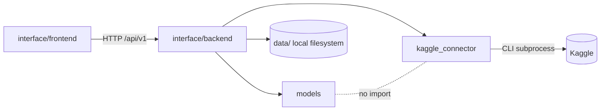
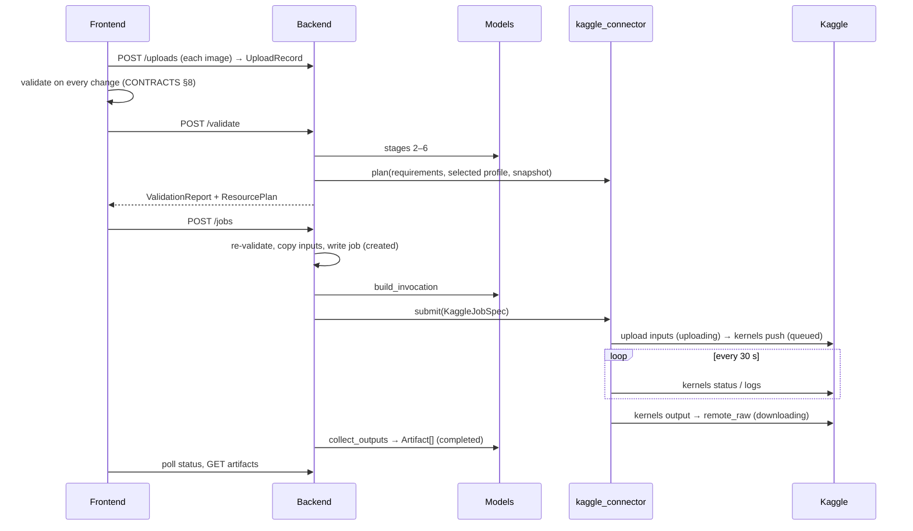
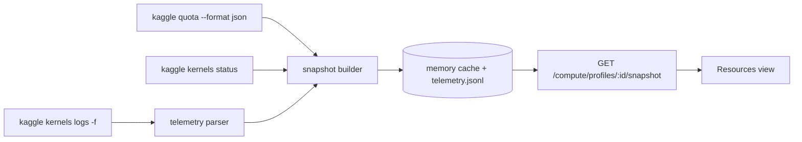

# Architecture

This is a local-first **modular monolith** with exactly three business modules: **Interface**, **Models** and **Kaggle**.
Schemas are in [CONTRACTS.md](CONTRACTS.md). Rationale is in [DECISIONS.md](DECISIONS.md).

## 1. Modules

| Module | Path | Owns | Must not |
|---|---|---|---|
| Interface: frontend | `interface/frontend/` | UI, Three.js GLB preview, client-side validation (same rules as the backend), polling | Touch Kaggle, credentials or files; call anything except the REST API |
| Interface: backend | `interface/backend/aas_backend/` | FastAPI API, orchestration, authoritative validation, job lifecycle, worker, **all of `data/`**, config and secrets | Contain model-specific logic or Kaggle CLI calls |
| Models | `models/` | Contracts (Pydantic), capability registry, validation rules, adapters | Import `interface` or `kaggle_connector`; know about Kaggle, HTTP or storage |
| Kaggle | `kaggle_connector/` | Profiles, auth, quota, job packaging, submit/poll/logs/download, telemetry, resource planning, notebook runtime | Import `interface` or `models`; know about pipelines, categories or models |

- The package is named `kaggle_connector` so it does not shadow the official `kaggle` package (D-002).
- AI agents are development-time tools, not a module. Any future in-app agent would live inside Interface (DF-10).

### 1.1 Dependency rules



- The backend is the only integration point. It maps `ModelInvocation` to `KaggleJobSpec`, and `ModelCapabilities.runtime` to `ResourceRequirements`.
- Third-party dependencies are limited to:
  - `models`: pydantic, Pillow
  - `kaggle_connector`: pydantic and the `kaggle` CLI; the notebook runtime may also use psutil and nvidia-ml-py
- An import-boundary test (M2) enforces these rules.

## 2. Directory structure

```
AI Asset Studio/
├── interface/
│   ├── frontend/src/            # M1: api/ (ApiClient, Http/Mock clients, types.ts), validation/,
│   │                            #     features/{generate,jobs,resources}/, components/ (GlbViewer, Gauge…)
│   └── backend/aas_backend/     # M2: api/, orchestrator/ (validation, worker, state machine), storage/, settings.py
├── models/
│   ├── contracts/               # M2: Pydantic schemas + JSON Schema export
│   ├── registry/                # M2: capability registry + validation stages 2–6
│   └── adapters/                # M2: mock_text_to_2d, mock_image_to_3d; M4+: real adapters
├── kaggle_connector/
│   ├── client/                  # ComputeClient protocol, MockKaggleClient (M2), KaggleCliClient + CLI parsers (M3)
│   ├── jobs/                    # packaging, submit, poll, logs, download
│   ├── resources/               # profiles, accelerator catalog, quota, telemetry parsing, planner
│   └── runtime/                 # runs INSIDE the notebook: runner, telemetry reporter, manifest (no backend imports)
├── data/                        # gitignored (CONTRACTS §9)
├── design/stitch/               # Stitch design reference (layout, typography) and screen exports
├── docs/
├── tests/{unit,integration,contract,live,fixtures}/   # live = opt-in `pytest -m kaggle`
├── pyproject.toml               # M2: one Python project (models, kaggle_connector, aas_backend)
└── .env.example  .gitignore  open.bat  stop.bat  CLAUDE.md  AGENTS.md  README.md
```

## 3. Technology

| Layer | Choice |
|---|---|
| Frontend | Node 22.12+, React 18, TypeScript strict, Vite, `three` (GLTFLoader, OrbitControls), TanStack Query, react-router, Vitest + Testing Library |
| Backend | Python 3.11+, FastAPI, uvicorn, pydantic v2, pydantic-settings, python-multipart, Pillow, pytest + httpx, ruff |
| Kaggle | Official `kaggle` CLI ≥ 2.2.1 (2.2.4 installed), run as a subprocess |
| Storage | Local files + JSON. No database |
| Execution | One in-process worker per profile (concurrency 1). No queue broker |

Exact versions are pinned when each package is created.

## 4. Runtime modes

- `AAS_COMPUTE_MODE=mock` selects `MockKaggleClient`. It runs the job package locally and produces the same status sequence, `AAS_*` log lines and manifest as Kaggle, with configurable quota and telemetry scenarios. It is used in M1 (frontend `VITE_API_MODE=mock` → `MockApiClient`), in M2, and in every automated test.
- `kaggle` selects `KaggleCliClient` (M3+).
- Contracts are identical in both modes. Only `/health.compute_mode` tells them apart.

## 5. Data flow

### 5.1 Generation job



### 5.2 Resource monitoring



Each snapshot group (quota, session, host, gpu) carries its own source, timestamp and freshness. Live metrics exist only while a cooperating notebook is running (D-028).

## 6. Kaggle connector

Built in M3 (`KaggleCliClient`); the reasons are in DECISIONS D-026…D-031.

| Concern | Design |
|---|---|
| Auth | One profile = one account. Only the profile named by `AAS_ACTIVE_PROFILE` is enabled; the others are listed as disabled and their credentials are never read. The token goes only into the CLI subprocess env (`KAGGLE_API_TOKEN`), with an isolated, empty `KAGGLE_CONFIG_DIR`. `kaggle config view` must report the configured username. Auth and quota refresh in the background every 5 min (D-030) |
| Inputs | Image jobs: one private dataset per job, `aas-in-<job id>`, deleted when the job ends (D-029). Text-only jobs skip this step |
| Submit | One private kernel per job, `aas-<job id>`: a generated `aas_kernel.py` embeds the runner, the adapter entrypoint and `job.json`, with no secrets → `kaggle kernels push` with an explicit `--timeout`. Accelerators: `cpu` and `gpu_t4x2` (D-031). Internet is off, except for jobs whose adapter sets `requires_internet` (the real models, which download pinned weights; D-032, D-034) |
| Poll | `kaggle kernels status` every 30 s, mapped to CONTRACTS §4 (D-030) |
| Logs | `kaggle kernels logs -f` while running (live telemetry, D-028). `kaggle kernels logs` after the run fills gaps. Lines are redacted before storage |
| Artifacts | `kaggle kernels output` → `outputs/<job_id>/remote_raw` → manifest check → `collect_outputs` |
| Cleanup | The dataset is deleted when the job ends. The kernel is deleted when the job completes and kept when it fails, so the run can be inspected (D-031) |
| Retries | CONTRACTS §4. Never auto-resubmit, never switch profile |
| Quota | `kaggle quota --format json` (D-026). A failed call gives `null` + `unavailable` |
| Test switch | `AAS_KAGGLE_TEST_FAILURE=kernel_error` makes every Kaggle job fail on purpose, to check error handling (D-031) |
| Stance | Kaggle is a limited batch platform. No persistent sessions or real-time inference |

## 7. Frontend routes

- `/generate/{text-to-2d|image-to-3d|text-to-3d}`: category → model (filtered) → dynamic form built from `inputs` and `options_schema` → profile, accelerator (Auto or a compatible one) and ResourcePlan panel → Generate. Text→3D is visible but disabled while `planned`.
- `/jobs`, `/jobs/:jobId`: history, status timeline, logs, image or GLB preview, downloads.
- `/resources`: the Kaggle Resources view (FR-R1–FR-R8).

The validation module is pure (no React) and is tested against V-01…V-20.
