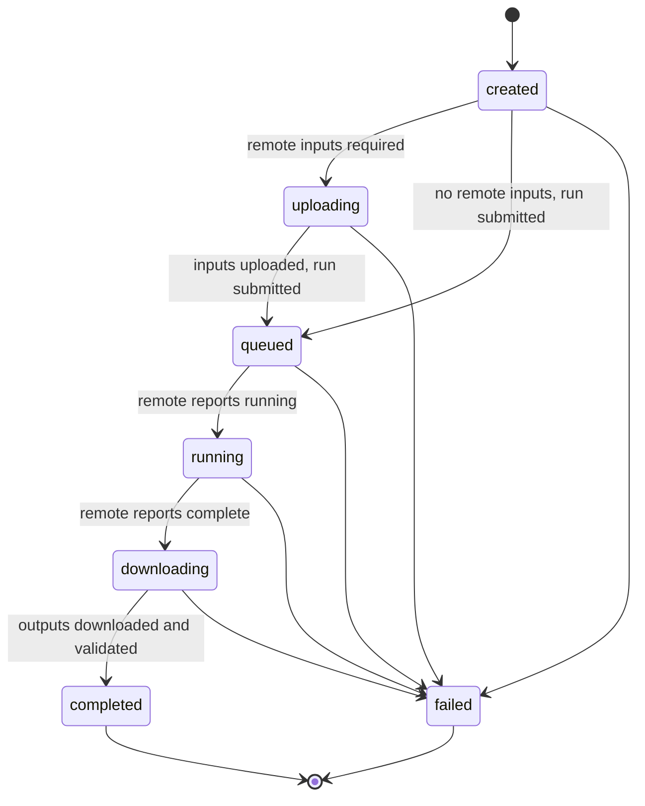

# Contracts — v1.1

Canonical source for schemas, API, job states, artifacts, validation and error codes. Change only via [§12](#12-contract-change-process).
v1.1 (2026-11-06) adds Character Production in [§13](#13-character-production-v11); it is additive, so every v1.0 rule still holds.
Related: [PRODUCT_SPEC.md](PRODUCT_SPEC.md) · [ARCHITECTURE.md](ARCHITECTURE.md) · [DECISIONS.md](DECISIONS.md)

## 1. Conventions

- Every top-level v1.0 payload has `"contract_version": "1.0"` (`MAJOR.MINOR`); Character Production payloads (§13) carry `"1.1"`, and requests accept any `1.x`. The encoding is JSON in UTF-8 with `snake_case` keys.
- Timestamps are RFC 3339 UTC with `Z`. Sizes are integer bytes, durations are seconds, percentages are 0–100, and quota is in hours.
- An unknown value is `null` plus an explicit status (§2.1, §6). Never `0`, `""` or a guess.
- Unknown request fields are rejected (`REQUEST_FIELD_INVALID`). Nothing is silently dropped.
- Internal metadata stores POSIX paths relative to `AAS_DATA_DIR`. API responses never contain paths; they use `content_url`.

### 1.1 Enumerations

| Enum | Values |
|---|---|
| `pipeline_type` | `text_to_2d`, `image_to_3d`, `text_to_3d` |
| `asset_category` | `character`, `skill_effect` (visual only), `weapon`, `companion` |
| `image_role` | `front`, `side`, `back`, `three_quarter` (views, max once each); `detail`, `style_reference` (may repeat) |
| `output_format` | `png` (text_to_2d), `glb` (image_to_3d, text_to_3d) |
| `accelerator_kind` | `cpu`, `gpu_cuda`, `tpu` |
| `job_status` | `created`, `uploading`, `queued`, `running`, `downloading`, `completed`, `failed` |
| `availability` | `available`, `experimental`, `planned`, `unavailable` |
| `artifact_kind` | `image`, `model_3d`, `texture`, `preview` |
| `severity` | `error`, `warning` |

### 1.2 Identifiers (the backend validates the regex before any path use)

| ID | Regex | Issuer |
|---|---|---|
| `job_id` | `^job_\d{8}T\d{6}Z_[0-9a-f]{6}$` | backend |
| `upload_id` | `^upl_[0-9a-f]{32}$` | backend |
| `input_id` / `artifact_id` | `^in_\d{2}$` / `^art_\d{2}$` (per job) | backend |
| `client_request_id` | UUID v4 (idempotency key) | frontend |
| `model_id` | `^[a-z0-9][a-z0-9-]{1,63}$` | registry |
| `profile_id` | `^[a-z0-9][a-z0-9-]{1,31}$` | backend config |
| `accelerator_id` | `^[a-z0-9_]{2,32}$` | Kaggle catalog |

### 1.3 Global limits (a model may set narrower limits)

- File size: 50 MiB (52 428 800 bytes).
- Images per request: 8.
- Prompt: 4 000 characters after trimming. A blank prompt becomes `null`.
- Upload types: `image/png`, `image/jpeg`, `image/webp`. The type is detected from the file bytes, not from the name or header.

## 2. Model contracts (Models module)

### 2.1 ModelCapabilities

```json
{ "contract_version": "1.0", "model_id": "mock-i3d-multiview", "display_name": "Mock Multiview Image→3D",
  "adapter": "mock_image_to_3d", "is_mock": true, "availability": "available",
  "supported_pipeline_types": ["image_to_3d"], "supported_asset_categories": ["character", "companion"],
  "inputs": { "prompt_supported": false, "prompt_required": false, "prompt_max_length": null,
              "min_images": 2, "max_images": 4,
              "supported_image_roles": ["front", "side", "back", "detail"], "required_image_roles": ["front", "side"],
              "supported_mime_types": ["image/png", "image/jpeg"], "maximum_file_size_bytes": 20971520,
              "min_image_width": 512, "min_image_height": 512, "max_image_width": 4096, "max_image_height": 4096 },
  "supported_output_formats": ["glb"],
  "runtime": { "supported_accelerators": ["gpu_cuda"], "multi_gpu": "optional",
               "minimum_gpu_vram_bytes": 12884901888, "estimated_runtime_seconds": 900 },
  "options_schema": { "seed": { "type": "integer", "minimum": 0, "maximum": 4294967295, "default": null },
                      "texture_resolution": { "type": "integer", "enum": [1024, 2048], "default": 1024 } },
  "unknown_requirements": [] }
```

Rules:
- **Availability:** only `available` and `experimental` models accept jobs. `experimental` adds the warning `MODEL_EXPERIMENTAL`.
- **Prompt:** when `prompt_supported` is `false`, sending a prompt is an error, `prompt_required` must be `false` and `prompt_max_length` must be `null`.
- **Image counts:** `0 ≤ min_images ≤ max_images ≤ 8`. When `max_images` is `0`, `supported_image_roles` must be empty and the other image fields `null`. `required_image_roles` ⊆ `supported_image_roles`.
- **Accelerators:** `supported_accelerators` lists `accelerator_kind` values in preference order. A model never names Kaggle hardware. `multi_gpu` is `unsupported`, `optional` or `required`.
- **Options:** `options_schema` maps a name to `{type: integer|number|string|boolean, enum?, minimum?, maximum?, max_length?, default, description?}`. Any option not listed is rejected.
- **Unknowns:** `unknown_requirements` lists the dotted path of every requirement that could not be determined (e.g. `runtime.minimum_gpu_vram_bytes`). A requirement field may be `null` only when it is listed there, or is not applicable. For dimension fields, `null` means "no constraint". Registry tests enforce this rule.

### 2.2 Mock registry (M2 test fixtures, not a model selection)

| model_id | Pipeline | Categories | Prompt | Images (min–max; roles; required) | Accel. | VRAM | Runtime s | Availability |
|---|---|---|---|---|---|---|---|---|
| `mock-t2d-basic` | text_to_2d | all | required ≤1000 | 0–0 | cpu, gpu_cuda | n/a | 30 | available |
| `mock-t2d-styleref` | text_to_2d | all | required ≤1000 | 0–1; style_reference | gpu_cuda | unknown | 60 | experimental |
| `mock-i3d-single` | image_to_3d | character, weapon, companion | not supported | 1–1; front; front | gpu_cuda | unknown | 120 | available |
| `mock-i3d-multiview` | image_to_3d | character, companion | not supported | 2–4; front/side/back/detail; front+side | gpu_cuda | 12 GiB | 900 | available |
| `mock-t3d-basic` | text_to_3d | all | required ≤1000 | 0–0 | gpu_cuda | unknown | unknown | planned |

Values the table does not show (owner-accepted placeholders, A-07):
- Image limits: `mock-i3d-multiview` as in §2.1. `mock-i3d-single` accepts PNG/JPEG and `mock-t2d-styleref` PNG/JPEG/WebP; both use the global 50 MiB file limit and have no dimension constraints (`null`).
- `multi_gpu` is `unsupported` for every mock except `mock-i3d-multiview` (`optional`).
- VRAM **n/a** means the model can run without a GPU: `minimum_gpu_vram_bytes` is `null` and is *not* listed in `unknown_requirements`. VRAM **unknown** means `null` *and* listed there.

Options:
- `mock-t2d-basic`: `seed`, `width`/`height` (enum 512/768/1024, default 1024), `negative_prompt` (string ≤ 1000, default null).
- `mock-i3d-multiview`: as in §2.1.
- All other mocks: `seed` only.

### 2.3 GenerationRequest (normalized, internal)

Built by the backend after validation. It is model-independent and compute-independent, and it is the adapter's only input. A batch job (§13.9) also carries `tasks` and `time_budget_seconds`; both are absent (`null`) for every other job. `options` contains every schema option with defaults filled in. `inputs` keeps the user's order.

```json
{ "contract_version": "1.0", "job_id": "job_20261106T101500Z_a1b2c3",
  "pipeline_type": "image_to_3d", "asset_category": "character", "model_id": "mock-i3d-multiview", "prompt": null,
  "inputs": [ { "input_id": "in_01", "role": "front", "path": "inputs/job_20261106T101500Z_a1b2c3/in_01_front.png",
                "mime_type": "image/png", "width": 1024, "height": 1536, "size_bytes": 812345, "sha256": "9f2c…" } ],
  "options": { "seed": null, "texture_resolution": 2048 }, "output_format": "glb", "created_at": "2026-11-06T10:15:00Z" }
```

### 2.4 ModelInvocation (adapter → backend; Kaggle-agnostic)

```json
{ "contract_version": "1.0", "job_id": "job_20261106T101500Z_a1b2c3", "model_id": "mock-i3d-multiview",
  "entrypoint": "models/adapters/mock_image_to_3d/remote_entry.py",
  "arguments": { "views": { "front": "in_01_front.png", "side": "in_02_side.png" }, "texture_resolution": 2048, "seed": null },
  "input_files": ["inputs/job_20261106T101500Z_a1b2c3/in_01_front.png", "inputs/job_20261106T101500Z_a1b2c3/in_02_side.png"],
  "expected_outputs": [ { "name": "model.glb", "kind": "model_3d", "format": "glb", "required": true },
                        { "name": "preview.png", "kind": "preview", "format": "png", "required": false } ],
  "resource_requirements": { "accelerator_kinds": ["gpu_cuda"], "multi_gpu": "optional",
                             "minimum_gpu_vram_bytes": 12884901888, "estimated_runtime_seconds": 900 } }
```

Adapter interface:
- `capabilities()` → `ModelCapabilities`
- `validate_model_specific(req)` → `ErrorItem[]`, for checks the schema cannot express
- `build_invocation(req)` → `ModelInvocation`
- `collect_outputs(req, output_dir)` → `Artifact[]`, or raises `ARTIFACT_INVALID`

`collect_outputs` only reads `output_dir`. All other methods are pure.

## 3. Browser-facing contracts

### 3.1 Upload (two-phase)

`POST /api/v1/uploads` returns an `UploadRecord`, and `GET /api/v1/uploads/{upload_id}` returns it again. Jobs refer to images by `upload_id`. Uploads are never deleted automatically when the model changes. `filename` is for display only and is never used in a path. The backend stops reading the body as soon as it exceeds the size limit, with or without a `Content-Length` header, and answers `413 UPLOAD_TOO_LARGE` (D-022).

```json
{ "contract_version": "1.0", "upload_id": "upl_3f0a9c1e2b7d4e8f9a0b1c2d3e4f5a6b", "filename": "ranger_front.png",
  "mime_type": "image/png", "size_bytes": 812345, "width": 1024, "height": 1536, "sha256": "9f2c…",
  "created_at": "2026-11-06T10:12:03Z", "expires_at": "2026-11-07T10:12:03Z" }
```

### 3.2 CreateJobRequest (body for both `POST /validate` and `POST /jobs`)

| Field | Rule |
|---|---|
| `contract_version` | Required, with major version `1` |
| `client_request_id` | Required UUID. Resending it returns the original job |
| `pipeline_type`, `asset_category`, `model_id`, `output_format` | Required |
| `prompt` | Optional, trimmed |
| `inputs` | `{upload_id, role}[]`, default `[]`. Each needs a role |
| `options` | Object, default `{}`, checked against the model's `options_schema` |
| `compute` | Required: `{profile_id, accelerator_id|null}`. `null` means recommend one (§7) |

```jsonc
// A — Text→2D
{ "contract_version": "1.0", "client_request_id": "7f9c2b1e-3c1d-4c4e-9a51-2a0d6f1e8b10",
  "pipeline_type": "text_to_2d", "asset_category": "weapon", "model_id": "mock-t2d-basic",
  "prompt": "Ornate frost greatsword, crystalline blade, game concept art", "inputs": [],
  "options": { "seed": 42, "width": 1024, "height": 1024 }, "output_format": "png",
  "compute": { "profile_id": "default", "accelerator_id": null } }

// B — Image→3D, full-body character, three views
{ "contract_version": "1.0", "client_request_id": "0b6d7c55-91f2-4d8e-8c3a-5f1e2d9a7b44",
  "pipeline_type": "image_to_3d", "asset_category": "character", "model_id": "mock-i3d-multiview", "prompt": null,
  "inputs": [ { "upload_id": "upl_3f0a…", "role": "front" }, { "upload_id": "upl_8d1e…", "role": "side" },
              { "upload_id": "upl_1a2b…", "role": "back" } ],
  "options": { "texture_resolution": 2048 }, "output_format": "glb",
  "compute": { "profile_id": "default", "accelerator_id": "gpu_t4x2" } }

// C — Text→3D: valid schema, but 422 PIPELINE_NOT_AVAILABLE while the pipeline is `planned`
{ "contract_version": "1.0", "client_request_id": "c3a1f0e2-7b6d-4a5c-9e8f-1d2c3b4a5f6e",
  "pipeline_type": "text_to_3d", "asset_category": "companion", "model_id": "mock-t3d-basic",
  "prompt": "Small fox spirit companion with glowing tail", "inputs": [], "options": {}, "output_format": "glb",
  "compute": { "profile_id": "default", "accelerator_id": null } }
```

### 3.3 ValidationReport (`POST /validate`: HTTP 200 for any well-formed JSON body; 400 if the body is not JSON)

```json
{ "contract_version": "1.0", "valid": false,
  "errors": [ { "code": "MODEL_REQUIRED_VIEW_MISSING", "severity": "error", "field": "inputs",
                "message": "This model requires a side view. Add an image with the role 'side'.",
                "details": { "missing_roles": ["side"] }, "retryable": false } ],
  "warnings": [], "resource_plan": null }
```

`resource_plan` (§7.3) is included only when stages 1–6 of §8.1 pass. `valid: true` means `POST /jobs` with the same body will be accepted, unless state changes in between (an upload expires, quota changes).

### 3.4 GenerationResult (job detail)

```json
{ "contract_version": "1.0", "job_id": "job_20261106T101500Z_a1b2c3", "status": "completed",
  "status_history": [ { "status": "created", "at": "2026-11-06T10:15:00Z" }, { "status": "uploading", "at": "…" },
                      { "status": "queued", "at": "…" }, { "status": "running", "at": "…" },
                      { "status": "downloading", "at": "…" }, { "status": "completed", "at": "2026-11-06T10:33:30Z" } ],
  "request": { "pipeline_type": "image_to_3d", "asset_category": "character", "model_id": "mock-i3d-multiview",
               "prompt": null, "output_format": "glb", "options": { "seed": null, "texture_resolution": 2048 },
               "inputs": [ { "input_id": "in_01", "role": "front", "mime_type": "image/png", "width": 1024, "height": 1536,
                             "size_bytes": 812345, "content_url": "/api/v1/jobs/job_…/inputs/in_01/content" } ] },
  "compute": { "profile_id": "default", "accelerator_id": "gpu_t4x2",
               "resource_plan": { "contract_version": "1.0", "profile_id": "default", "accelerator_id": "gpu_t4x2",
                                  "selection": "user_selected", "fit": "ok", "required_seconds": 1950,
                                  "estimate_basis": { "estimated_runtime_seconds": 900, "safety_factor": 1.5, "overhead_seconds": 600 },
                                  "session_limit_seconds": 43200, "quota_remaining_seconds": 66600,
                                  "candidates": [ { "accelerator_id": "gpu_t4x2", "fit": "ok", "reasons": [] } ],
                                  "warnings": [], "errors": [] } },
  "artifacts": [ { "artifact_id": "art_01", "kind": "model_3d", "format": "glb", "mime_type": "model/gltf-binary",
                   "size_bytes": 4821330, "sha256": "aa01…", "width": null, "height": null, "is_primary": true,
                   "content_url": "/api/v1/jobs/job_…/artifacts/art_01/content" },
                 { "artifact_id": "art_02", "kind": "preview", "format": "png", "mime_type": "image/png",
                   "size_bytes": 201554, "sha256": "bb02…", "width": 512, "height": 512, "is_primary": false,
                   "content_url": "/api/v1/jobs/job_…/artifacts/art_02/content" } ],
  "preview": { "artifact_id": "art_02" }, "warnings": [], "error": null,
  "execution": { "backend": "kaggle", "remote_ref": "owner/aas-runner", "submitted_at": "…", "started_at": "…",
                 "finished_at": "…", "duration_seconds": 925, "transient_retries": 1, "retry_of": null },
  "created_at": "2026-11-06T10:15:00Z", "updated_at": "2026-11-06T10:33:30Z" }
```

- A failed job has the same shape, with `artifacts: []`, `preview: null` and a populated `error`. Example: `{"code":"KAGGLE_KERNEL_ERROR","severity":"error","field":null,"message":"The remote notebook exited with an error. See the job logs.","details":{"failed_in_status":"running","remote_status":"error"},"retryable":false}`.
- `compute.resource_plan` is the full `ResourcePlan` (§7.3) computed when the job was created (D-020).
- `execution.backend` is `mock` or `kaggle`.
- v1.1 adds two optional fields used only by batch jobs (§13.9): `request.batch` and `artifacts[].task_id`. Both are `null` for every other job.
- The internal file `data/jobs/<job_id>.json` has the same shape plus `path` on inputs and artifacts. The API strips those paths.

### 3.5 Artifact conventions

| kind | format / mime | Use |
|---|---|---|
| `image` | png / `image/png` | Primary output of `text_to_2d` |
| `model_3d` | glb / `model/gltf-binary` | Primary output of `image_to_3d` and `text_to_3d` |
| `texture` | png | Optional. A GLB must still embed its own textures |
| `preview` | png | Optional 3D thumbnail |

- A completed job has exactly one `is_primary` artifact, and its format equals `output_format`.
- A GLB must be glTF 2.0 binary (magic `glTF`, version 2). A PNG must decode. `collect_outputs` checks both.
- Artifacts are stored at `outputs/<job_id>/<artifact_id>.<format>`.

## 4. Job lifecycle



States:
- `created`: persisted and waiting for the profile's worker slot. Each profile runs one job at a time.
- `uploading`: pushing inputs to the remote store.
- `queued`: the run was submitted but has not started.
- `running`: executing, with logs and telemetry possibly streaming.
- `downloading`: fetching outputs, then running `collect_outputs`.
- `completed`: terminal, with a primary artifact.
- `failed`: terminal, with `error` set.

Rules:
1. Only the transitions shown are allowed. Terminal states never change.
2. Every transition appends to `status_history` and rewrites the job file atomically (temp file + rename).
3. A failure keeps inputs, logs and downloaded files, and sets `error.details.failed_in_status`.
4. Transient remote reads and downloads get at most 3 in-job retries (5 s / 15 s / 45 s). Each attempt increments `execution.transient_retries`.
5. A run is **never** resubmitted automatically, because it consumes quota. `POST /jobs/{id}/retry` is allowed only when `error.retryable` is true. It creates a new, re-validated job with `retry_of` set.
6. On startup, every non-terminal job is reconciled. A job with a remote reference resumes polling. Any other job fails with `BACKEND_RESTARTED` (retryable).
7. A job in `queued` or `running` for longer than `required_seconds × 1.25` fails with `KAGGLE_TIMEOUT`.
8. Cancellation is out of scope for the MVP (DF-09).

## 5. REST API (`/api/v1`)

The backend binds to `127.0.0.1`, serves a single user, has no auth, and allows CORS only for the frontend dev origin (`localhost` and `127.0.0.1` count as the same host).

| Method | Path | Request → Response |
|---|---|---|
| GET | `/health` | → `{status, contract_version, compute_mode: mock|kaggle}` |
| GET | `/catalog` | → `Catalog` (§5.1) |
| GET | `/models?pipeline_type=&asset_category=` | → `{models: ModelCapabilities[]}` |
| GET | `/models/{model_id}` | → `ModelCapabilities` |
| POST | `/uploads` | multipart `file` (one) → `201 UploadRecord` |
| GET / DELETE | `/uploads/{upload_id}[/content]` | → `UploadRecord` / bytes / `204` (`409 UPLOAD_IN_USE`) |
| POST | `/validate` | `CreateJobRequest` → `200 ValidationReport` |
| POST | `/jobs` | `CreateJobRequest` → `201 GenerationResult` (status `created`) or `422` |
| GET | `/jobs?status=&pipeline_type=&limit=50&cursor=` | → `{jobs: JobSummary[], next_cursor}`, newest first |
| GET | `/jobs/{job_id}` | → `GenerationResult` |
| GET | `/jobs/{job_id}/status` | → `{job_id, status, updated_at, progress: {stage, percent, message}}` |
| GET | `/jobs/{job_id}/logs?offset=0&limit=500` | → `{lines: [{n, at, source: backend|remote, text}], next_offset, complete}` |
| POST | `/jobs/{job_id}/retry` | `{client_request_id}` → `201` new job or `409 JOB_NOT_RETRYABLE` |
| DELETE | `/jobs/{job_id}` | → `204`. Terminal jobs only. Removes inputs, outputs, logs and metadata |
| GET | `/jobs/{job_id}/inputs/{input_id}/content` | → bytes |
| GET | `/jobs/{job_id}/artifacts[/{artifact_id}/content?download=0|1]` | → `{contract_version, artifacts: Artifact[]}` / bytes (inline or attachment) |
| GET | `/compute/profiles` | → `{profiles: ComputeProfile[]}` (no secrets) |
| GET | `/compute/profiles/{profile_id}/snapshot?refresh=0|1` | → `KaggleResourceSnapshot` |

- `JobSummary` = `{job_id, status, pipeline_type, asset_category, model_id, created_at, updated_at, primary_artifact|null, error_code|null}`. `primary_artifact` is the full artifact object, as in §3.4.
- `Artifact` = one entry of `GenerationResult.artifacts` (§3.4).
- `progress` comes from `AAS_PROGRESS` lines, or is `null`. The logs endpoint never returns `AAS_TELEMETRY` lines.
- Polling (no WebSockets):
  - Job status every 2 s.
  - Snapshot every 15 s while a job is running, otherwise every 60 s.
  - `refresh=1` is limited to once per 60 s per profile.

### 5.1 Catalog

```json
{ "contract_version": "1.0",
  "pipelines": [ { "pipeline_type": "text_to_2d", "display_name": "Text → 2D", "availability": "available", "output_formats": ["png"] },
                 { "pipeline_type": "image_to_3d", "display_name": "Image → 3D", "availability": "available", "output_formats": ["glb"] },
                 { "pipeline_type": "text_to_3d", "display_name": "Text → 3D", "availability": "planned", "output_formats": ["glb"] } ],
  "asset_categories": ["character", "skill_effect", "weapon", "companion"],
  "image_roles": ["front", "side", "back", "three_quarter", "detail", "style_reference"],
  "limits": { "max_upload_bytes": 52428800, "max_images_per_request": 8, "prompt_max_length": 4000,
              "supported_upload_mime_types": ["image/png", "image/jpeg", "image/webp"] } }
```

### 5.2 ErrorResponse (every non-2xx response)

```json
{ "contract_version": "1.0", "warnings": [],
  "errors": [ { "code": "MODEL_INPUT_COUNT_EXCEEDED", "severity": "error", "field": "inputs",
                "message": "This model accepts at most 1 image; 3 were provided.",
                "details": { "max_images": 1, "provided": 3 }, "retryable": false } ] }
```

- `ErrorItem` = `{code, severity, field|null, message, details, retryable}`.
- `field` is a request path: `prompt`, `inputs`, `inputs[2].role`, `options.seed`, `compute.accelerator_id`.
- `message` is English and user-facing. The frontend may localize it by `code`.

HTTP status codes:
- **400** malformed JSON or multipart; `PATH_INVALID` (an ID that fails its regex)
- **404** `*_NOT_FOUND`; an unknown route returns 404 with `PATH_INVALID`
- **405** a known route with the wrong method, code `REQUEST_FIELD_INVALID`
- **409** `JOB_NOT_RETRYABLE`, `JOB_NOT_TERMINAL`, `UPLOAD_IN_USE`
- **413** `UPLOAD_TOO_LARGE`
- **415** `UPLOAD_UNSUPPORTED_TYPE`
- **422** validation errors (§8)
- **500** `INTERNAL_ERROR`, never with a stack trace

## 6. Kaggle resource contracts (Kaggle module)

### 6.1 ComputeProfile (public view; never includes credentials)

A profile is **one Kaggle account, owned and operated by one person who has authorized its use**. The rules are in DECISIONS D-008.

```json
{ "contract_version": "1.0", "profile_id": "default", "display_name": "Owner Kaggle", "owner_label": "project-owner",
  "mode": "kaggle", "enabled": true, "authorization_confirmed": true,
  "accelerators": [
    { "accelerator_id": "cpu", "kind": "cpu", "device_count": 0, "vram_bytes_per_device": null, "max_session_seconds": 43200 },
    { "accelerator_id": "gpu_p100", "kind": "gpu_cuda", "device_count": 1, "vram_bytes_per_device": 17179869184, "max_session_seconds": 43200 },
    { "accelerator_id": "gpu_t4x2", "kind": "gpu_cuda", "device_count": 2, "vram_bytes_per_device": 16106127360, "max_session_seconds": 43200 },
    { "accelerator_id": "tpu_vm", "kind": "tpu", "device_count": 1, "vram_bytes_per_device": null, "max_session_seconds": 32400 } ] }
```

`mode` is `kaggle`, or `mock` for the profile served by the mock client (M1/M2). The catalog is **provisional** until M3 verifies it (DF-06). The Kaggle `--accelerator` value for each entry is kept internal.

### 6.2 KaggleResourceSnapshot

```json
{ "contract_version": "1.0", "compute_profile_id": "default", "authentication_status": "authenticated",
  "accelerator_type": "gpu_t4x2",
  "accelerator_availability": [ { "accelerator_id": "gpu_t4x2", "status": "available" }, { "accelerator_id": "tpu_vm", "status": "unknown" } ],
  "gpu_quota_total_hours": 30.0, "gpu_quota_used_hours": 11.5, "gpu_quota_remaining_hours": 18.5,
  "tpu_quota_total_hours": null, "tpu_quota_used_hours": null, "tpu_quota_remaining_hours": null, "quota_reset_at": null,
  "session_started_at": "2026-11-06T10:17:40Z", "estimated_session_remaining_seconds": 41100, "session_status": "running",
  "cpu_utilization_percent": 63.5, "ram_used_bytes": 9663676416, "ram_total_bytes": 33285996544,
  "gpu_devices": [
    { "index": 0, "name": "Tesla T4", "utilization_percent": 97.0, "vram_used_bytes": 13421772800, "vram_total_bytes": 16106127360, "temperature_c": 71.0, "status": "available" },
    { "index": 1, "name": "Tesla T4", "utilization_percent": 4.0, "vram_used_bytes": 524288000, "vram_total_bytes": 16106127360, "temperature_c": null, "status": "available" } ],
  "observed_at": { "snapshot": "2026-11-06T10:20:05Z", "quota": "2026-11-06T10:18:00Z", "session": "2026-11-06T10:20:00Z",
                   "host": "2026-11-06T10:19:52Z", "gpu": "2026-11-06T10:19:52Z" },
  "source": { "quota": "kaggle_cli_quota", "session": "kaggle_cli_status", "host": "notebook_telemetry", "gpu": "notebook_telemetry" },
  "freshness_status": { "quota": "fresh", "session": "fresh", "host": "fresh", "gpu": "fresh" },
  "error": [ { "code": "COMPUTE_TPU_QUOTA_UNAVAILABLE", "severity": "warning", "field": "tpu_quota_total_hours",
               "message": "TPU quota was not reported by the Kaggle CLI.", "details": {}, "retryable": true } ] }
```

| Field(s) | Semantics |
|---|---|
| `authentication_status` | `authenticated`, `unauthenticated` (no credentials), `invalid_credentials`, or `unknown` (not checked or network error) |
| `accelerator_type` | Accelerator of the current or last session, otherwise `null` |
| `accelerator_availability[].status` | `available`, `quota_exhausted`, `unknown`, `not_in_profile` |
| quota fields, `quota_reset_at` | Only from `kaggle quota`. Never derived from assumed limits. `null` if not reported |
| `session_status` | `none`, `queued`, `running`, `finished`, `failed`, `unknown` |
| `session_started_at` | First local observation of `running` (source `local_observation` if Kaggle gives no timestamp) |
| `estimated_session_remaining_seconds` | **An estimate.** `min(max_session_seconds − elapsed, remaining quota for that kind)`, using only known terms. `null` if both terms are unknown or there is no session |
| CPU / RAM / GPU fields | Only from notebook telemetry (§6.4). `null` with status `not_applicable` (no session), `unavailable` (running, no sample) or `unsupported` (TPU, MVP) |
| `gpu_devices[]` | One entry per `index`. **GPU0 and GPU1 are independent**, never summed or averaged. Every field is nullable. Per-device `status` is `available`, `unavailable` or `unsupported` |
| `observed_at`, `source`, `freshness_status` | One entry per group: `quota`, `session`, `host` (CPU/RAM), `gpu`. `observed_at` also has `snapshot` |
| `source` values | `kaggle_cli_quota`, `kaggle_cli_status`, `notebook_telemetry`, `local_observation`, `mock`, `none` |
| `freshness_status` values | `fresh`, `stale`, `unavailable`, `unsupported`, `not_applicable` |
| `error` | `ErrorItem[]`, empty if there are no problems (e.g. `KAGGLE_AUTH_FAILED`, `COMPUTE_QUOTA_UNKNOWN`, `COMPUTE_TELEMETRY_*`) |

Freshness:

| Group | fresh | stale | unavailable |
|---|---|---|---|
| quota | ≤ 10 min | > 10 min | never read, or the last read failed |
| session | ≤ 60 s | > 60 s | no remote reference |
| host / gpu | ≤ 3 × reporter interval (45 s) | > 3 × interval | session running, no sample yet |

Stale values are returned and marked `stale`, never shown as live.

### 6.3 Required snapshot scenarios

- **No session:** `session_status: "none"`, CPU/RAM fields `null`, `gpu_devices: []`. For `host` and `gpu`, freshness is `not_applicable` and source is `none`.
- **Quota missing** (old CLI or command failed): every quota field is `null`, quota freshness is `unavailable`, and `error` contains `COMPUTE_QUOTA_UNKNOWN`.
- **Telemetry stale:** the last values are kept, `host`/`gpu` freshness is `stale`, and `error` contains `COMPUTE_TELEMETRY_STALE` with `details.age_seconds`.

### 6.4 Notebook output protocol (runtime → connector)

The runner prints prefixed single-line JSON (≤ 4 KiB) to stdout. The connector reads it through `kaggle kernels logs` (`-f` while running; best-effort, DF-07).

```
AAS_PROGRESS {"v":1,"job_id":"job_…","at":"2026-11-06T10:20:00Z","stage":"inference","percent":40,"message":"Reconstructing mesh"}
AAS_TELEMETRY {"v":1,"job_id":"job_…","at":"2026-11-06T10:19:52Z","cpu_percent":63.5,"ram_used_bytes":9663676416,"ram_total_bytes":33285996544,"gpu_source":"nvml","gpus":[{"index":0,"name":"Tesla T4","utilization_percent":97.0,"vram_used_bytes":13421772800,"vram_total_bytes":16106127360,"temperature_c":71.0},{"index":1,"name":"Tesla T4","utilization_percent":4.0,"vram_used_bytes":524288000,"vram_total_bytes":16106127360,"temperature_c":null}],"errors":[]}
```

- `gpu_source` is `nvml`, `nvidia_smi` (fallback) or `none`.
- The reporter interval is 15 s by default (allowed 5–60 s). It runs in a daemon thread, and its exceptions go to `errors[]` without failing the job.
- Samples are stored in `data/logs/<job_id>.telemetry.jsonl`. Malformed lines are skipped and counted.

Output manifest at `/kaggle/working/aas_output/manifest.json` (the mock client writes the same file locally):

```json
{ "v": 1, "job_id": "job_…", "status": "ok", "error": null,
  "outputs": [ { "name": "model.glb", "kind": "model_3d", "format": "glb", "size_bytes": 4821330, "sha256": "aa01…" } ] }
```

On failure the manifest has `status: "error"` and `error: {code, message}`. A missing manifest fails the job with `ARTIFACT_INVALID`.

## 7. Resource planning (deterministic)

### 7.1 Inputs

- `ResourceRequirements`: mapped by the backend from `ModelCapabilities.runtime`. The Kaggle module never sees models or categories.
- The **explicitly selected** `ComputeProfile`. Other profiles are never considered.
- That profile's latest snapshot.
- Configurable constants: `safety_factor = 1.5` and `overhead_seconds = 600`.

### 7.2 Algorithm

```
candidates = profile accelerators whose kind ∈ req.accelerator_kinds, ordered by model preference, then profile order
if req.multi_gpu == "required": drop candidates with device_count < 2
if empty                                      -> error MODEL_ACCELERATOR_INCOMPATIBLE
if user chose accelerator_id: must be in candidates (else MODEL_ACCELERATOR_INCOMPATIBLE); selection = user_selected;
                              only that candidate is evaluated
else selection = recommended
for each candidate c:
  vram:    (gpu_cuda only) known req.min_vram > known c.vram -> insufficient (COMPUTE_VRAM_INSUFFICIENT);
           c.vram unknown, or req.min_vram listed in unknown_requirements -> warning COMPUTE_VRAM_UNKNOWN;
           req.min_vram null and not listed (n/a, §2.2) -> no check
  time:    runtime unknown -> required = null + warning MODEL_RUNTIME_UNKNOWN; else required = ceil(runtime × 1.5 + 600)
  session: required > c.max_session_seconds      -> insufficient (COMPUTE_SESSION_LIMIT_EXCEEDED)
  quota:   (skip for cpu) remaining null or not fresh -> warning COMPUTE_QUOTA_UNKNOWN; required > remaining -> insufficient (COMPUTE_QUOTA_INSUFFICIENT)
  c.fit = insufficient if any check failed; unknown if any warning; else ok
chosen = first ok, else first unknown, else none -> the first candidate's reasons become blocking errors
```

Errors block job creation. Warnings never block; they are shown in the UI and stored in `GenerationResult.warnings`. `kernels push --timeout` is set to `min(required ?? max_session_seconds, max_session_seconds)`.

### 7.3 ResourcePlan

```json
{ "contract_version": "1.0", "profile_id": "default", "accelerator_id": "gpu_t4x2", "selection": "user_selected", "fit": "ok",
  "required_seconds": 1950, "estimate_basis": { "estimated_runtime_seconds": 900, "safety_factor": 1.5, "overhead_seconds": 600 },
  "session_limit_seconds": 43200, "quota_remaining_seconds": 66600,
  "candidates": [ { "accelerator_id": "gpu_t4x2", "fit": "ok", "reasons": [] } ], "warnings": [], "errors": [] }
```

This is the plan for request B: 900 × 1.5 + 600 = 1 950 s. With `accelerator_id: null`, both `gpu_p100` and `gpu_t4x2` would be `ok`, and the plan would choose `gpu_p100` because it comes first in profile order. The UI labels every plan number as an **estimate**.

## 8. Validation

### 8.1 Stages (the backend is authoritative; the frontend runs stages 2–7 with the same rules)

1. **Schema:** version, types, required fields, unknown fields. *Short-circuits.*
2. **Catalog:** the pipeline is known and accepts jobs; the category is known. *Short-circuits.*
3. **Model:** it exists, accepts jobs, and supports the pipeline and category. *Short-circuits.*
4. **Inputs:** prompt, uploads exist, count, roles, MIME type, size, dimensions.
5. **Output format.**
6. **Options**, then `validate_model_specific`.
7. **Compute:** profile, authentication, plan (§7).

Stages 4–7 report every error they find. A request with any error creates no job and contacts no remote service (stage 7 reads only the cached snapshot).

### 8.2 Error codes

Validation codes (`Retry` = `error.retryable`; warnings do not block):

| Code | Sev. | Field | Retry | Condition |
|---|---|---|---|---|
| `CONTRACT_VERSION_UNSUPPORTED` | error | `contract_version` | no | Major version ≠ 1 |
| `REQUEST_FIELD_INVALID` | error | field | no | Type error, missing field or unknown field |
| `PIPELINE_UNKNOWN` | error | `pipeline_type` | no | Not in enum |
| `PIPELINE_NOT_AVAILABLE` | error | `pipeline_type` | no | Pipeline is `planned` or `unavailable` |
| `ASSET_CATEGORY_UNKNOWN` | error | `asset_category` | no | Not in enum |
| `MODEL_NOT_FOUND` | error | `model_id` | no | Not in registry |
| `MODEL_UNAVAILABLE` | error | `model_id` | no | Model is `planned` or `unavailable` |
| `MODEL_EXPERIMENTAL` | warning | `model_id` | — | Model is `experimental` |
| `MODEL_PIPELINE_INCOMPATIBLE` | error | `model_id` | no | Pipeline not supported |
| `MODEL_CATEGORY_INCOMPATIBLE` | error | `asset_category` | no | Category not supported |
| `MODEL_PROMPT_REQUIRED` | error | `prompt` | no | Required prompt is null |
| `MODEL_PROMPT_NOT_SUPPORTED` | error | `prompt` | no | Prompt given when `prompt_supported` is false |
| `MODEL_PROMPT_TOO_LONG` | error | `prompt` | no | Over the model or global limit |
| `MODEL_IMAGE_INPUT_NOT_SUPPORTED` | error | `inputs` | no | Images given when `max_images` is 0 |
| `MODEL_INPUT_COUNT_INSUFFICIENT` | error | `inputs` | no | Fewer than `min_images` |
| `MODEL_INPUT_COUNT_EXCEEDED` | error | `inputs` | no | More than `max_images` (or the global limit) |
| `MODEL_IMAGE_ROLE_UNSUPPORTED` | error | `inputs[i].role` | no | Role not supported |
| `MODEL_IMAGE_ROLE_DUPLICATE` | error | `inputs[i].role` | no | View role repeated |
| `MODEL_REQUIRED_VIEW_MISSING` | error | `inputs` | no | Required role missing (`details.missing_roles`) |
| `MODEL_UNSUPPORTED_FILE_FORMAT` | error | `inputs[i].upload_id` | no | MIME type not supported |
| `MODEL_FILE_TOO_LARGE` | error | `inputs[i].upload_id` | no | Over `maximum_file_size_bytes` |
| `MODEL_IMAGE_DIMENSIONS_INVALID` | error | `inputs[i].upload_id` | no | Outside the min/max size (`details` has actual and allowed) |
| `MODEL_OUTPUT_FORMAT_UNSUPPORTED` | error | `output_format` | no | Not supported by the model or pipeline |
| `MODEL_OPTION_UNSUPPORTED` | error | `options.<name>` | no | Not in `options_schema` |
| `MODEL_OPTION_INVALID` | error | `options.<name>` | no | Type, enum, range or length violation |
| `MODEL_ACCELERATOR_INCOMPATIBLE` | error | `compute.accelerator_id` | no | §7.2 |
| `MODEL_RUNTIME_UNKNOWN` | warning | `model_id` | — | Runtime estimate unknown |
| `UPLOAD_NOT_FOUND` | error | `inputs[i].upload_id` | no | Upload unknown or expired |
| `UPLOAD_CORRUPT` | error | `inputs[i].upload_id` / `file` | no | Image cannot be decoded |
| `UPLOAD_TOO_LARGE` | error | `file` | no | Over the global limit (413) |
| `UPLOAD_UNSUPPORTED_TYPE` | error | `file` | no | Content is not PNG, JPEG or WebP (415) |
| `UPLOAD_IN_USE` | error | `upload_id` | no | Deleting an upload a job references |
| `COMPUTE_PROFILE_NOT_FOUND` | error | `compute.profile_id` | no | Profile unknown or disabled |
| `COMPUTE_PROFILE_UNAUTHENTICATED` | error | `compute.profile_id` | yes | Profile not `authenticated` |
| `COMPUTE_VRAM_INSUFFICIENT` | error | `compute.accelerator_id` | no | §7.2 |
| `COMPUTE_VRAM_UNKNOWN` | warning | `compute.accelerator_id` | — | §7.2 |
| `COMPUTE_SESSION_LIMIT_EXCEEDED` | error | `compute.accelerator_id` | no | §7.2 |
| `COMPUTE_QUOTA_INSUFFICIENT` | error | `compute.accelerator_id` | yes (after reset) | §7.2 |
| `COMPUTE_QUOTA_UNKNOWN` | warning | `compute.profile_id` | — | Quota null or not fresh |
| `COMPUTE_TPU_QUOTA_UNAVAILABLE` | warning | snapshot field | — | TPU quota not reported |
| `COMPUTE_TELEMETRY_UNAVAILABLE` | warning | snapshot group | — | Session running, no sample |
| `COMPUTE_TELEMETRY_STALE` | warning | snapshot group | — | Sample older than the threshold |
| `JOB_NOT_FOUND` / `ARTIFACT_NOT_FOUND` | error | — | no | 404 |
| `JOB_NOT_RETRYABLE` | error | — | no | Job not `failed`, or not retryable |
| `JOB_NOT_TERMINAL` | error | — | no | Deleting a non-terminal job |
| `PATH_INVALID` | error | — | no | Fails the regex or root check (logged as a security event) |

Job-time errors (`GenerationResult.error`):

| Code | Retry | Condition |
|---|---|---|
| `KAGGLE_AUTH_FAILED` | no | Credentials rejected (401/403) |
| `KAGGLE_RATE_LIMITED` | yes | HTTP 429 after the in-job retries |
| `KAGGLE_NETWORK_ERROR` | yes | Connection or timeout after the in-job retries |
| `KAGGLE_UPLOAD_FAILED` | yes | Input upload failed |
| `KAGGLE_SUBMIT_FAILED` | yes | Kernel push failed |
| `KAGGLE_QUOTA_EXHAUSTED` | no | Run refused for quota |
| `KAGGLE_KERNEL_ERROR` | no | Remote run ended in `error` |
| `KAGGLE_TIMEOUT` | yes | §4 rule 7, or the session limit was reached |
| `ARTIFACT_DOWNLOAD_FAILED` | yes | Download failed after the in-job retries |
| `ARTIFACT_INVALID` | no | Manifest or required output missing, or a format check failed |
| `BACKEND_RESTARTED` | yes | §4 rule 6 |
| `INTERNAL_ERROR` | no | Unexpected exception (details logged locally only) |

### 8.3 Model switching (UI)

When the pipeline, category or model changes, the frontend re-validates and:
- **keeps** every upload and value; nothing is deleted automatically;
- marks each incompatible field with its code and message;
- hides options the new model does not declare and does not send them, while listing any non-default value among them as "not used by this model";
- keeps Generate disabled until there are no errors.

### 8.4 Validation test matrix (M1 frontend, M2 backend)

| ID | Scenario | Setup | Expected |
|---|---|---|---|
| V-01 | Text-only model gets an image | `mock-t2d-basic` + 1 image | `MODEL_IMAGE_INPUT_NOT_SUPPORTED` |
| V-02 | Single-image model gets 3 images | `mock-i3d-single` + front/side/back | `MODEL_INPUT_COUNT_EXCEEDED` (max 1, provided 3), plus `MODEL_IMAGE_ROLE_UNSUPPORTED` for side and back |
| V-03 | Multiview model is missing the side view | `mock-i3d-multiview` + front, back | `MODEL_REQUIRED_VIEW_MISSING` (`["side"]`) |
| V-04 | Valid full-body front/side/back | `mock-i3d-multiview`, 1024×1536 PNGs, `gpu_t4x2` | `valid: true`, fit `ok` |
| V-05 | GPU-only model with TPU | `mock-i3d-multiview`, `tpu_vm` | `MODEL_ACCELERATOR_INCOMPATIBLE` |
| V-06 | Unknown minimum VRAM | `mock-i3d-single`, `gpu_t4x2` | valid; warning `COMPUTE_VRAM_UNKNOWN`; fit `unknown` |
| V-07 | Kaggle quota missing | snapshot quota is null | valid; warning `COMPUTE_QUOTA_UNKNOWN`; fit `unknown` |
| V-08 | GPU0 and GPU1 memory differ | telemetry fixture | each device keeps its own values; the UI shows two gauges |
| V-09 | Job exceeds the session limit | fixture runtime 40 000 s (required 60 600 > 43 200) | `COMPUTE_SESSION_LIMIT_EXCEEDED` |
| V-10 | Telemetry stale or unavailable | no sample / a sample 120 s old | freshness `unavailable` / `stale`, plus a warning; not shown as live |
| V-11 | Required prompt is blank | `mock-t2d-basic`, `"   "` | `MODEL_PROMPT_REQUIRED` |
| V-12 | Unsupported format | `mock-i3d-single` + WebP | `MODEL_UNSUPPORTED_FILE_FORMAT` |
| V-13 | File too large for the model | `mock-i3d-multiview` + 25 MiB PNG | `MODEL_FILE_TOO_LARGE` |
| V-14 | Wrong dimensions | `mock-i3d-multiview` + 256×256 front | `MODEL_IMAGE_DIMENSIONS_INVALID` |
| V-15 | Unsupported category | `mock-i3d-multiview` + `weapon` | `MODEL_CATEGORY_INCOMPATIBLE` |
| V-16 | Unsupported output | `mock-t2d-basic` + `glb` | `MODEL_OUTPUT_FORMAT_UNSUPPORTED` |
| V-17 | Unsupported option | `mock-i3d-single` + `texture_resolution` | `MODEL_OPTION_UNSUPPORTED` |
| V-18 | Insufficient quota | 0.3 h left, 1 950 s required | `COMPUTE_QUOTA_INSUFFICIENT` |
| V-19 | Model switch keeps uploads | 3 uploads, switch multiview → single | uploads kept; errors as in V-02 |
| V-20 | Planned pipeline | example C (§3.2) | `PIPELINE_NOT_AVAILABLE` |

## 9. Storage

The backend is the **only** reader and writer of `data/`. The connector writes only into directories the backend passes to it. The frontend never touches files.

```
data/                                         # AAS_DATA_DIR, gitignored
├── inputs/staging/<upload_id>/{file.<ext>, upload.json}
├── inputs/<job_id>/<input_id>_<role>.<ext>
├── outputs/<job_id>/<artifact_id>.<ext>      # + remote_raw/ while downloading
├── jobs/<job_id>.json                        # internal GenerationResult (with paths)
└── logs/{backend.log, <job_id>.log, <job_id>.telemetry.jsonl}
```

Lifecycle:
- **Staged uploads** are deleted 24 h after creation if no job references them (swept at startup and hourly), or by `DELETE /uploads/{id}`.
- **Job inputs** are copied from staging when the job is created.
- **Outputs** (PNG, GLB, textures, previews) are written in `downloading`, after validation.
- **`remote_raw/`** is deleted once `collect_outputs` succeeds, and kept on failure.
- **Everything belonging to a job** (inputs, metadata, logs, telemetry, outputs) is removed by `DELETE /jobs/{id}`.

Path safety: every path is `data_root / <validated relative path>`, resolved and rejected with `PATH_INVALID` if it escapes the root, is absolute, contains `..` or is a symlink. File names are built from IDs, roles and formats only, never from user input.

## 10. Secrets

- Kaggle credentials live only in the local `.env` (gitignored). They are held in backend memory and passed **only** in the environment of the CLI subprocess for the selected profile.
- They never appear in API responses, the frontend, logs, job files, notebook source or output, or datasets.
- The log writer redacts the configured secret values and any `KAGGLE_(KEY|API_TOKEN)=…` pattern.
- An M3 test checks that a known fake token never appears in `data/`, in API responses or in a job package.

## 11. Frontend type mirroring

`interface/frontend/src/api/types.ts` mirrors this document by hand. The examples here are also kept as shared fixtures in `tests/fixtures/contracts/*.json`. The frontend mock client serves those fixtures, and backend tests validate them with the Pydantic models. A fixture that fails on either side breaks the build.

## 12. Contract change process

1. Edit this file first. An added field, enum value or error code is a MINOR bump (`1.1`). A rename, removal or change of meaning is a MAJOR bump with a new `/api/v2`.
2. Add an entry to [DECISIONS.md](DECISIONS.md).
3. Update the fixtures, Pydantic models, TS types and tests in the same change.
4. The owner approves every MAJOR change before implementation.

## 13. Character Production (v1.1)

Added in v1.1 (approved 2026-11-06, D-035; merged D-037). Everything in §1–§12 is unchanged; this section is
additive. Workflow semantics (stages S1–S7, gates, staleness) are in [v2/CHARACTER_WORKFLOW.md](v2/CHARACTER_WORKFLOW.md);
storage and components are in [v2/ARCHITECTURE.md](v2/ARCHITECTURE.md).

### 13.1 Compatibility with v1.0

- **Additive only (MINOR → `1.1`).** No v1 endpoint, field, enum value or error code is renamed, removed or changes
  meaning. `job_status` is unchanged.
- **The new endpoints** live under the same `/api/v1` prefix, with the same conventions (§1), error envelope
  (`ErrorResponse`, §5.2), ID-before-path validation and path safety (§9).
- **New payloads** carry `"contract_version": "1.1"`. Requests accept any `1.x`; another major version returns
  `CONTRACT_VERSION_UNSUPPORTED`, as in v1.
- **Two optional fields are added to v1 models**, used only by batch jobs (§13.9): `GenerationResult.request.batch` and
  `Artifact.task_id`. One warning code is added: `BATCH_PARTIAL`. Clients that ignore unknown fields are unaffected.
  The frontend v1 types must add both fields as optional.
- **Change process (§12):** approved on 2026-11-06 (D-035) and merged here as v1.1 (OD-01, D-037). Workflow
  semantics stay in [v2/CHARACTER_WORKFLOW.md](v2/CHARACTER_WORKFLOW.md) and storage in
  [v2/ARCHITECTURE.md](v2/ARCHITECTURE.md). Fixtures: `tests/fixtures/contracts/v2/*.json`.

### 13.2 Identifiers

The backend validates every ID against its regex before it touches a path (`PATH_INVALID`, HTTP 400).

| ID | Regex | Issuer | Notes |
|---|---|---|---|
| `character_id` | `^chr_[0-9a-f]{12}$` | backend | Immutable, and also the folder name. Renaming a character never changes it |
| `stage_id` | `^s[1-7]$` | fixed | `s1`…`s7`; shown as "S1"…"S7" |
| `revision` | integer ≥ 1 | backend | Sequential per stage |
| `reference_id` | `^ref_[0-9a-f]{12}$` | backend | |
| `asset_id` | `^ast_[0-9a-f]{12}$` | backend | A frozen copy of an approved image |
| `manifest_id` | `^bat_[0-9a-f]{12}$` | backend | Preview or production batch |
| `task_id` | `^[a-z0-9][a-z0-9_-]{1,39}$` | client | Unique within one manifest, e.g. `front_01` |
| `group_id` | `^g[0-9]{2}$` | backend | Task group inside a manifest |
| `candidate_id` | `^cand_[0-9]{2}$` | client | S3 |
| `item_id` | `^item_[0-9]{3}$` | client | S5 review items |
| `attribute_id`, checklist `item_id` | `^[a-z0-9_]{2,40}$` | client / fixed | |
| `question_id` | `^q_[a-z0-9_]{2,40}$` | fixed | S2 guided questions |
| `client_request_id` | UUID v4 | frontend | Idempotency key, as in v1 |

### 13.3 Enumerations

| Enum | Values |
|---|---|
| `stage_id` | `s1`, `s2`, `s3`, `s4`, `s5`, `s6`, `s7` |
| `editorial_status` | `not_started`, `draft`, `in_review`, `approved`, `needs_revision`, `blocked` |
| `feature_availability` | `available`, `planned`, `unavailable` |
| `job_status` (v1, unchanged) | `created`, `uploading`, `queued`, `running`, `downloading`, `completed`, `failed` |
| `decision_action` | `submit`, `approve`, `request_revision`, `withdraw` |
| `revision_decision` | `pending`, `approved`, `revision_requested`, `withdrawn` |
| `lock_level` | `locked`, `preferred`, `flexible` |
| `spec_group` | `identity`, `face`, `hair`, `eyes`, `body`, `outfit`, `accessories`, `color`, `style`, `pose`, `other` |
| `reference_kind` | `image`, `url` |
| `reference_purpose` | `moodboard`, `sketch`, `concept` |
| `asset_purpose` | `full_body`, `portrait`, `key_visual`, `front`, `side`, `back`, `three_quarter`, `detail`, `chibi` |
| `dependency_kind` | `hard`, `soft` |
| `answer_status` | `answered`, `unknown`, `skipped` |
| `candidate_verdict` | `undecided`, `selected`, `rejected` |
| `batch_kind` | `preview`, `production` |
| `batch_status` | `ready`, `submitted`, `completed`, `partially_completed`, `failed` |
| `task_status` | `pending`, `succeeded`, `failed`, `not_run` |
| `compute_target` | `kaggle`, `local` (`local` is `planned`, OD-09) |

**Three kinds of status, never mixed:**
- `job_status` belongs to one v1 job.
- `task_status` belongs to one task inside a batch.
- `batch_status` is derived from the batch's task statuses (§13.5.6).

`editorial_status` is the owner's decision on a stage. A `completed` job never changes an `editorial_status` by
itself.

### 13.4 Schemas

Pydantic v2 models (in `aas_backend/characters/contracts.py`, [v2/ARCHITECTURE.md §3](v2/ARCHITECTURE.md#3-components-and-integration)) extend the v1 `ContractModel`:
`extra = "forbid"`, so an unknown field is `REQUEST_FIELD_INVALID`. TypeScript interfaces mirror them by hand in
`src/api/characterTypes.ts` (§13.8). No field is typed `Any`/`any`. Option values use the v1 `OptionValue` type.

```python
# Shared aliases (Pydantic)
StageId = Literal["s1", "s2", "s3", "s4", "s5", "s6", "s7"]
EditorialStatus = Literal["not_started", "draft", "in_review", "approved", "needs_revision", "blocked"]
FeatureAvailability = Literal["available", "planned", "unavailable"]
AssetPurpose = Literal["full_body", "portrait", "key_visual", "front", "side", "back",
                       "three_quarter", "detail", "chibi"]
OptionValue = int | float | str | bool | None          # same as v1 CreateJobRequest.options values
ShortText = Annotated[str, StringConstraints(strip_whitespace=True, min_length=1, max_length=200)]
LongText = Annotated[str, StringConstraints(strip_whitespace=True, max_length=8000)]
HexColor = Annotated[str, StringConstraints(pattern=r"^#[0-9A-Fa-f]{6}$")]
```

```ts
// Shared aliases (TypeScript)
export type StageId = "s1" | "s2" | "s3" | "s4" | "s5" | "s6" | "s7";
export type EditorialStatus = "not_started" | "draft" | "in_review" | "approved" | "needs_revision" | "blocked";
export type FeatureAvailability = "available" | "planned" | "unavailable";
export type AssetPurpose = "full_body" | "portrait" | "key_visual" | "front" | "side" | "back"
  | "three_quarter" | "detail" | "chibi";
export type OptionValue = number | string | boolean | null;   // existing v1 type
```

#### 13.4.1 JobReference, ResolvedJob, ArtifactReference

A link to an existing job is stored as `JobReference` only. Job data is **never copied** into the character. It is
resolved on read into `ResolvedJob`. An approved image is frozen into an `ArtifactReference` (§13.5.5).

```python
class JobReference(ContractModel):
    job_id: str                      # v1 job_id regex
    artifact_id: str | None = None   # v1 artifact_id regex; None = the job's primary artifact

class ResolvedJob(ContractModel):    # response only
    job_id: str
    artifact_id: str | None
    missing: bool                    # the job (or the artifact) no longer exists
    status: Literal["created","uploading","queued","running","downloading","completed","failed"] | None
    model_id: str | None
    prompt: str | None
    options: dict[str, OptionValue] | None
    task_id: str | None              # set for batch artifacts
    artifact: Artifact | None        # the v1 Artifact object (with content_url), or None

class AssetSource(ContractModel):
    job_id: str
    artifact_id: str
    task_id: str | None
    model_id: str
    model_revision: str | None       # the adapter recipe's pinned revision; None for mocks
    prompt: str | None
    negative_prompt: str | None
    seed: int | None                 # None = the job used a random seed (OD-05)
    width: int
    height: int
    options: dict[str, OptionValue]

class ArtifactReference(ContractModel):          # a frozen asset
    asset_id: str
    purpose: AssetPurpose
    mime_type: Literal["image/png"]
    width: int
    height: int
    size_bytes: int
    sha256: str
    content_url: str                 # /api/v1/characters/{character_id}/assets/{asset_id}/content
    source: AssetSource | None       # None when frozen from a reference (S3 sketch), see reference_id
    reference_id: str | None
    frozen_in: "RevisionPointer"
    created_at: datetime

class RevisionPointer(ContractModel):
    stage_id: StageId
    revision: int
```

```ts
export interface JobReference { job_id: string; artifact_id: string | null }
export interface ResolvedJob {
  job_id: string; artifact_id: string | null; missing: boolean; status: JobStatus | null;
  model_id: string | null; prompt: string | null; options: Record<string, OptionValue> | null;
  task_id: string | null; artifact: Artifact | null;
}
export interface AssetSource {
  job_id: string; artifact_id: string; task_id: string | null; model_id: string; model_revision: string | null;
  prompt: string | null; negative_prompt: string | null; seed: number | null; width: number; height: number;
  options: Record<string, OptionValue>;
}
export interface RevisionPointer { stage_id: StageId; revision: number }
export interface ArtifactReference {
  asset_id: string; purpose: AssetPurpose; mime_type: "image/png"; width: number; height: number;
  size_bytes: number; sha256: string; content_url: string; source: AssetSource | null;
  reference_id: string | null; frozen_in: RevisionPointer; created_at: string;
}
```

#### 13.4.2 Character and CharacterSummary

```python
class Character(ContractModel):
    contract_version: Literal["1.1"]
    character_id: str
    name: Annotated[str, StringConstraints(strip_whitespace=True, min_length=1, max_length=80)]
    summary: Annotated[str, StringConstraints(max_length=2000)] | None
    tags: list[Annotated[str, StringConstraints(min_length=1, max_length=40)]]   # max 20, unique
    cover_asset_id: str | None       # a frozen asset of this character, or None
    version: int                     # optimistic concurrency, starts at 1
    created_at: datetime
    updated_at: datetime

class CharacterSummary(ContractModel):
    character_id: str
    name: str
    tags: list[str]
    cover_url: str | None
    current_stage: StageId           # the first stage that is not approved (s7 if all are)
    approved_count: int              # 0..7, approved and not stale
    stage_statuses: dict[StageId, EditorialStatus]   # all seven keys
    updated_at: datetime
```

```ts
export interface Character {
  contract_version: "1.1"; character_id: string; name: string; summary: string | null; tags: string[];
  cover_asset_id: string | null; version: number; created_at: string; updated_at: string;
}
export interface CharacterSummary {
  character_id: string; name: string; tags: string[]; cover_url: string | null; current_stage: StageId;
  approved_count: number; stage_statuses: Record<StageId, EditorialStatus>; updated_at: string;
}
```

#### 13.4.3 StageConfig (static, served by the backend)

`StageConfig` is defined once in the backend and returned in the workflow response, so the frontend never
duplicates the dependency graph or the checklists. Labels are i18n keys, and the frontend owns their text.

```python
class StageDependency(ContractModel):
    stage_id: StageId                # the upstream stage
    kind: Literal["hard", "soft"]

class ChecklistItemConfig(ContractModel):
    item_id: str
    label_key: str                   # e.g. "stage.s5.check.multiview_same_character"
    required: bool

class GuidedQuestion(ContractModel):  # S2 only
    question_id: str
    label_key: str
    core: bool                       # core questions are shown first

class StageConfig(ContractModel):
    stage_id: StageId
    order: int                       # 1..7
    title_key: str                   # "stage.s1.title"
    objective_key: str
    availability: FeatureAvailability   # evaluated on read (CHARACTER_WORKFLOW §5)
    availability_reason: str | None     # e.g. "no_text_to_2d_model", "planned_m5", "out_of_scope"
    dependencies: list[StageDependency]
    checklist: list[ChecklistItemConfig]
    required_purposes: list[AssetPurpose]   # s4, s5: ["full_body","front","side","back"]; otherwise []
    guided_questions: list[GuidedQuestion]  # s2 only; otherwise []
```

```ts
export interface StageDependency { stage_id: StageId; kind: "hard" | "soft" }
export interface ChecklistItemConfig { item_id: string; label_key: string; required: boolean }
export interface GuidedQuestion { question_id: string; label_key: string; core: boolean }
export interface StageConfig {
  stage_id: StageId; order: number; title_key: string; objective_key: string;
  availability: FeatureAvailability; availability_reason: string | null; dependencies: StageDependency[];
  checklist: ChecklistItemConfig[]; required_purposes: AssetPurpose[]; guided_questions: GuidedQuestion[];
}
```

#### 13.4.4 ApprovalChecklist

```python
class ChecklistItemState(ContractModel):
    item_id: str                     # must exist in StageConfig.checklist
    checked: bool
    note: Annotated[str, StringConstraints(max_length=500)] | None

class ApprovalChecklist(ContractModel):
    items: list[ChecklistItemState]  # one per configured item; missing items count as unchecked
```

```ts
export interface ChecklistItemState { item_id: string; checked: boolean; note: string | null }
export interface ApprovalChecklist { items: ChecklistItemState[] }
```

#### 13.4.5 ReferenceAsset

Creating an image reference promotes an existing v1 upload (`upload_id`) into the character folder, because staged
uploads expire after 24 h. A URL reference stores text only and is **never fetched**.

```python
class ReferenceAsset(ContractModel):
    contract_version: Literal["1.1"]
    reference_id: str
    character_id: str
    kind: Literal["image", "url"]
    purpose: Literal["moodboard", "sketch", "concept"]
    title: ShortText
    url: Annotated[str, StringConstraints(max_length=2000)] | None   # kind="url": http(s) only
    source_note: Annotated[str, StringConstraints(max_length=500)] | None  # origin / licence note
    mime_type: Literal["image/png", "image/jpeg", "image/webp"] | None    # kind="image"
    width: int | None
    height: int | None
    size_bytes: int | None
    sha256: str | None
    content_url: str | None          # kind="image" only
    created_at: datetime
```

```ts
export interface ReferenceAsset {
  contract_version: "1.1"; reference_id: string; character_id: string; kind: "image" | "url";
  purpose: "moodboard" | "sketch" | "concept"; title: string; url: string | null; source_note: string | null;
  mime_type: "image/png" | "image/jpeg" | "image/webp" | null; width: number | null; height: number | null;
  size_bytes: number | null; sha256: string | null; content_url: string | null; created_at: string;
}
```

#### 13.4.6 Stage content (discriminated by `stage_id`)

```python
class ReferenceNote(ContractModel):              # S1: how a reference is used
    reference_id: str
    aspects: list[SpecGroup]                     # at least one for checklist item references_tagged
    likes: Annotated[str, StringConstraints(max_length=1000)] | None
    do_not_copy: Annotated[str, StringConstraints(max_length=1000)] | None

class ConceptContent(ContractModel):             # S1
    stage_id: Literal["s1"]
    idea: Annotated[str, StringConstraints(max_length=4000)] | None
    directions: list[Annotated[str, StringConstraints(min_length=1, max_length=1000)]]  # max 3
    notes: LongText | None
    palette: list[HexColor]                      # max 12
    references: list[ReferenceNote]              # max 60

class SpecAttribute(ContractModel):
    attribute_id: str
    group: SpecGroup
    label: ShortText
    value: Annotated[str, StringConstraints(min_length=1, max_length=1000)]
    lock: Literal["locked", "preferred", "flexible"]
    reference_ids: list[str]

class GuidedAnswer(ContractModel):
    question_id: str
    status: Literal["answered", "unknown", "skipped"]
    answer: Annotated[str, StringConstraints(max_length=2000)] | None   # required when status="answered"

class CharacterSpecification(ContractModel):     # S2
    stage_id: Literal["s2"]
    summary: Annotated[str, StringConstraints(max_length=2000)] | None
    attributes: list[SpecAttribute]              # max 200, unique attribute_id
    answers: list[GuidedAnswer]
    open_questions: list[ShortText]
    rejection_criteria: list[ShortText]

class PreviewProfile(ContractModel):             # S3
    model_id: str
    compute_target: Literal["kaggle", "local"]   # "local" rejected while planned: STAGE_NOT_AVAILABLE
    variations: int                              # 1..8 images per preview prompt
    width: int
    height: int
    options: dict[str, OptionValue]              # checked against the model's options_schema

class ConceptCandidate(ContractModel):
    candidate_id: str
    source: Literal["batch_task", "job_artifact", "reference"]
    manifest_id: str | None                      # source="batch_task"
    task_id: str | None                          # source="batch_task"
    job: JobReference | None                     # source="job_artifact"
    reference_id: str | None                     # source="reference"
    verdict: Literal["undecided", "selected", "rejected"]
    matches: list[str]                           # S2 attribute_ids
    mismatches: list[str]
    feedback: Annotated[str, StringConstraints(max_length=2000)] | None

class ConceptValidationContent(ContractModel):   # S3
    stage_id: Literal["s3"]
    preview_profile: PreviewProfile | None
    preview_prompt: Annotated[str, StringConstraints(max_length=4000)] | None
    candidates: list[ConceptCandidate]           # max 24
    selected_candidate_id: str | None
    review_notes: LongText | None

class PromptEntry(ContractModel):
    purpose: AssetPurpose
    canonical_prompt: Annotated[str, StringConstraints(max_length=4000)]
    negative_prompt: Annotated[str, StringConstraints(max_length=1000)] | None
    notes: Annotated[str, StringConstraints(max_length=2000)] | None

class ProductionProfile(ContractModel):          # S4
    target_model_id: str
    compute_target: Literal["kaggle"]
    options: dict[str, OptionValue]              # defaults for every task

class ProductionTask(ContractModel):
    task_id: str
    purpose: AssetPurpose
    prompt: Annotated[str, StringConstraints(min_length=1, max_length=4000)]   # actual model prompt
    negative_prompt: Annotated[str, StringConstraints(max_length=1000)] | None
    seed: int | None                             # 0..4294967295; explicit seed recommended (OD-05)
    width: int
    height: int
    options: dict[str, OptionValue]              # overrides ProductionProfile.options

class PromptSet(ContractModel):                  # S4
    stage_id: Literal["s4"]
    entries: list[PromptEntry]                   # at most one per purpose
    production_profile: ProductionProfile | None
    tasks: list[ProductionTask]                  # max 60, unique task_id
    reference_asset_ids: list[str]               # frozen assets (S3 concept) or reference_ids

class ProductionItem(ContractModel):             # S5 review
    item_id: str
    purpose: AssetPurpose
    manifest_id: str | None                      # a batch task result ...
    task_id: str | None
    job: JobReference | None                     # ... or a linked existing job
    selected: bool
    note: Annotated[str, StringConstraints(max_length=1000)] | None

class ProductionReviewContent(ContractModel):    # S5
    stage_id: Literal["s5"]
    items: list[ProductionItem]                  # max 120
    consistency_notes: LongText | None

class PlannedContent(ContractModel):             # S6, S7 (read-only in V2)
    stage_id: Literal["s6", "s7"]
    notes: LongText | None

StageContent = Annotated[
    ConceptContent | CharacterSpecification | ConceptValidationContent | PromptSet
    | ProductionReviewContent | PlannedContent,
    Field(discriminator="stage_id"),
]
```

```ts
export type SpecGroup = "identity" | "face" | "hair" | "eyes" | "body" | "outfit" | "accessories" | "color"
  | "style" | "pose" | "other";
export interface ReferenceNote { reference_id: string; aspects: SpecGroup[]; likes: string | null; do_not_copy: string | null }
export interface ConceptContent {
  stage_id: "s1"; idea: string | null; directions: string[]; notes: string | null; palette: string[];
  references: ReferenceNote[];
}
export interface SpecAttribute {
  attribute_id: string; group: SpecGroup; label: string; value: string; lock: "locked" | "preferred" | "flexible";
  reference_ids: string[];
}
export interface GuidedAnswer { question_id: string; status: "answered" | "unknown" | "skipped"; answer: string | null }
export interface CharacterSpecification {
  stage_id: "s2"; summary: string | null; attributes: SpecAttribute[]; answers: GuidedAnswer[];
  open_questions: string[]; rejection_criteria: string[];
}
export interface PreviewProfile {
  model_id: string; compute_target: "kaggle" | "local"; variations: number; width: number; height: number;
  options: Record<string, OptionValue>;
}
export interface ConceptCandidate {
  candidate_id: string; source: "batch_task" | "job_artifact" | "reference"; manifest_id: string | null;
  task_id: string | null; job: JobReference | null; reference_id: string | null;
  verdict: "undecided" | "selected" | "rejected"; matches: string[]; mismatches: string[]; feedback: string | null;
}
export interface ConceptValidationContent {
  stage_id: "s3"; preview_profile: PreviewProfile | null; preview_prompt: string | null;
  candidates: ConceptCandidate[]; selected_candidate_id: string | null; review_notes: string | null;
}
export interface PromptEntry { purpose: AssetPurpose; canonical_prompt: string; negative_prompt: string | null; notes: string | null }
export interface ProductionProfile { target_model_id: string; compute_target: "kaggle"; options: Record<string, OptionValue> }
export interface ProductionTask {
  task_id: string; purpose: AssetPurpose; prompt: string; negative_prompt: string | null; seed: number | null;
  width: number; height: number; options: Record<string, OptionValue>;
}
export interface PromptSet {
  stage_id: "s4"; entries: PromptEntry[]; production_profile: ProductionProfile | null; tasks: ProductionTask[];
  reference_asset_ids: string[];
}
export interface ProductionItem {
  item_id: string; purpose: AssetPurpose; manifest_id: string | null; task_id: string | null;
  job: JobReference | null; selected: boolean; note: string | null;
}
export interface ProductionReviewContent { stage_id: "s5"; items: ProductionItem[]; consistency_notes: string | null }
export interface PlannedContent { stage_id: "s6" | "s7"; notes: string | null }
export type StageContent = ConceptContent | CharacterSpecification | ConceptValidationContent | PromptSet
  | ProductionReviewContent | PlannedContent;
```

Cross-field rules (checked on save; violations are `REQUEST_FIELD_INVALID` with the field path):
- `content.stage_id` equals the path `stage_id`.
- `ConceptCandidate` has exactly the fields its `source` needs, and `ProductionItem` has either (`manifest_id` +
  `task_id`) or `job`.
- `GuidedAnswer.answer` is non-null exactly when `status = "answered"`.
- IDs referenced inside the content (`reference_id`, `attribute_id`, `asset_id`) must exist (`REFERENCE_NOT_FOUND`
  and so on).

Semantic completeness (required purposes, exactly one selection) is checked **on approval only**, so an incomplete
draft can always be saved.

#### 13.4.7 StageDraft

```python
class StageDraft(ContractModel):
    contract_version: Literal["1.1"]
    character_id: str
    stage_id: StageId
    draft_version: int               # 0 = never saved; +1 on every save
    based_on_revision: int | None    # the revision the draft started from (the approved one, typically)
    content: StageContent
    checklist: ApprovalChecklist
    updated_at: datetime | None
```

```ts
export interface StageDraft {
  contract_version: "1.1"; character_id: string; stage_id: StageId; draft_version: number;
  based_on_revision: number | null; content: StageContent; checklist: ApprovalChecklist; updated_at: string | null;
}
```

#### 13.4.8 StageRevision and ApprovedSnapshot

```python
class StageRevision(ContractModel):
    contract_version: Literal["1.1"]
    character_id: str
    stage_id: StageId
    revision: int
    content: StageContent
    checklist: ApprovalChecklist
    source_revisions: dict[StageId, int]   # approved revision of every dependency at submit time
    submitted_at: datetime
    decision: Literal["pending", "approved", "revision_requested", "withdrawn"]
    decided_at: datetime | None
    note: Annotated[str, StringConstraints(max_length=2000)] | None
    frozen_assets: list[ArtifactReference]   # S3 and S5, filled on approval; otherwise []
    batch_manifest_id: str | None            # S4: the production manifest frozen on approval

class StaleReason(ContractModel):
    upstream_stage_id: StageId
    used_revision: int               # source_revisions[upstream] of the snapshot
    current_revision: int            # the upstream's current approved revision

class ApprovedSnapshot(ContractModel):   # pointer; the content is the revision itself
    revision: int
    approved_at: datetime
    source_revisions: dict[StageId, int]
    stale: bool
    stale_reasons: list[StaleReason]
```

```ts
export interface StageRevision {
  contract_version: "1.1"; character_id: string; stage_id: StageId; revision: number; content: StageContent;
  checklist: ApprovalChecklist; source_revisions: Partial<Record<StageId, number>>; submitted_at: string;
  decision: "pending" | "approved" | "revision_requested" | "withdrawn"; decided_at: string | null;
  note: string | null; frozen_assets: ArtifactReference[]; batch_manifest_id: string | null;
}
export interface StaleReason { upstream_stage_id: StageId; used_revision: number; current_revision: number }
export interface ApprovedSnapshot {
  revision: number; approved_at: string; source_revisions: Partial<Record<StageId, number>>; stale: boolean;
  stale_reasons: StaleReason[];
}
```

#### 13.4.9 StageState

```python
class StageState(ContractModel):
    stage_id: StageId
    editorial_status: EditorialStatus    # derived on read (§5.3)
    availability: FeatureAvailability
    draft_version: int
    has_unsubmitted_changes: bool
    latest_revision: int | None
    pending_revision: int | None
    approved: ApprovedSnapshot | None
    last_decision: Literal["approved", "revision_requested", "withdrawn"] | None
    blockers: list[ErrorItem]            # v1 ErrorItem: why "approve" would fail now (may be empty)
```

```ts
export interface StageState {
  stage_id: StageId; editorial_status: EditorialStatus; availability: FeatureAvailability; draft_version: number;
  has_unsubmitted_changes: boolean; latest_revision: number | null; pending_revision: number | null;
  approved: ApprovedSnapshot | null; last_decision: "approved" | "revision_requested" | "withdrawn" | null;
  blockers: ErrorItem[];
}
```

#### 13.4.10 BatchManifest and TaskResult

```python
class BatchTask(ProductionTask):          # the frozen task, plus where it was assigned
    group_id: str

class TaskGroup(ContractModel):
    group_id: str
    model_id: str
    model_revision: str | None
    task_ids: list[str]
    micro_batch_size: int                 # 1 for the M4 models (CHARACTER_WORKFLOW §4.1)
    estimated_runtime_seconds: int | None # measured seconds/image × len(task_ids); None if unknown

class BatchAttempt(ContractModel):
    attempt: int                          # 1, 2, ...
    group_id: str
    job_id: str
    task_ids: list[str]
    submitted_at: datetime

class TaskResult(ContractModel):
    task_id: str
    status: Literal["pending", "succeeded", "failed", "not_run"]
    attempt: int | None                   # the attempt that produced this status
    job_id: str | None
    artifact_id: str | None               # set when succeeded
    sha256: str | None
    error: ErrorItem | None               # v1 ErrorItem, set when failed / not_run
    artifact_missing: bool                # the job or its artifact was deleted before freezing

class ReferenceUse(ContractModel):
    asset_id: str
    applied: bool
    reason: str | None                    # e.g. "model_has_no_image_role" when not applied

class BatchManifest(ContractModel):
    contract_version: Literal["1.1"]
    manifest_id: str
    character_id: str
    kind: Literal["preview", "production"]
    status: Literal["ready", "submitted", "completed", "partially_completed", "failed"]   # derived, §5.6
    approved_spec_revision: int           # S2 revision the prompts come from
    prompt_set_revision: int | None       # S4 revision (production only)
    concept_revision: int | None          # S3 revision (production only)
    target_model_id: str
    model_revision: str | None
    references: list[ReferenceUse]
    tasks: list[BatchTask]
    groups: list[TaskGroup]
    expected_model_loads: int             # == len(groups)
    attempts: list[BatchAttempt]
    results: list[TaskResult]             # one per task
    retryable_task_ids: list[str]         # failed + not_run, when a retry is allowed
    created_at: datetime
    updated_at: datetime
```

```ts
export interface BatchTask extends ProductionTask { group_id: string }
export interface TaskGroup {
  group_id: string; model_id: string; model_revision: string | null; task_ids: string[];
  micro_batch_size: number; estimated_runtime_seconds: number | null;
}
export interface BatchAttempt { attempt: number; group_id: string; job_id: string; task_ids: string[]; submitted_at: string }
export interface TaskResult {
  task_id: string; status: "pending" | "succeeded" | "failed" | "not_run"; attempt: number | null;
  job_id: string | null; artifact_id: string | null; sha256: string | null; error: ErrorItem | null;
  artifact_missing: boolean;
}
export interface ReferenceUse { asset_id: string; applied: boolean; reason: string | null }
export interface BatchManifest {
  contract_version: "1.1"; manifest_id: string; character_id: string; kind: "preview" | "production";
  status: "ready" | "submitted" | "completed" | "partially_completed" | "failed";
  approved_spec_revision: number; prompt_set_revision: number | null; concept_revision: number | null;
  target_model_id: string; model_revision: string | null; references: ReferenceUse[]; tasks: BatchTask[];
  groups: TaskGroup[]; expected_model_loads: number; attempts: BatchAttempt[]; results: TaskResult[];
  retryable_task_ids: string[]; created_at: string; updated_at: string;
}
```

#### 13.4.11 StageHistory

`history.jsonl`, one event per line; append-only.

```python
class StageHistory(ContractModel):
    seq: int                              # 1, 2, 3 ... per character
    at: datetime
    stage_id: StageId | None              # None for character-level events
    action: Literal["character_created", "character_updated", "draft_saved", "submitted", "approved",
                    "revision_requested", "withdrawn", "reference_added", "reference_removed",
                    "batch_created", "batch_submitted", "batch_retried"]
    revision: int | None
    manifest_id: str | None
    affected_stages: list[StageId]        # on "approved": downstream stages that became stale
    note: Annotated[str, StringConstraints(max_length=2000)] | None
```

```ts
export interface StageHistory {
  seq: number; at: string; stage_id: StageId | null;
  action: "character_created" | "character_updated" | "draft_saved" | "submitted" | "approved"
    | "revision_requested" | "withdrawn" | "reference_added" | "reference_removed" | "batch_created"
    | "batch_submitted" | "batch_retried";
  revision: number | null; manifest_id: string | null; affected_stages: StageId[]; note: string | null;
}
```

`draft_saved` is recorded at most once per stage per minute, so the log stays small.

#### 13.4.12 Response envelopes

```python
class WorkflowStage(ContractModel):
    config: StageConfig
    state: StageState

class CharacterWorkflow(ContractModel):          # GET /characters/{character_id}
    contract_version: Literal["1.1"]
    character: Character
    stages: list[WorkflowStage]                  # exactly 7, in order
    approved_outputs: list[ArtifactReference]    # frozen assets of current approved snapshots

class RevisionSummary(ContractModel):
    revision: int
    decision: Literal["pending", "approved", "revision_requested", "withdrawn"]
    submitted_at: datetime
    decided_at: datetime | None

class StageInput(ContractModel):                 # read-only upstream context
    stage_id: StageId
    kind: Literal["hard", "soft"]
    revision: int | None                         # None = no approved snapshot yet
    content: StageContent | None
    frozen_assets: list[ArtifactReference]

class StageDetail(ContractModel):                # GET /characters/{id}/stages/{stage_id}
    contract_version: Literal["1.1"]
    character: CharacterSummary
    character_version: int
    config: StageConfig
    state: StageState
    draft: StageDraft
    approved_revision: StageRevision | None
    pending_revision: StageRevision | None
    revisions: list[RevisionSummary]             # newest first
    inputs: list[StageInput]                     # one per dependency
    references: list[ReferenceAsset]             # every reference of the character
    resolved_jobs: list[ResolvedJob]             # every JobReference in draft/pending/approved content
    batches: list[BatchManifest]                 # s3: preview batches; s4/s5: the production manifest(s)
    manifest_preview: BatchManifest | None       # s4 only: what approval would freeze (not stored)
    resource_plans: list[ResourcePlan]           # s4/s5: one per group (v1 ResourcePlan), else []
```

TypeScript mirrors these field-for-field (`interface CharacterWorkflow`, `StageDetail` and so on).

### 13.5 Rules

#### 13.5.1 Concurrency

- `PATCH /characters/{id}` carries `expected_version`. A mismatch returns `409 CHARACTER_VERSION_CONFLICT`, and
  `details.current_version` tells the client what to reload.
- `PUT …/draft` and `POST …/decisions` carry `expected_draft_version`. A mismatch returns
  `409 STAGE_DRAFT_CONFLICT`, with `details.current_draft_version`.
- One backend process serializes all writes to one character with a per-character lock. Each file is written
  atomically (temp file + fsync + rename, the existing `atomic_write_json`). Revision files use exclusive creation,
  so an existing revision can never be overwritten.

#### 13.5.2 Approval

`POST …/decisions {action: "approve", revision}` succeeds only if **all** of these hold. Otherwise nothing changes,
and the response is 422 with every failing reason:

1. The stage is `available` (else `STAGE_NOT_AVAILABLE`).
2. `revision` is the pending revision (else `STAGE_TRANSITION_INVALID`).
3. Every hard dependency has an approved snapshot (`STAGE_BLOCKED`, `details.stage_id`), and that snapshot's
   revision equals the revision's `source_revisions` entry (`STAGE_UPSTREAM_CHANGED`: resubmit to pick up the new
   upstream).
4. Every required checklist item is checked (`STAGE_CHECKLIST_INCOMPLETE`, `details.item_ids`).
5. The stage content rules hold (`STAGE_CONTENT_INCOMPLETE`, `details.rule`), as listed in CHARACTER_WORKFLOW §3.

`StageState.blockers` runs the same checks against the current draft (or the pending revision), so the UI can show
why *Approve* is disabled before the owner clicks it.

#### 13.5.3 Derived `editorial_status`

These are evaluated in order on every read:

1. `in_review` if `pending_revision` is set.
2. `needs_revision` if `last_decision = "revision_requested"` and there was no newer submit, or if `approved` is
   set and `approved.stale`.
3. `draft` if `has_unsubmitted_changes`.
4. `approved` if `approved` is set.
5. `blocked` if `latest_revision` is null and a hard dependency has no approved snapshot.
6. `not_started` otherwise.

#### 13.5.4 Staleness

For an approved stage X and each dependency U of X, X is **stale** if `X.approved.source_revisions[U]` differs from
`U.approved.revision`. Staleness is computed on read and is never stored, so it cannot drift. When U approves a new
revision, the `approved` history event lists the stages that became stale (`affected_stages`).

#### 13.5.5 Freezing approved images

- On approval of S3 (the selected candidate) and S5 (every selected item), the backend copies each image into
  `data/characters/<id>/assets/<asset_id>.png`. It verifies the `sha256` against the v1 artifact record, and
  records `ArtifactReference` in the revision's `frozen_assets`. The S3 concept is frozen with purpose `key_visual`;
  S5 images keep their item's purpose. A sketch reference in JPEG or WebP is re-encoded as PNG (its `sha256` is the
  PNG's, `source: null`, `reference_id` set).
- From then on the approval no longer depends on the job: `DELETE /jobs/{id}` (v1, unchanged) still removes the
  job, but the frozen copy stays.
- A frozen asset is never modified or deleted while a revision references it, and V2 offers no API that deletes
  one.

#### 13.5.6 Batch status and task status

- A task starts `pending` and gets a final status when its attempt's job is terminal:
  - `succeeded` if the job produced an artifact with that `task_id`;
  - otherwise `failed` or `not_run`, as reported by the runner in the `BATCH_PARTIAL` warning or in the job error.
  If a failed job has no per-task report, every task in it is `failed`, with the job's error.
- Task results are reconciled **on read**. When a manifest is read and one of its attempt jobs has become terminal,
  the results are updated from that job and the manifest is written back atomically. No hook is added to the job
  worker.
- `batch_status`, evaluated in order:
  1. `ready`: no attempt yet.
  2. `submitted`: any task is `pending`.
  3. `completed`: all tasks are `succeeded`.
  4. `failed`: no task `succeeded`.
  5. `partially_completed`: otherwise.
- `retryable_task_ids` lists the `failed` and `not_run` tasks, once no attempt is running.

### 13.6 API

All routes are under `/api/v1`. "Reuses" means that an existing v1 endpoint is called as is.

| # | Method | Path | Request → Response | Purpose |
|---|---|---|---|---|
| 1 | GET | `/characters?q=&stage=&status=&limit=50&cursor=` | → `{contract_version, characters: CharacterSummary[], next_cursor}` | List / search / filter (newest `updated_at` first) |
| 2 | POST | `/characters` | `CreateCharacterRequest` → `201 Character` | Create |
| 3 | GET | `/characters/{character_id}` | → `CharacterWorkflow` | Read + complete workflow + blockers + approved outputs |
| 4 | PATCH | `/characters/{character_id}` | `UpdateCharacterRequest` → `Character` | Rename, tags, summary, cover |
| 5 | GET | `/characters/{character_id}/stages/{stage_id}` | → `StageDetail` | Stage detail, inputs, revisions, links, blockers |
| 6 | PUT | `/characters/{character_id}/stages/{stage_id}/draft` | `SaveDraftRequest` → `StageDetail` | Save draft (also links jobs, candidates, references) |
| 7 | POST | `/characters/{character_id}/stages/{stage_id}/decisions` | `StageDecisionRequest` → `StageDetail` | Submit / approve / request revision / withdraw |
| 8 | GET | `/characters/{character_id}/stages/{stage_id}/revisions/{revision}` | → `StageRevision` | One immutable revision |
| 9 | GET | `/characters/{character_id}/history?limit=100&cursor=` | → `{contract_version, events: StageHistory[], next_cursor}` | History (newest first) |
| 10 | POST | `/characters/{character_id}/references` | `CreateReferenceRequest` → `201 ReferenceAsset` | Promote an upload, or add a URL |
| 11 | GET | `/characters/{character_id}/references/{reference_id}/content` | → bytes | Reference image |
| 12 | DELETE | `/characters/{character_id}/references/{reference_id}` | → `204` or `409 REFERENCE_IN_USE` | Remove an unused reference |
| 13 | GET | `/characters/{character_id}/outputs` | → `{contract_version, outputs: ArtifactReference[]}` | Approved outputs (current approved snapshots) |
| 14 | GET | `/characters/{character_id}/assets/{asset_id}/content?download=0\|1` | → bytes | Frozen image |
| 15 | POST | `/characters/{character_id}/batches` | `CreatePreviewBatchRequest` → `201 BatchManifest` | Create **and submit** an S3 preview batch |
| 16 | GET | `/characters/{character_id}/batches/{manifest_id}` | → `BatchManifest` | Batch status + per-task results |
| 17 | POST | `/characters/{character_id}/batches/{manifest_id}/submit` | `SubmitBatchRequest` → `BatchManifest` | Submit the S4-frozen production batch (S5) |
| 18 | POST | `/characters/{character_id}/batches/{manifest_id}/retry` | `SubmitBatchRequest` → `BatchManifest` | New job(s) for failed / not-run tasks only |
| 19 | DELETE | `/characters/{character_id}` | → `204` or `409 BATCH_ATTEMPT_RUNNING` | Delete the character and everything stored under it (D-038) |

**Reused unchanged:**

| v1 endpoint | Used for |
|---|---|
| `POST /uploads` | Every image a character uses starts as a staged upload |
| `GET /models`, `GET /catalog` | Preview/production model choice and option schemas |
| `POST /validate`, `POST /jobs` | Generate Studio jobs that are linked afterwards |
| `GET /jobs`, `GET /jobs/{id}` | The "link a job" picker; resolving `JobReference` |
| `GET /jobs/{id}/status` | Batch job progress (polled every 2 s) |
| `GET /jobs/{id}/logs` | Logs |
| `GET /jobs/{id}/artifacts/{artifact_id}/content` | Images before they are frozen |
| `GET /compute/profiles`, `…/snapshot` | The compute selector for batches |

**Not added:** no endpoint deletes a single revision or frozen asset (a character is deleted as a whole, route 19). There are no separate
dependency or blocker endpoints, because routes 3 and 5 include them, and no batch-list endpoint, because route 5
returns the stage's batches.

#### 13.6.1 Request schemas

```python
class CreateCharacterRequest(ContractModel):
    contract_version: str                 # "1.x"
    client_request_id: UUID4              # idempotent: a repeat returns the first result (201)
    name: Annotated[str, StringConstraints(strip_whitespace=True, min_length=1, max_length=80)]
    summary: str | None = None
    tags: list[str] = []

class UpdateCharacterRequest(ContractModel):
    contract_version: str
    expected_version: int
    name: str | None = None               # omitted/None = unchanged
    summary: str | None = None
    tags: list[str] | None = None
    cover_asset_id: str | None = None

class SaveDraftRequest(ContractModel):
    contract_version: str
    expected_draft_version: int
    content: StageContent
    checklist: ApprovalChecklist

class StageDecisionRequest(ContractModel):
    contract_version: str
    action: Literal["submit", "approve", "request_revision", "withdraw"]
    expected_draft_version: int
    revision: int | None = None           # required for approve / withdraw / request_revision on a pending revision
    note: str | None = None               # ≤ 2000

class CreateReferenceRequest(ContractModel):
    contract_version: str
    client_request_id: UUID4
    kind: Literal["image", "url"]
    purpose: Literal["moodboard", "sketch", "concept"]
    title: str                            # 1..200
    upload_id: str | None = None          # kind="image" (v1 upload_id)
    url: str | None = None                # kind="url"
    source_note: str | None = None

class ComputeSelection(ContractModel):    # same meaning as v1 CreateJobRequest.compute
    profile_id: str
    accelerator_id: str                   # "auto" or a catalog accelerator_id

class CreatePreviewBatchRequest(ContractModel):
    contract_version: str
    client_request_id: UUID4
    kind: Literal["preview"]              # production manifests are created only by S4 approval
    compute: ComputeSelection

class SubmitBatchRequest(ContractModel):
    contract_version: str
    client_request_id: UUID4
    compute: ComputeSelection
```

#### 13.6.2 Examples

`POST /api/v1/characters`

```json
{ "contract_version": "1.1", "client_request_id": "0f8d8a1e-2c4b-4f7a-9d3e-6b5a4c3d2e1f",
  "name": "Ice Lotus Mage", "summary": null, "tags": ["xianxia", "mage"] }
```

`201`

```json
{ "contract_version": "1.1", "character_id": "chr_3f9a0c1e2b7d", "name": "Ice Lotus Mage", "summary": null,
  "tags": ["xianxia", "mage"], "cover_asset_id": null, "version": 1,
  "created_at": "2026-11-06T10:00:00Z", "updated_at": "2026-11-06T10:00:00Z" }
```

`GET /api/v1/characters?stage=s5`

```json
{ "contract_version": "1.1", "next_cursor": null,
  "characters": [ { "character_id": "chr_3f9a0c1e2b7d", "name": "Ice Lotus Mage", "tags": ["xianxia", "mage"],
                    "cover_url": null, "current_stage": "s5", "approved_count": 4,
                    "stage_statuses": { "s1": "approved", "s2": "approved", "s3": "approved", "s4": "approved",
                                        "s5": "draft", "s6": "blocked", "s7": "blocked" },
                    "updated_at": "2026-11-06T12:40:00Z" } ] }
```

`PUT /api/v1/characters/chr_3f9a0c1e2b7d/stages/s2/draft`

```json
{ "contract_version": "1.1", "expected_draft_version": 3,
  "content": { "stage_id": "s2", "summary": "An adult female ice-lotus mage.",
               "attributes": [ { "attribute_id": "hair", "group": "hair", "label": "Hair",
                                 "value": "Long silver-white hair with faint icy-blue undertones",
                                 "lock": "locked", "reference_ids": ["ref_0a1b2c3d4e5f"] },
                               { "attribute_id": "eyes", "group": "eyes", "label": "Eyes", "value": "Pale blue",
                                 "lock": "locked", "reference_ids": [] } ],
               "answers": [ { "question_id": "q_name_role", "status": "answered", "answer": "Ice-lotus mage, ally" },
                            { "question_id": "q_scale", "status": "unknown", "answer": null } ],
               "open_questions": [], "rejection_criteria": ["Short hair", "Warm colour palette"] },
  "checklist": { "items": [ { "item_id": "locked_clear", "checked": true, "note": null } ] } }
```

`POST /api/v1/characters/chr_3f9a0c1e2b7d/stages/s4/decisions`. The approval below fails, so nothing changes (`422`):

```json
{ "contract_version": "1.1", "warnings": [],
  "errors": [ { "code": "STAGE_CHECKLIST_INCOMPLETE", "severity": "error", "field": "checklist",
                "message": "Required checklist items are not checked.",
                "details": { "item_ids": ["manifest_reviewed"] }, "retryable": false },
              { "code": "STAGE_CONTENT_INCOMPLETE", "severity": "error", "field": "content.tasks",
                "message": "Required purpose 'back' has no production task.",
                "details": { "rule": "required_purpose_task", "purpose": "back" }, "retryable": false } ] }
```

`GET /api/v1/characters/chr_3f9a0c1e2b7d/batches/bat_7c2d9e0f1a3b`, a production batch after its first attempt:

```json
{ "contract_version": "1.1", "manifest_id": "bat_7c2d9e0f1a3b", "character_id": "chr_3f9a0c1e2b7d",
  "kind": "production", "status": "partially_completed",
  "approved_spec_revision": 2, "prompt_set_revision": 1, "concept_revision": 1,
  "target_model_id": "animagine-xl-4", "model_revision": "2b7c1b397761bf5bd3cc42e5b39ec99314a75a96",
  "references": [ { "asset_id": "ast_1d2e3f4a5b6c", "applied": false, "reason": "model_has_no_image_role" } ],
  "tasks": [ { "task_id": "front_01", "purpose": "front", "prompt": "safe, 1girl, solo, front view, …",
               "negative_prompt": null, "seed": 41001, "width": 832, "height": 1216, "options": {}, "group_id": "g01" },
             { "task_id": "back_01", "purpose": "back", "prompt": "safe, 1girl, solo, from behind, …",
               "negative_prompt": null, "seed": 41003, "width": 832, "height": 1216, "options": {}, "group_id": "g01" } ],
  "groups": [ { "group_id": "g01", "model_id": "animagine-xl-4",
                "model_revision": "2b7c1b397761bf5bd3cc42e5b39ec99314a75a96", "task_ids": ["front_01", "back_01"],
                "micro_batch_size": 1, "estimated_runtime_seconds": 50 } ],
  "expected_model_loads": 1,
  "attempts": [ { "attempt": 1, "group_id": "g01", "job_id": "job_20261106T130000Z_a1b2c3",
                  "task_ids": ["front_01", "back_01"], "submitted_at": "2026-11-06T13:00:00Z" } ],
  "results": [ { "task_id": "front_01", "status": "succeeded", "attempt": 1, "job_id": "job_20261106T130000Z_a1b2c3",
                 "artifact_id": "art_01", "sha256": "9f2c…", "error": null, "artifact_missing": false },
               { "task_id": "back_01", "status": "not_run", "attempt": 1, "job_id": "job_20261106T130000Z_a1b2c3",
                 "artifact_id": null, "sha256": null,
                 "error": { "code": "BATCH_TASK_NOT_RUN", "severity": "error", "field": null,
                            "message": "The job's time budget ran out before this task started.",
                            "details": { "reason": "deadline" }, "retryable": true },
                 "artifact_missing": false } ],
  "retryable_task_ids": ["back_01"],
  "created_at": "2026-11-06T12:55:00Z", "updated_at": "2026-11-06T13:09:00Z" }
```

#### 13.6.3 Endpoint behaviour

| # | Validation | Persistence | Errors (besides `REQUEST_FIELD_INVALID`, `PATH_INVALID`) |
|---|---|---|---|
| 1 | `stage` ∈ stage_id; `status` ∈ editorial_status (matched against `current_stage`'s status); `q` matches name/tags, case-insensitive; `limit` 1–100 | Reads `character.json` files | — |
| 2 | Name 1–80 characters after trimming; ≤ 20 tags | Creates the folder and `character.json` (version 1); history `character_created` | — |
| 3 | — | Read only (staleness and blockers derived) | `CHARACTER_NOT_FOUND` |
| 4 | `expected_version` | `character.json` version +1; history | `CHARACTER_NOT_FOUND`, `CHARACTER_VERSION_CONFLICT`, `ASSET_NOT_FOUND` (cover) |
| 5 | — | Read only; reconciles batch results (§13.5.6) | `CHARACTER_NOT_FOUND` |
| 6 | Content schema and cross-field rules; referenced IDs exist; linked jobs exist (`completed` is only required on approval); stage `available` | `draft.json`; `draft_version` +1 | `STAGE_NOT_AVAILABLE`, `STAGE_DRAFT_CONFLICT`, `REFERENCE_NOT_FOUND`, `ASSET_NOT_FOUND`, `LINKED_JOB_NOT_FOUND`, `MODEL_NOT_FOUND`, `MODEL_OPTION_*` |
| 7 | §13.5.2 for `approve`; `submit` needs `has_unsubmitted_changes` or a re-review; `withdraw`/`request_revision` need the right state | `submit`: new `revisions/<n>.json` (exclusive create). `approve`: decision fields, frozen assets, S4 manifest. Plus history | `STAGE_TRANSITION_INVALID`, `STAGE_DRAFT_CONFLICT`, `STAGE_BLOCKED`, `STAGE_UPSTREAM_CHANGED`, `STAGE_CHECKLIST_INCOMPLETE`, `STAGE_CONTENT_INCOMPLETE`, `STAGE_NOT_AVAILABLE`, `LINKED_JOB_NOT_COMPLETED`, `LINKED_ARTIFACT_INVALID` |
| 8 | revision ≥ 1 | Read only | `REVISION_NOT_FOUND` |
| 9 | `limit` 1–500 | Read only | `CHARACTER_NOT_FOUND` |
| 10 | `kind=image` needs a live `upload_id` (re-sniffed); `kind=url` needs `http`/`https`, ≤ 2000 characters, never fetched; idempotent on `client_request_id` | Copies the upload to `references/<reference_id>.<ext>` plus its `.json`; history | `UPLOAD_NOT_FOUND`, `UPLOAD_CORRUPT`, `REFERENCE_URL_INVALID` |
| 11 | — | Read only | `REFERENCE_NOT_FOUND` |
| 12 | Not used by any draft, revision or manifest | Deletes the file and its JSON; history | `REFERENCE_NOT_FOUND`, `REFERENCE_IN_USE` (`details.used_by`) |
| 13–14 | — | Read only | `ASSET_NOT_FOUND` |
| 15 | S2 approved; S3 draft has a `preview_profile` and a `preview_prompt`; the model accepts `text_to_2d` + `character`; v1 validation stages 2–7 run per group (the resource plan must not be `insufficient`) | New `batches/<manifest_id>.json`, then **one v1 job per group** (§13.9); history | `STAGE_BLOCKED`, `STAGE_CONTENT_INCOMPLETE`, `STAGE_NOT_AVAILABLE` (`local`), `MODEL_*`, `COMPUTE_*` (v1 codes, 422) |
| 16 | — | Reconciles task results on read | `BATCH_NOT_FOUND` |
| 17 | Manifest `kind=production` and `ready`; its `approved_spec_revision`/`prompt_set_revision` equal the current approved S2/S4 revisions and neither is stale; v1 validation per group; idempotent on `client_request_id` | One v1 job per group; `attempts` += 1 per group; history | `BATCH_NOT_FOUND`, `BATCH_ALREADY_SUBMITTED`, `BATCH_MANIFEST_STALE`, `COMPUTE_*` |
| 18 | `retryable_task_ids` non-empty and no attempt running | New job(s) for those tasks only; history | `BATCH_NOT_FOUND`, `BATCH_NOTHING_TO_RETRY`, `BATCH_ATTEMPT_RUNNING`, `COMPUTE_*` |
| 19 | No attempt of any of its batches is running | Removes `data/characters/<character_id>/` (references, drafts, revisions, frozen assets, manifests, history, request index); no history remains. The folder is first renamed to `characters/.deleted-<character_id>-<random>`, so a crash never leaves half a character; startup removes leftovers. The v1 jobs of its batches are **kept** (they stay in the Jobs history; `DELETE /jobs/{id}` removes them). Not idempotent: a second call returns `CHARACTER_NOT_FOUND` | `CHARACTER_NOT_FOUND`, `BATCH_ATTEMPT_RUNNING` (`details.manifest_ids`) |

### 13.7 Error codes (additions)

| Code | HTTP | Field | Retry | Condition |
|---|---|---|---|---|
| `CHARACTER_NOT_FOUND` | 404 | — | no | Unknown `character_id` |
| `CHARACTER_VERSION_CONFLICT` | 409 | — | no | `expected_version` differs (`details.current_version`) |
| `STAGE_DRAFT_CONFLICT` | 409 | — | no | `expected_draft_version` differs (`details.current_draft_version`) |
| `STAGE_NOT_AVAILABLE` | 422 | `stage_id` | no | Stage `planned`/`unavailable`, or `compute_target = local` |
| `STAGE_BLOCKED` | 422 | `stage_id` | no | A hard dependency has no approved snapshot (`details.stage_id`) |
| `STAGE_UPSTREAM_CHANGED` | 422 | `stage_id` | no | A dependency was re-approved after this revision was submitted |
| `STAGE_CHECKLIST_INCOMPLETE` | 422 | `checklist` | no | Required items unchecked (`details.item_ids`) |
| `STAGE_CONTENT_INCOMPLETE` | 422 | `content.*` | no | A content rule failed (`details.rule`) |
| `STAGE_TRANSITION_INVALID` | 409 | `action` | no | Action not allowed in the current state |
| `REVISION_NOT_FOUND` | 404 | — | no | |
| `REFERENCE_NOT_FOUND` / `ASSET_NOT_FOUND` | 404 (path) / 422 (body) | field | no | |
| `REFERENCE_IN_USE` | 409 | — | no | Deleting a referenced reference (`details.used_by`) |
| `REFERENCE_URL_INVALID` | 422 | `url` | no | Not http/https, or too long |
| `LINKED_JOB_NOT_FOUND` | 422 | `content.*.job` | no | Job or artifact unknown |
| `LINKED_JOB_NOT_COMPLETED` | 422 | `content.*.job` | no | Approving with a linked job that is not `completed` |
| `LINKED_ARTIFACT_INVALID` | 422 | `content.*.job` | no | Not a PNG image artifact, or `sha256` mismatch when freezing |
| `BATCH_NOT_FOUND` | 404 | — | no | |
| `BATCH_ALREADY_SUBMITTED` | 409 | — | no | Submit on a manifest that has attempts |
| `BATCH_MANIFEST_STALE` | 409 | — | no | S2/S4 re-approved or stale since the manifest was frozen |
| `BATCH_NOTHING_TO_RETRY` | 409 | — | no | No `failed`/`not_run` task |
| `BATCH_ATTEMPT_RUNNING` | 409 | — | no | An attempt job is not terminal yet (route 18, or route 19 for any batch of the character) |
| `BATCH_TASK_FAILED` | — (task result) | — | yes | One task raised an error inside the job (`details.message`) |
| `BATCH_TASK_NOT_RUN` | — (task result) | — | yes | The job ended before the task started (`details.reason`: `deadline`, `job_failed`) |
| `BATCH_PARTIAL` | — (**job warning**) | — | — | A batch job completed with some tasks not succeeded (`details.failed`, `details.not_run`) |

All other codes come from v1 unchanged (`REQUEST_FIELD_INVALID`, `PATH_INVALID`, `UPLOAD_*`, `MODEL_*`,
`COMPUTE_*`, `INTERNAL_ERROR`, `CONTRACT_VERSION_UNSUPPORTED`). The frontend localizes the new codes like the v1
ones ([UI.md §7](UI.md)).

### 13.8 Frontend contract

- **Types:** `src/api/characterTypes.ts` mirrors §13.4 by hand. `ApiClient` gains one method per route in §13.6, and the
  mock client serves fixtures in `tests/fixtures/contracts/v2/*.json` (validated by backend tests, as in §11).
- **Routes:** exactly three page templates.
  - `/characters`: `CharacterLibraryPage`.
  - `/characters/:characterId?node=<stage_id>`: `CharacterWorkspacePage`. `node` is the selected node, `s1` by
    default, or `current_stage` when absent.
  - `/characters/:characterId/stages/:stageId`: `StageDetailPage`, one layout with seven content configurations.
    Its "back" link returns to `/characters/:characterId?node=<stageId>`, so S5 is still selected after the
    round trip.
- **Generate Studio prefill** (optional, frontend-only): `navigate("/generate/text-to-2d", { state: { prefill:
  { asset_category: "character", model_id, prompt, options }, from_character: { character_id, stage_id } } })`. Studio
  pre-fills its draft from it and shows "From character …". The job is linked later through the S3/S5 "link a job"
  picker. No v1 request field changes.
- **Polling:** batch job status uses the v1 rule (every 2 s while a job is non-terminal); the manifest is refetched
  when a job becomes terminal. No other polling.
- **Honesty:** values shown come only from these payloads or v1 payloads. No progress, VRAM, GPU or similarity number
  is computed or invented in the frontend.

Component responsibilities are in [ARCHITECTURE.md §6](v2/ARCHITECTURE.md#6-frontend-components).

### 13.9 Batch jobs inside the v1 job system

A batch group becomes **one ordinary v1 job**. Only these internal or additive changes are needed:

| Part | Change |
|---|---|
| `GenerationRequest` (internal, §2.3) | Optional `tasks: list[GenerationTask]`, where `GenerationTask = {task_id, prompt, options}` and `options` are the task's fully normalized model options (seed, width, height, negative prompt, …), and optional `time_budget_seconds` (the run timeout). For a batch job `prompt` is `null`, `options` is `{}`, and the model's prompt and option rules are checked **per task** (errors carry `tasks[i].…`). Both fields are omitted from a normal job's request, which serializes exactly as in v1.0 |
| `GenerationResult.request` (§3.4) | **New optional field** `batch: {character_id, manifest_id, group_id, attempt, task_ids} \| null`. `null` for every non-batch job |
| `Artifact` (§3.4) | **New optional field** `task_id: string \| null`. Each succeeded task is one `image` artifact; the **primary** is the first succeeded task in task order |
| Job outcome | `completed` if ≥ 1 task succeeded (plus warning `BATCH_PARTIAL` if not all did); `failed` if none did. Job states and transitions are unchanged. `BATCH_PARTIAL.details` = `{failed: [task_id], not_run: [task_id], tasks: {task_id: {status, reason, message}}}`; the manifest's task results are reconciled from it |
| Resource plan | `estimated_runtime_seconds` = the model's measured seconds per image × the number of tasks; the existing planner, quota and session-limit checks apply as in v1 |
| Adapter (`models/`) | An adapter that declares `supports_batch` builds the arguments with `tasks` and `deadline_seconds` = the run timeout minus max(120 s, 10 %); `expected_outputs` has one optional `task_<task_id>.png` per task; `collect_outputs` reads `task_results.json` (`{v: 1, tasks: [{task_id, status, seed, seconds, error: {message, reason} \| null}]}`) and returns one artifact per succeeded task with a valid PNG. Both Text→2D adapters (mock and the M4 models) support batches; the Image→3D mocks do not. `model_revision()` gives the pinned weights revision recorded in provenance (`null` for mocks) |
| Remote entrypoint | Installs, downloads and **loads the model once per job**, printing one log line `MODEL_LOAD <model_id> <revision>` per load (tests count it); encodes every prompt; renders the tasks in order; writes `task_<task_id>.png` after each one; records per-task errors; does not start a task once the elapsed time plus the last task's duration would pass the deadline (the rest become `not_run`, reason `deadline`); and exits successfully if any task succeeded. A normal job runs through the same loop with one item and fails with that item's error |
| v1 retry (`POST /jobs/{id}/retry`) | Unchanged for normal jobs. For a batch job it returns `409 JOB_NOT_RETRYABLE` with `details.reason = "use_batch_retry"`, so a retry always updates the manifest (OD-10) |
| Studio, Jobs and Library pages | Show batch jobs like any job; the job detail lists every image artifact with its `task_id` |

The Kaggle connector (`kaggle_connector/`) is **not changed**: one job is still one kernel with one entrypoint.

**Manifest details (implementation, D-037):**
- A production manifest's task `options` are the S4 production profile's options overridden by the task's own,
  so the frozen manifest is self-contained. A job's task options are those plus `seed`, `width`, `height` and,
  when set, `negative_prompt`.
- Preview tasks are `preview_01`…`preview_NN` (one per `variations`), purpose `full_body`, random seeds (`null`).
- A reference listed in S4 is recorded as `applied: false` with `reason` `model_has_no_image_role`, or
  `batch_image_inputs_not_supported` for a model that has an image role: batch jobs carry no image inputs in V2.
- `StageDetail.manifest_preview` uses the fixed placeholder ID `bat_000000000000`; it is never stored.
- Error envelopes from `/api/v1/characters…` routes carry `"contract_version": "1.1"`; all other routes keep `"1.0"`.
- S4 approval reports only the plan errors that splitting or another model would fix
  (`COMPUTE_SESSION_LIMIT_EXCEEDED`, `COMPUTE_VRAM_INSUFFICIENT`); quota and authentication are checked when the
  batch is submitted.
