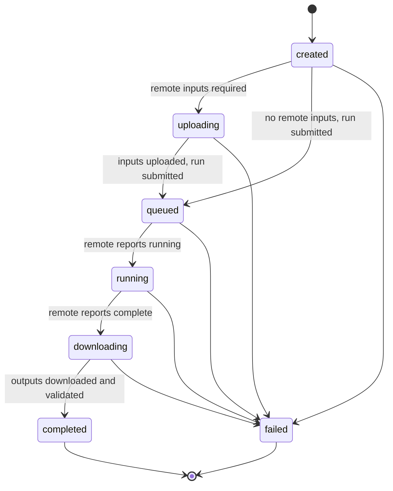

# Contracts — v1.0

Canonical source for schemas, API, job states, artifacts, validation and error codes. Change only via [§12](#12-contract-change-process).
Related: [PRODUCT_SPEC.md](PRODUCT_SPEC.md) · [ARCHITECTURE.md](ARCHITECTURE.md) · [DECISIONS.md](DECISIONS.md)

## 1. Conventions

- Every top-level payload has `"contract_version": "1.0"` (`MAJOR.MINOR`). The encoding is JSON in UTF-8 with `snake_case` keys.
- Timestamps are RFC 3339 UTC with `Z`. Sizes are integer bytes, durations are seconds, percentages are 0–100, and quota is in hours.
- An unknown value is `null` plus an explicit status (§2.1, §6). Never `0`, `""` or a guess.
- Unknown request fields are rejected (`REQUEST_FIELD_INVALID`). Nothing is silently dropped.
- Internal metadata stores POSIX paths relative to `AAS_DATA_DIR`. API responses never contain paths; they use `content_url`.

### 1.1 Enumerations

| Enum | Values |
|---|---|
| `pipeline_type` | `text_to_2d`, `image_to_3d`, `text_to_3d` |
| `asset_category` | `character`, `skill_effect` (visual only), `weapon`, `companion` |
| `image_role` | `front`, `side`, `back`, `three_quarter` (views, max once each); `detail`, `style_reference` (may repeat) |
| `output_format` | `png` (text_to_2d), `glb` (image_to_3d, text_to_3d) |
| `accelerator_kind` | `cpu`, `gpu_cuda`, `tpu` |
| `job_status` | `created`, `uploading`, `queued`, `running`, `downloading`, `completed`, `failed` |
| `availability` | `available`, `experimental`, `planned`, `unavailable` |
| `artifact_kind` | `image`, `model_3d`, `texture`, `preview` |
| `severity` | `error`, `warning` |

### 1.2 Identifiers (the backend validates the regex before any path use)

| ID | Regex | Issuer |
|---|---|---|
| `job_id` | `^job_\d{8}T\d{6}Z_[0-9a-f]{6}$` | backend |
| `upload_id` | `^upl_[0-9a-f]{32}$` | backend |
| `input_id` / `artifact_id` | `^in_\d{2}$` / `^art_\d{2}$` (per job) | backend |
| `client_request_id` | UUID v4 (idempotency key) | frontend |
| `model_id` | `^[a-z0-9][a-z0-9-]{1,63}$` | registry |
| `profile_id` | `^[a-z0-9][a-z0-9-]{1,31}$` | backend config |
| `accelerator_id` | `^[a-z0-9_]{2,32}$` | Kaggle catalog |

### 1.3 Global limits (a model may set narrower limits)

- File size: 50 MiB (52 428 800 bytes).
- Images per request: 8.
- Prompt: 4 000 characters after trimming. A blank prompt becomes `null`.
- Upload types: `image/png`, `image/jpeg`, `image/webp`. The type is detected from the file bytes, not from the name or header.

## 2. Model contracts (Models module)

### 2.1 ModelCapabilities

```json
{ "contract_version": "1.0", "model_id": "mock-i3d-multiview", "display_name": "Mock Multiview Image→3D",
  "adapter": "mock_image_to_3d", "is_mock": true, "availability": "available",
  "supported_pipeline_types": ["image_to_3d"], "supported_asset_categories": ["character", "companion"],
  "inputs": { "prompt_supported": false, "prompt_required": false, "prompt_max_length": null,
              "min_images": 2, "max_images": 4,
              "supported_image_roles": ["front", "side", "back", "detail"], "required_image_roles": ["front", "side"],
              "supported_mime_types": ["image/png", "image/jpeg"], "maximum_file_size_bytes": 20971520,
              "min_image_width": 512, "min_image_height": 512, "max_image_width": 4096, "max_image_height": 4096 },
  "supported_output_formats": ["glb"],
  "runtime": { "supported_accelerators": ["gpu_cuda"], "multi_gpu": "optional",
               "minimum_gpu_vram_bytes": 12884901888, "estimated_runtime_seconds": 900 },
  "options_schema": { "seed": { "type": "integer", "minimum": 0, "maximum": 4294967295, "default": null },
                      "texture_resolution": { "type": "integer", "enum": [1024, 2048], "default": 1024 } },
  "unknown_requirements": [] }
```

Rules:
- **Availability:** only `available` and `experimental` models accept jobs. `experimental` adds the warning `MODEL_EXPERIMENTAL`.
- **Prompt:** when `prompt_supported` is `false`, sending a prompt is an error, `prompt_required` must be `false` and `prompt_max_length` must be `null`.
- **Image counts:** `0 ≤ min_images ≤ max_images ≤ 8`. When `max_images` is `0`, `supported_image_roles` must be empty and the other image fields `null`. `required_image_roles` ⊆ `supported_image_roles`.
- **Accelerators:** `supported_accelerators` lists `accelerator_kind` values in preference order. A model never names Kaggle hardware. `multi_gpu` is `unsupported`, `optional` or `required`.
- **Options:** `options_schema` maps a name to `{type: integer|number|string|boolean, enum?, minimum?, maximum?, max_length?, default, description?}`. Any option not listed is rejected.
- **Unknowns:** `unknown_requirements` lists the dotted path of every requirement that could not be determined (e.g. `runtime.minimum_gpu_vram_bytes`). A requirement field may be `null` only when it is listed there, or is not applicable. For dimension fields, `null` means "no constraint". Registry tests enforce this rule.

### 2.2 Mock registry (M2 test fixtures, not a model selection)

| model_id | Pipeline | Categories | Prompt | Images (min–max; roles; required) | Accel. | VRAM | Runtime s | Availability |
|---|---|---|---|---|---|---|---|---|
| `mock-t2d-basic` | text_to_2d | all | required ≤1000 | 0–0 | cpu, gpu_cuda | n/a | 30 | available |
| `mock-t2d-styleref` | text_to_2d | all | required ≤1000 | 0–1; style_reference | gpu_cuda | unknown | 60 | experimental |
| `mock-i3d-single` | image_to_3d | character, weapon, companion | not supported | 1–1; front; front | gpu_cuda | unknown | 120 | available |
| `mock-i3d-multiview` | image_to_3d | character, companion | not supported | 2–4; front/side/back/detail; front+side | gpu_cuda | 12 GiB | 900 | available |
| `mock-t3d-basic` | text_to_3d | all | required ≤1000 | 0–0 | gpu_cuda | unknown | unknown | planned |

Options:
- `mock-t2d-basic`: `seed`, `width`/`height` (enum 512/768/1024, default 1024), `negative_prompt` (string ≤ 1000, default null).
- `mock-i3d-multiview`: as in §2.1.
- All other mocks: `seed` only.

### 2.3 GenerationRequest (normalized, internal)

Built by the backend after validation. It is model-independent and compute-independent, and it is the adapter's only input. `options` contains every schema option with defaults filled in. `inputs` keeps the user's order.

```json
{ "contract_version": "1.0", "job_id": "job_20261106T101500Z_a1b2c3",
  "pipeline_type": "image_to_3d", "asset_category": "character", "model_id": "mock-i3d-multiview", "prompt": null,
  "inputs": [ { "input_id": "in_01", "role": "front", "path": "inputs/job_20261106T101500Z_a1b2c3/in_01_front.png",
                "mime_type": "image/png", "width": 1024, "height": 1536, "size_bytes": 812345, "sha256": "9f2c…" } ],
  "options": { "seed": null, "texture_resolution": 2048 }, "output_format": "glb", "created_at": "2026-11-06T10:15:00Z" }
```

### 2.4 ModelInvocation (adapter → backend; Kaggle-agnostic)

```json
{ "contract_version": "1.0", "job_id": "job_20261106T101500Z_a1b2c3", "model_id": "mock-i3d-multiview",
  "entrypoint": "models/adapters/mock_image_to_3d/remote_entry.py",
  "arguments": { "views": { "front": "in_01_front.png", "side": "in_02_side.png" }, "texture_resolution": 2048, "seed": null },
  "input_files": ["inputs/job_20261106T101500Z_a1b2c3/in_01_front.png", "inputs/job_20261106T101500Z_a1b2c3/in_02_side.png"],
  "expected_outputs": [ { "name": "model.glb", "kind": "model_3d", "format": "glb", "required": true },
                        { "name": "preview.png", "kind": "preview", "format": "png", "required": false } ],
  "resource_requirements": { "accelerator_kinds": ["gpu_cuda"], "multi_gpu": "optional",
                             "minimum_gpu_vram_bytes": 12884901888, "estimated_runtime_seconds": 900 } }
```

Adapter interface:
- `capabilities()` → `ModelCapabilities`
- `validate_model_specific(req)` → `ErrorItem[]`, for checks the schema cannot express
- `build_invocation(req)` → `ModelInvocation`
- `collect_outputs(req, output_dir)` → `Artifact[]`, or raises `ARTIFACT_INVALID`

`collect_outputs` only reads `output_dir`. All other methods are pure.

## 3. Browser-facing contracts

### 3.1 Upload (two-phase)

`POST /api/v1/uploads` returns an `UploadRecord`. Jobs refer to images by `upload_id`. Uploads are never deleted automatically when the model changes. `filename` is for display only and is never used in a path.

```json
{ "contract_version": "1.0", "upload_id": "upl_3f0a9c1e2b7d4e8f9a0b1c2d3e4f5a6b", "filename": "ranger_front.png",
  "mime_type": "image/png", "size_bytes": 812345, "width": 1024, "height": 1536, "sha256": "9f2c…",
  "created_at": "2026-11-06T10:12:03Z", "expires_at": "2026-11-07T10:12:03Z" }
```

### 3.2 CreateJobRequest (body for both `POST /validate` and `POST /jobs`)

| Field | Rule |
|---|---|
| `contract_version` | Required, with major version `1` |
| `client_request_id` | Required UUID. Resending it returns the original job |
| `pipeline_type`, `asset_category`, `model_id`, `output_format` | Required |
| `prompt` | Optional, trimmed |
| `inputs` | `{upload_id, role}[]`, default `[]`. Each needs a role |
| `options` | Object, default `{}`, checked against the model's `options_schema` |
| `compute` | Required: `{profile_id, accelerator_id|null}`. `null` means recommend one (§7) |

```jsonc
// A — Text→2D
{ "contract_version": "1.0", "client_request_id": "7f9c2b1e-3c1d-4c4e-9a51-2a0d6f1e8b10",
  "pipeline_type": "text_to_2d", "asset_category": "weapon", "model_id": "mock-t2d-basic",
  "prompt": "Ornate frost greatsword, crystalline blade, game concept art", "inputs": [],
  "options": { "seed": 42, "width": 1024, "height": 1024 }, "output_format": "png",
  "compute": { "profile_id": "default", "accelerator_id": null } }

// B — Image→3D, full-body character, three views
{ "contract_version": "1.0", "client_request_id": "0b6d7c55-91f2-4d8e-8c3a-5f1e2d9a7b44",
  "pipeline_type": "image_to_3d", "asset_category": "character", "model_id": "mock-i3d-multiview", "prompt": null,
  "inputs": [ { "upload_id": "upl_3f0a…", "role": "front" }, { "upload_id": "upl_8d1e…", "role": "side" },
              { "upload_id": "upl_1a2b…", "role": "back" } ],
  "options": { "texture_resolution": 2048 }, "output_format": "glb",
  "compute": { "profile_id": "default", "accelerator_id": "gpu_t4x2" } }

// C — Text→3D: valid schema, but 422 PIPELINE_NOT_AVAILABLE while the pipeline is `planned`
{ "contract_version": "1.0", "client_request_id": "c3a1f0e2-7b6d-4a5c-9e8f-1d2c3b4a5f6e",
  "pipeline_type": "text_to_3d", "asset_category": "companion", "model_id": "mock-t3d-basic",
  "prompt": "Small fox spirit companion with glowing tail", "inputs": [], "options": {}, "output_format": "glb",
  "compute": { "profile_id": "default", "accelerator_id": null } }
```

### 3.3 ValidationReport (`POST /validate`, always HTTP 200)

```json
{ "contract_version": "1.0", "valid": false,
  "errors": [ { "code": "MODEL_REQUIRED_VIEW_MISSING", "severity": "error", "field": "inputs",
                "message": "This model requires a side view. Add an image with the role 'side'.",
                "details": { "missing_roles": ["side"] }, "retryable": false } ],
  "warnings": [], "resource_plan": null }
```

`resource_plan` (§7.3) is included only when stages 1–6 of §8.1 pass. `valid: true` means `POST /jobs` with the same body will be accepted, unless state changes in between (an upload expires, quota changes).

### 3.4 GenerationResult (job detail)

```json
{ "contract_version": "1.0", "job_id": "job_20261106T101500Z_a1b2c3", "status": "completed",
  "status_history": [ { "status": "created", "at": "2026-11-06T10:15:00Z" }, { "status": "uploading", "at": "…" },
                      { "status": "queued", "at": "…" }, { "status": "running", "at": "…" },
                      { "status": "downloading", "at": "…" }, { "status": "completed", "at": "2026-11-06T10:33:30Z" } ],
  "request": { "pipeline_type": "image_to_3d", "asset_category": "character", "model_id": "mock-i3d-multiview",
               "prompt": null, "output_format": "glb", "options": { "seed": null, "texture_resolution": 2048 },
               "inputs": [ { "input_id": "in_01", "role": "front", "mime_type": "image/png", "width": 1024, "height": 1536,
                             "size_bytes": 812345, "content_url": "/api/v1/jobs/job_…/inputs/in_01/content" } ] },
  "compute": { "profile_id": "default", "accelerator_id": "gpu_t4x2",
               "resource_plan": { "fit": "ok", "selection": "user_selected", "required_seconds": 1950 } },
  "artifacts": [ { "artifact_id": "art_01", "kind": "model_3d", "format": "glb", "mime_type": "model/gltf-binary",
                   "size_bytes": 4821330, "sha256": "aa01…", "width": null, "height": null, "is_primary": true,
                   "content_url": "/api/v1/jobs/job_…/artifacts/art_01/content" },
                 { "artifact_id": "art_02", "kind": "preview", "format": "png", "mime_type": "image/png",
                   "size_bytes": 201554, "sha256": "bb02…", "width": 512, "height": 512, "is_primary": false,
                   "content_url": "/api/v1/jobs/job_…/artifacts/art_02/content" } ],
  "preview": { "artifact_id": "art_02" }, "warnings": [], "error": null,
  "execution": { "backend": "kaggle", "remote_ref": "owner/aas-runner", "submitted_at": "…", "started_at": "…",
                 "finished_at": "…", "duration_seconds": 925, "transient_retries": 1, "retry_of": null },
  "created_at": "2026-11-06T10:15:00Z", "updated_at": "2026-11-06T10:33:30Z" }
```

- A failed job has the same shape, with `artifacts: []`, `preview: null` and a populated `error`. Example: `{"code":"KAGGLE_KERNEL_ERROR","severity":"error","field":null,"message":"The remote notebook exited with an error. See the job logs.","details":{"failed_in_status":"running","remote_status":"error"},"retryable":false}`.
- `execution.backend` is `mock` or `kaggle`.
- The internal file `data/jobs/<job_id>.json` has the same shape plus `path` on inputs and artifacts. The API strips those paths.

### 3.5 Artifact conventions

| kind | format / mime | Use |
|---|---|---|
| `image` | png / `image/png` | Primary output of `text_to_2d` |
| `model_3d` | glb / `model/gltf-binary` | Primary output of `image_to_3d` and `text_to_3d` |
| `texture` | png | Optional. A GLB must still embed its own textures |
| `preview` | png | Optional 3D thumbnail |

- A completed job has exactly one `is_primary` artifact, and its format equals `output_format`.
- A GLB must be glTF 2.0 binary (magic `glTF`, version 2). A PNG must decode. `collect_outputs` checks both.
- Artifacts are stored at `outputs/<job_id>/<artifact_id>.<format>`.

## 4. Job lifecycle



States:
- `created`: persisted and waiting for the profile's worker slot. Each profile runs one job at a time.
- `uploading`: pushing inputs to the remote store.
- `queued`: the run was submitted but has not started.
- `running`: executing, with logs and telemetry possibly streaming.
- `downloading`: fetching outputs, then running `collect_outputs`.
- `completed`: terminal, with a primary artifact.
- `failed`: terminal, with `error` set.

Rules:
1. Only the transitions shown are allowed. Terminal states never change.
2. Every transition appends to `status_history` and rewrites the job file atomically (temp file + rename).
3. A failure keeps inputs, logs and downloaded files, and sets `error.details.failed_in_status`.
4. Transient remote reads and downloads get at most 3 in-job retries (5 s / 15 s / 45 s). Each attempt increments `execution.transient_retries`.
5. A run is **never** resubmitted automatically, because it consumes quota. `POST /jobs/{id}/retry` is allowed only when `error.retryable` is true. It creates a new, re-validated job with `retry_of` set.
6. On startup, every non-terminal job is reconciled. A job with a remote reference resumes polling. Any other job fails with `BACKEND_RESTARTED` (retryable).
7. A job in `queued` or `running` for longer than `required_seconds × 1.25` fails with `KAGGLE_TIMEOUT`.
8. Cancellation is out of scope for the MVP (DF-09).

## 5. REST API (`/api/v1`)

The backend binds to `127.0.0.1`, serves a single user, has no auth, and allows CORS only for the frontend dev origin.

| Method | Path | Request → Response |
|---|---|---|
| GET | `/health` | → `{status, contract_version, compute_mode: mock|kaggle}` |
| GET | `/catalog` | → `Catalog` (§5.1) |
| GET | `/models?pipeline_type=&asset_category=` | → `{models: ModelCapabilities[]}` |
| GET | `/models/{model_id}` | → `ModelCapabilities` |
| POST | `/uploads` | multipart `file` (one) → `201 UploadRecord` |
| GET / DELETE | `/uploads/{upload_id}[/content]` | → bytes / `204` (`409 UPLOAD_IN_USE`) |
| POST | `/validate` | `CreateJobRequest` → `200 ValidationReport` |
| POST | `/jobs` | `CreateJobRequest` → `201 GenerationResult` (status `created`) or `422` |
| GET | `/jobs?status=&pipeline_type=&limit=50&cursor=` | → `{jobs: JobSummary[], next_cursor}`, newest first |
| GET | `/jobs/{job_id}` | → `GenerationResult` |
| GET | `/jobs/{job_id}/status` | → `{job_id, status, updated_at, progress: {stage, percent, message}}` |
| GET | `/jobs/{job_id}/logs?offset=0&limit=500` | → `{lines: [{n, at, source: backend|remote, text}], next_offset, complete}` |
| POST | `/jobs/{job_id}/retry` | `{client_request_id}` → `201` new job or `409 JOB_NOT_RETRYABLE` |
| DELETE | `/jobs/{job_id}` | → `204`. Terminal jobs only. Removes inputs, outputs, logs and metadata |
| GET | `/jobs/{job_id}/inputs/{input_id}/content` | → bytes |
| GET | `/jobs/{job_id}/artifacts[/{artifact_id}/content?download=0|1]` | → list / bytes (inline or attachment) |
| GET | `/compute/profiles` | → `{profiles: ComputeProfile[]}` (no secrets) |
| GET | `/compute/profiles/{profile_id}/snapshot?refresh=0|1` | → `KaggleResourceSnapshot` |

- `JobSummary` = `{job_id, status, pipeline_type, asset_category, model_id, created_at, updated_at, primary_artifact|null, error_code|null}`.
- `progress` comes from `AAS_PROGRESS` lines, or is `null`. The logs endpoint never returns `AAS_TELEMETRY` lines.
- Polling (no WebSockets):
  - Job status every 2 s.
  - Snapshot every 15 s while a job is running, otherwise every 60 s.
  - `refresh=1` is limited to once per 60 s per profile.

### 5.1 Catalog

```json
{ "contract_version": "1.0",
  "pipelines": [ { "pipeline_type": "text_to_2d", "display_name": "Text → 2D", "availability": "available", "output_formats": ["png"] },
                 { "pipeline_type": "image_to_3d", "display_name": "Image → 3D", "availability": "available", "output_formats": ["glb"] },
                 { "pipeline_type": "text_to_3d", "display_name": "Text → 3D", "availability": "planned", "output_formats": ["glb"] } ],
  "asset_categories": ["character", "skill_effect", "weapon", "companion"],
  "image_roles": ["front", "side", "back", "three_quarter", "detail", "style_reference"],
  "limits": { "max_upload_bytes": 52428800, "max_images_per_request": 8, "prompt_max_length": 4000,
              "supported_upload_mime_types": ["image/png", "image/jpeg", "image/webp"] } }
```

### 5.2 ErrorResponse (every non-2xx response)

```json
{ "contract_version": "1.0", "warnings": [],
  "errors": [ { "code": "MODEL_INPUT_COUNT_EXCEEDED", "severity": "error", "field": "inputs",
                "message": "This model accepts at most 1 image; 3 were provided.",
                "details": { "max_images": 1, "provided": 3 }, "retryable": false } ] }
```

- `ErrorItem` = `{code, severity, field|null, message, details, retryable}`.
- `field` is a request path: `prompt`, `inputs`, `inputs[2].role`, `options.seed`, `compute.accelerator_id`.
- `message` is English and user-facing. The frontend may localize it by `code`.

HTTP status codes:
- **400** malformed JSON or multipart
- **404** `*_NOT_FOUND`
- **409** `JOB_NOT_RETRYABLE`, `JOB_NOT_TERMINAL`, `UPLOAD_IN_USE`
- **413** `UPLOAD_TOO_LARGE`
- **415** `UPLOAD_UNSUPPORTED_TYPE`
- **422** validation errors (§8)
- **500** `INTERNAL_ERROR`, never with a stack trace

## 6. Kaggle resource contracts (Kaggle module)

### 6.1 ComputeProfile (public view; never includes credentials)

A profile is **one Kaggle account, owned and operated by one person who has authorized its use**. The rules are in DECISIONS D-008.

```json
{ "contract_version": "1.0", "profile_id": "default", "display_name": "Owner Kaggle", "owner_label": "project-owner",
  "mode": "kaggle", "enabled": true, "authorization_confirmed": true,
  "accelerators": [
    { "accelerator_id": "cpu", "kind": "cpu", "device_count": 0, "vram_bytes_per_device": null, "max_session_seconds": 43200 },
    { "accelerator_id": "gpu_p100", "kind": "gpu_cuda", "device_count": 1, "vram_bytes_per_device": 17179869184, "max_session_seconds": 43200 },
    { "accelerator_id": "gpu_t4x2", "kind": "gpu_cuda", "device_count": 2, "vram_bytes_per_device": 16106127360, "max_session_seconds": 43200 },
    { "accelerator_id": "tpu_vm", "kind": "tpu", "device_count": 1, "vram_bytes_per_device": null, "max_session_seconds": 32400 } ] }
```

The catalog is **provisional** until M3 verifies it (DF-06). The Kaggle `--accelerator` value for each entry is kept internal.

### 6.2 KaggleResourceSnapshot

```json
{ "contract_version": "1.0", "compute_profile_id": "default", "authentication_status": "authenticated",
  "accelerator_type": "gpu_t4x2",
  "accelerator_availability": [ { "accelerator_id": "gpu_t4x2", "status": "available" }, { "accelerator_id": "tpu_vm", "status": "unknown" } ],
  "gpu_quota_total_hours": 30.0, "gpu_quota_used_hours": 11.5, "gpu_quota_remaining_hours": 18.5,
  "tpu_quota_total_hours": null, "tpu_quota_used_hours": null, "tpu_quota_remaining_hours": null, "quota_reset_at": null,
  "session_started_at": "2026-11-06T10:17:40Z", "estimated_session_remaining_seconds": 41100, "session_status": "running",
  "cpu_utilization_percent": 63.5, "ram_used_bytes": 9663676416, "ram_total_bytes": 33285996544,
  "gpu_devices": [
    { "index": 0, "name": "Tesla T4", "utilization_percent": 97.0, "vram_used_bytes": 13421772800, "vram_total_bytes": 16106127360, "temperature_c": 71.0, "status": "available" },
    { "index": 1, "name": "Tesla T4", "utilization_percent": 4.0, "vram_used_bytes": 524288000, "vram_total_bytes": 16106127360, "temperature_c": null, "status": "available" } ],
  "observed_at": { "snapshot": "2026-11-06T10:20:05Z", "quota": "2026-11-06T10:18:00Z", "session": "2026-11-06T10:20:00Z",
                   "host": "2026-11-06T10:19:52Z", "gpu": "2026-11-06T10:19:52Z" },
  "source": { "quota": "kaggle_cli_quota", "session": "kaggle_cli_status", "host": "notebook_telemetry", "gpu": "notebook_telemetry" },
  "freshness_status": { "quota": "fresh", "session": "fresh", "host": "fresh", "gpu": "fresh" },
  "error": [ { "code": "COMPUTE_TPU_QUOTA_UNAVAILABLE", "severity": "warning", "field": "tpu_quota_total_hours",
               "message": "TPU quota was not reported by the Kaggle CLI.", "details": {}, "retryable": true } ] }
```

| Field(s) | Semantics |
|---|---|
| `authentication_status` | `authenticated`, `unauthenticated` (no credentials), `invalid_credentials`, or `unknown` (not checked or network error) |
| `accelerator_type` | Accelerator of the current or last session, otherwise `null` |
| `accelerator_availability[].status` | `available`, `quota_exhausted`, `unknown`, `not_in_profile` |
| quota fields, `quota_reset_at` | Only from `kaggle quota`. Never derived from assumed limits. `null` if not reported |
| `session_status` | `none`, `queued`, `running`, `finished`, `failed`, `unknown` |
| `session_started_at` | First local observation of `running` (source `local_observation` if Kaggle gives no timestamp) |
| `estimated_session_remaining_seconds` | **An estimate.** `min(max_session_seconds − elapsed, remaining quota for that kind)`, using only known terms. `null` if both terms are unknown or there is no session |
| CPU / RAM / GPU fields | Only from notebook telemetry (§6.4). `null` with status `not_applicable` (no session), `unavailable` (running, no sample) or `unsupported` (TPU, MVP) |
| `gpu_devices[]` | One entry per `index`. **GPU0 and GPU1 are independent**, never summed or averaged. Every field is nullable. Per-device `status` is `available`, `unavailable` or `unsupported` |
| `observed_at`, `source`, `freshness_status` | One entry per group: `quota`, `session`, `host` (CPU/RAM), `gpu`. `observed_at` also has `snapshot` |
| `source` values | `kaggle_cli_quota`, `kaggle_cli_status`, `notebook_telemetry`, `local_observation`, `mock`, `none` |
| `freshness_status` values | `fresh`, `stale`, `unavailable`, `unsupported`, `not_applicable` |
| `error` | `ErrorItem[]`, empty if there are no problems (e.g. `KAGGLE_AUTH_FAILED`, `COMPUTE_QUOTA_UNKNOWN`, `COMPUTE_TELEMETRY_*`) |

Freshness:

| Group | fresh | stale | unavailable |
|---|---|---|---|
| quota | ≤ 10 min | > 10 min | never read, or the last read failed |
| session | ≤ 60 s | > 60 s | no remote reference |
| host / gpu | ≤ 3 × reporter interval (45 s) | > 3 × interval | session running, no sample yet |

Stale values are returned and marked `stale`, never shown as live.

### 6.3 Required snapshot scenarios

- **No session:** `session_status: "none"`, CPU/RAM fields `null`, `gpu_devices: []`. For `host` and `gpu`, freshness is `not_applicable` and source is `none`.
- **Quota missing** (old CLI or command failed): every quota field is `null`, quota freshness is `unavailable`, and `error` contains `COMPUTE_QUOTA_UNKNOWN`.
- **Telemetry stale:** the last values are kept, `host`/`gpu` freshness is `stale`, and `error` contains `COMPUTE_TELEMETRY_STALE` with `details.age_seconds`.

### 6.4 Notebook output protocol (runtime → connector)

The runner prints prefixed single-line JSON (≤ 4 KiB) to stdout. The connector reads it through `kaggle kernels logs` (`-f` while running; best-effort, DF-07).

```
AAS_PROGRESS {"v":1,"job_id":"job_…","at":"2026-11-06T10:20:00Z","stage":"inference","percent":40,"message":"Reconstructing mesh"}
AAS_TELEMETRY {"v":1,"job_id":"job_…","at":"2026-11-06T10:19:52Z","cpu_percent":63.5,"ram_used_bytes":9663676416,"ram_total_bytes":33285996544,"gpu_source":"nvml","gpus":[{"index":0,"name":"Tesla T4","utilization_percent":97.0,"vram_used_bytes":13421772800,"vram_total_bytes":16106127360,"temperature_c":71.0},{"index":1,"name":"Tesla T4","utilization_percent":4.0,"vram_used_bytes":524288000,"vram_total_bytes":16106127360,"temperature_c":null}],"errors":[]}
```

- `gpu_source` is `nvml`, `nvidia_smi` (fallback) or `none`.
- The reporter interval is 15 s by default (allowed 5–60 s). It runs in a daemon thread, and its exceptions go to `errors[]` without failing the job.
- Samples are stored in `data/logs/<job_id>.telemetry.jsonl`. Malformed lines are skipped and counted.

Output manifest at `/kaggle/working/aas_output/manifest.json` (the mock client writes the same file locally):

```json
{ "v": 1, "job_id": "job_…", "status": "ok", "error": null,
  "outputs": [ { "name": "model.glb", "kind": "model_3d", "format": "glb", "size_bytes": 4821330, "sha256": "aa01…" } ] }
```

On failure the manifest has `status: "error"` and `error: {code, message}`. A missing manifest fails the job with `ARTIFACT_INVALID`.

## 7. Resource planning (deterministic)

### 7.1 Inputs

- `ResourceRequirements`: mapped by the backend from `ModelCapabilities.runtime`. The Kaggle module never sees models or categories.
- The **explicitly selected** `ComputeProfile`. Other profiles are never considered.
- That profile's latest snapshot.
- Configurable constants: `safety_factor = 1.5` and `overhead_seconds = 600`.

### 7.2 Algorithm

```
candidates = profile accelerators whose kind ∈ req.accelerator_kinds, ordered by model preference, then profile order
if req.multi_gpu == "required": drop candidates with device_count < 2
if empty                                      -> error MODEL_ACCELERATOR_INCOMPATIBLE
if user chose accelerator_id: must be in candidates (else MODEL_ACCELERATOR_INCOMPATIBLE); selection = user_selected
else selection = recommended
for each candidate c:
  vram:    known req.min_vram > known c.vram      -> insufficient (COMPUTE_VRAM_INSUFFICIENT); either unknown -> warning COMPUTE_VRAM_UNKNOWN
  time:    runtime unknown -> required = null + warning MODEL_RUNTIME_UNKNOWN; else required = ceil(runtime × 1.5 + 600)
  session: required > c.max_session_seconds      -> insufficient (COMPUTE_SESSION_LIMIT_EXCEEDED)
  quota:   (skip for cpu) remaining null or not fresh -> warning COMPUTE_QUOTA_UNKNOWN; required > remaining -> insufficient (COMPUTE_QUOTA_INSUFFICIENT)
  c.fit = insufficient if any check failed; unknown if any warning; else ok
chosen = first ok, else first unknown, else none -> the first candidate's reasons become blocking errors
```

Errors block job creation. Warnings never block; they are shown in the UI and stored in `GenerationResult.warnings`. `kernels push --timeout` is set to `min(required ?? max_session_seconds, max_session_seconds)`.

### 7.3 ResourcePlan

```json
{ "contract_version": "1.0", "profile_id": "default", "accelerator_id": "gpu_t4x2", "selection": "user_selected", "fit": "ok",
  "required_seconds": 1950, "estimate_basis": { "estimated_runtime_seconds": 900, "safety_factor": 1.5, "overhead_seconds": 600 },
  "session_limit_seconds": 43200, "quota_remaining_seconds": 66600,
  "candidates": [ { "accelerator_id": "gpu_t4x2", "fit": "ok", "reasons": [] } ], "warnings": [], "errors": [] }
```

This is the plan for request B: 900 × 1.5 + 600 = 1 950 s. With `accelerator_id: null`, both `gpu_p100` and `gpu_t4x2` would be `ok`, and the plan would choose `gpu_p100` because it comes first in profile order. The UI labels every plan number as an **estimate**.

## 8. Validation

### 8.1 Stages (the backend is authoritative; the frontend runs stages 2–7 with the same rules)

1. **Schema:** version, types, required fields, unknown fields. *Short-circuits.*
2. **Catalog:** the pipeline is known and accepts jobs; the category is known. *Short-circuits.*
3. **Model:** it exists, accepts jobs, and supports the pipeline and category. *Short-circuits.*
4. **Inputs:** prompt, uploads exist, count, roles, MIME type, size, dimensions.
5. **Output format.**
6. **Options**, then `validate_model_specific`.
7. **Compute:** profile, authentication, plan (§7).

Stages 4–7 report every error they find. A request with any error creates no job and contacts no remote service (stage 7 reads only the cached snapshot).

### 8.2 Error codes

Validation codes (`Retry` = `error.retryable`; warnings do not block):

| Code | Sev. | Field | Retry | Condition |
|---|---|---|---|---|
| `CONTRACT_VERSION_UNSUPPORTED` | error | `contract_version` | no | Major version ≠ 1 |
| `REQUEST_FIELD_INVALID` | error | field | no | Type error, missing field or unknown field |
| `PIPELINE_UNKNOWN` | error | `pipeline_type` | no | Not in enum |
| `PIPELINE_NOT_AVAILABLE` | error | `pipeline_type` | no | Pipeline is `planned` or `unavailable` |
| `ASSET_CATEGORY_UNKNOWN` | error | `asset_category` | no | Not in enum |
| `MODEL_NOT_FOUND` | error | `model_id` | no | Not in registry |
| `MODEL_UNAVAILABLE` | error | `model_id` | no | Model is `planned` or `unavailable` |
| `MODEL_EXPERIMENTAL` | warning | `model_id` | — | Model is `experimental` |
| `MODEL_PIPELINE_INCOMPATIBLE` | error | `model_id` | no | Pipeline not supported |
| `MODEL_CATEGORY_INCOMPATIBLE` | error | `asset_category` | no | Category not supported |
| `MODEL_PROMPT_REQUIRED` | error | `prompt` | no | Required prompt is null |
| `MODEL_PROMPT_NOT_SUPPORTED` | error | `prompt` | no | Prompt given when `prompt_supported` is false |
| `MODEL_PROMPT_TOO_LONG` | error | `prompt` | no | Over the model or global limit |
| `MODEL_IMAGE_INPUT_NOT_SUPPORTED` | error | `inputs` | no | Images given when `max_images` is 0 |
| `MODEL_INPUT_COUNT_INSUFFICIENT` | error | `inputs` | no | Fewer than `min_images` |
| `MODEL_INPUT_COUNT_EXCEEDED` | error | `inputs` | no | More than `max_images` (or the global limit) |
| `MODEL_IMAGE_ROLE_UNSUPPORTED` | error | `inputs[i].role` | no | Role not supported |
| `MODEL_IMAGE_ROLE_DUPLICATE` | error | `inputs[i].role` | no | View role repeated |
| `MODEL_REQUIRED_VIEW_MISSING` | error | `inputs` | no | Required role missing (`details.missing_roles`) |
| `MODEL_UNSUPPORTED_FILE_FORMAT` | error | `inputs[i].upload_id` | no | MIME type not supported |
| `MODEL_FILE_TOO_LARGE` | error | `inputs[i].upload_id` | no | Over `maximum_file_size_bytes` |
| `MODEL_IMAGE_DIMENSIONS_INVALID` | error | `inputs[i].upload_id` | no | Outside the min/max size (`details` has actual and allowed) |
| `MODEL_OUTPUT_FORMAT_UNSUPPORTED` | error | `output_format` | no | Not supported by the model or pipeline |
| `MODEL_OPTION_UNSUPPORTED` | error | `options.<name>` | no | Not in `options_schema` |
| `MODEL_OPTION_INVALID` | error | `options.<name>` | no | Type, enum, range or length violation |
| `MODEL_ACCELERATOR_INCOMPATIBLE` | error | `compute.accelerator_id` | no | §7.2 |
| `MODEL_RUNTIME_UNKNOWN` | warning | `model_id` | — | Runtime estimate unknown |
| `UPLOAD_NOT_FOUND` | error | `inputs[i].upload_id` | no | Upload unknown or expired |
| `UPLOAD_CORRUPT` | error | `inputs[i].upload_id` / `file` | no | Image cannot be decoded |
| `UPLOAD_TOO_LARGE` | error | `file` | no | Over the global limit (413) |
| `UPLOAD_UNSUPPORTED_TYPE` | error | `file` | no | Content is not PNG, JPEG or WebP (415) |
| `UPLOAD_IN_USE` | error | `upload_id` | no | Deleting an upload a job references |
| `COMPUTE_PROFILE_NOT_FOUND` | error | `compute.profile_id` | no | Profile unknown or disabled |
| `COMPUTE_PROFILE_UNAUTHENTICATED` | error | `compute.profile_id` | yes | Profile not `authenticated` |
| `COMPUTE_VRAM_INSUFFICIENT` | error | `compute.accelerator_id` | no | §7.2 |
| `COMPUTE_VRAM_UNKNOWN` | warning | `compute.accelerator_id` | — | §7.2 |
| `COMPUTE_SESSION_LIMIT_EXCEEDED` | error | `compute.accelerator_id` | no | §7.2 |
| `COMPUTE_QUOTA_INSUFFICIENT` | error | `compute.accelerator_id` | yes (after reset) | §7.2 |
| `COMPUTE_QUOTA_UNKNOWN` | warning | `compute.profile_id` | — | Quota null or not fresh |
| `COMPUTE_TPU_QUOTA_UNAVAILABLE` | warning | snapshot field | — | TPU quota not reported |
| `COMPUTE_TELEMETRY_UNAVAILABLE` | warning | snapshot group | — | Session running, no sample |
| `COMPUTE_TELEMETRY_STALE` | warning | snapshot group | — | Sample older than the threshold |
| `JOB_NOT_FOUND` / `ARTIFACT_NOT_FOUND` | error | — | no | 404 |
| `JOB_NOT_RETRYABLE` | error | — | no | Job not `failed`, or not retryable |
| `JOB_NOT_TERMINAL` | error | — | no | Deleting a non-terminal job |
| `PATH_INVALID` | error | — | no | Fails the regex or root check (logged as a security event) |

Job-time errors (`GenerationResult.error`):

| Code | Retry | Condition |
|---|---|---|
| `KAGGLE_AUTH_FAILED` | no | Credentials rejected (401/403) |
| `KAGGLE_RATE_LIMITED` | yes | HTTP 429 after the in-job retries |
| `KAGGLE_NETWORK_ERROR` | yes | Connection or timeout after the in-job retries |
| `KAGGLE_UPLOAD_FAILED` | yes | Input upload failed |
| `KAGGLE_SUBMIT_FAILED` | yes | Kernel push failed |
| `KAGGLE_QUOTA_EXHAUSTED` | no | Run refused for quota |
| `KAGGLE_KERNEL_ERROR` | no | Remote run ended in `error` |
| `KAGGLE_TIMEOUT` | yes | §4 rule 7, or the session limit was reached |
| `ARTIFACT_DOWNLOAD_FAILED` | yes | Download failed after the in-job retries |
| `ARTIFACT_INVALID` | no | Manifest or required output missing, or a format check failed |
| `BACKEND_RESTARTED` | yes | §4 rule 6 |
| `INTERNAL_ERROR` | no | Unexpected exception (details logged locally only) |

### 8.3 Model switching (UI)

When the pipeline, category or model changes, the frontend re-validates and:
- **keeps** every upload and value; nothing is deleted automatically;
- marks each incompatible field with its code and message;
- hides options the new model does not declare and does not send them, while listing any non-default value among them as "not used by this model";
- keeps Generate disabled until there are no errors.

### 8.4 Validation test matrix (M1 frontend, M2 backend)

| ID | Scenario | Setup | Expected |
|---|---|---|---|
| V-01 | Text-only model gets an image | `mock-t2d-basic` + 1 image | `MODEL_IMAGE_INPUT_NOT_SUPPORTED` |
| V-02 | Single-image model gets 3 images | `mock-i3d-single` + front/side/back | `MODEL_INPUT_COUNT_EXCEEDED` (max 1, provided 3), plus `MODEL_IMAGE_ROLE_UNSUPPORTED` for side and back |
| V-03 | Multiview model is missing the side view | `mock-i3d-multiview` + front, back | `MODEL_REQUIRED_VIEW_MISSING` (`["side"]`) |
| V-04 | Valid full-body front/side/back | `mock-i3d-multiview`, 1024×1536 PNGs, `gpu_t4x2` | `valid: true`, fit `ok` |
| V-05 | GPU-only model with TPU | `mock-i3d-multiview`, `tpu_vm` | `MODEL_ACCELERATOR_INCOMPATIBLE` |
| V-06 | Unknown minimum VRAM | `mock-i3d-single`, `gpu_t4x2` | valid; warning `COMPUTE_VRAM_UNKNOWN`; fit `unknown` |
| V-07 | Kaggle quota missing | snapshot quota is null | valid; warning `COMPUTE_QUOTA_UNKNOWN`; fit `unknown` |
| V-08 | GPU0 and GPU1 memory differ | telemetry fixture | each device keeps its own values; the UI shows two gauges |
| V-09 | Job exceeds the session limit | fixture runtime 40 000 s (required 60 600 > 43 200) | `COMPUTE_SESSION_LIMIT_EXCEEDED` |
| V-10 | Telemetry stale or unavailable | no sample / a sample 120 s old | freshness `unavailable` / `stale`, plus a warning; not shown as live |
| V-11 | Required prompt is blank | `mock-t2d-basic`, `"   "` | `MODEL_PROMPT_REQUIRED` |
| V-12 | Unsupported format | `mock-i3d-single` + WebP | `MODEL_UNSUPPORTED_FILE_FORMAT` |
| V-13 | File too large for the model | `mock-i3d-multiview` + 25 MiB PNG | `MODEL_FILE_TOO_LARGE` |
| V-14 | Wrong dimensions | `mock-i3d-multiview` + 256×256 front | `MODEL_IMAGE_DIMENSIONS_INVALID` |
| V-15 | Unsupported category | `mock-i3d-multiview` + `weapon` | `MODEL_CATEGORY_INCOMPATIBLE` |
| V-16 | Unsupported output | `mock-t2d-basic` + `glb` | `MODEL_OUTPUT_FORMAT_UNSUPPORTED` |
| V-17 | Unsupported option | `mock-i3d-single` + `texture_resolution` | `MODEL_OPTION_UNSUPPORTED` |
| V-18 | Insufficient quota | 0.3 h left, 1 950 s required | `COMPUTE_QUOTA_INSUFFICIENT` |
| V-19 | Model switch keeps uploads | 3 uploads, switch multiview → single | uploads kept; errors as in V-02 |
| V-20 | Planned pipeline | example C (§3.2) | `PIPELINE_NOT_AVAILABLE` |

## 9. Storage

The backend is the **only** reader and writer of `data/`. The connector writes only into directories the backend passes to it. The frontend never touches files.

```
data/                                         # AAS_DATA_DIR, gitignored
├── inputs/staging/<upload_id>/{file.<ext>, upload.json}
├── inputs/<job_id>/<input_id>_<role>.<ext>
├── outputs/<job_id>/<artifact_id>.<ext>      # + remote_raw/ while downloading
├── jobs/<job_id>.json                        # internal GenerationResult (with paths)
└── logs/{backend.log, <job_id>.log, <job_id>.telemetry.jsonl}
```

Lifecycle:
- **Staged uploads** are deleted 24 h after creation if no job references them (swept at startup and hourly), or by `DELETE /uploads/{id}`.
- **Job inputs** are copied from staging when the job is created.
- **Outputs** (PNG, GLB, textures, previews) are written in `downloading`, after validation.
- **`remote_raw/`** is deleted once `collect_outputs` succeeds, and kept on failure.
- **Everything belonging to a job** (inputs, metadata, logs, telemetry, outputs) is removed by `DELETE /jobs/{id}`.

Path safety: every path is `data_root / <validated relative path>`, resolved and rejected with `PATH_INVALID` if it escapes the root, is absolute, contains `..` or is a symlink. File names are built from IDs, roles and formats only, never from user input.

## 10. Secrets

- Kaggle credentials live only in the local `.env` (gitignored). They are held in backend memory and passed **only** in the environment of the CLI subprocess for the selected profile.
- They never appear in API responses, the frontend, logs, job files, notebook source or output, or datasets.
- The log writer redacts the configured secret values and any `KAGGLE_(KEY|API_TOKEN)=…` pattern.
- An M3 test checks that a known fake token never appears in `data/`, in API responses or in a job package.

## 11. Frontend type mirroring

`interface/frontend/src/api/types.ts` mirrors this document by hand. The examples here are also kept as shared fixtures in `tests/fixtures/contracts/*.json`. The frontend mock client serves those fixtures, and backend tests validate them with the Pydantic models. A fixture that fails on either side breaks the build.

## 12. Contract change process

1. Edit this file first. An added field, enum value or error code is a MINOR bump (`1.1`). A rename, removal or change of meaning is a MAJOR bump with a new `/api/v2`.
2. Add an entry to [DECISIONS.md](DECISIONS.md).
3. Update the fixtures, Pydantic models, TS types and tests in the same change.
4. The owner approves every MAJOR change before implementation.
