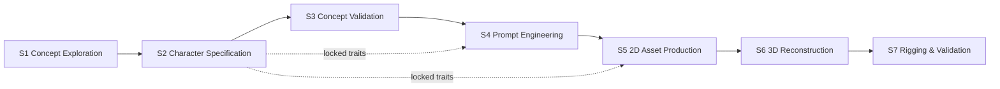

# V2 Character Workflow — S1 to S7

> **Status: APPROVED by the owner on 2026-11-06 (D-035).** Backend implemented (V2-1, V2-2); frontend with Codex
> (V2-3…V2-5). Requirements: [PRODUCT_SPEC §8](../PRODUCT_SPEC.md#8-character-production-v2); architecture:
> [ARCHITECTURE §8](../ARCHITECTURE.md#8-character-production-v2).

This document defines the seven stages of Character Production, their approval gates, how revisions work and how a
change upstream affects downstream stages. Types and endpoints are in [CONTRACTS.md §13](../CONTRACTS.md#13-character-production-v11); the source
material is the owner's [CHARACTER_PRODUCTION_WORKFLOW.md](../sources/CHARACTER_PRODUCTION_WORKFLOW.md) (v1.0).

**Principle:** the owner decides; the app records, validates and shows evidence. A stage passes only when the owner
approves it. A generation job that completed is a candidate, never an approval.

## 1. Overview

| Stage | `stage_id` | Availability (V2) | Hard dependencies | Soft dependencies | Main output |
|---|---|---|---|---|---|
| S1 Concept Exploration | `s1` | `available` | — | — | Idea, tagged references, design directions |
| S2 Character Specification | `s2` | `available` | `s1` | — | `CharacterSpecification` with Locked/Preferred/Flexible attributes |
| S3 Concept Validation | `s3` | `available` | `s2` | `s1` | Quick previews (light model) → one selected concept image, frozen on approval |
| S4 Prompt Engineering | `s4` | `available` | `s2`, `s3` | — | `PromptSet` + production tasks; approval freezes the **Production Batch Manifest** |
| S5 2D Asset Production | `s5` | `available` (needs a `text_to_2d` model for category `character`) | `s4` | `s2` | Batch run on the large model → approved 2D set, frozen on approval |
| S6 3D Reconstruction | `s6` | `planned` | `s5` | `s2` | (future) approved GLB |
| S7 Rigging & Validation | `s7` | `planned` | `s6` | — | (future) rigged export |

- A **hard** dependency must have a current approved snapshot before this stage can be approved.
- A **soft** dependency is shown as context in the input zone. If it changes, this stage is flagged for re-review,
  but its approval is not blocked.

### 1.1 Status model (shared by every stage)

`editorial_status` (what the owner did) and `availability` (whether the app can do the stage) are separate fields.

| `editorial_status` | Meaning |
|---|---|
| `not_started` | No draft, no revision, and every hard dependency is approved |
| `blocked` | No draft and no revision yet, and a hard dependency has no current approved snapshot |
| `draft` | The draft has changes that were not submitted. The stage may still have an older approved snapshot in use |
| `in_review` | A submitted revision is waiting for the owner's decision |
| `approved` | The latest decision approved a revision, and it is not stale |
| `needs_revision` | The owner asked for changes, or the approved snapshot is stale because an upstream stage approved a newer revision |

The API derives `editorial_status` on every read, in this priority order:
1. `in_review`
2. `needs_revision`
3. `draft`
4. `approved`
5. `blocked`
6. `not_started`

The rules are in [CONTRACTS.md §13.5.3](../CONTRACTS.md#1353-derived-editorial_status). `availability` is
`available | planned | unavailable`. A `planned` stage is visible and read-only; it cannot be drafted or approved.

### 1.2 Actions and gates

| Action | Allowed when | Effect |
|---|---|---|
| Save draft | Stage `available` | Writes the working copy. Creates no revision. Upstream need not be approved (exploration is allowed) |
| Submit for review | A draft exists and its content passes schema validation | Freezes the draft into an immutable revision `N` with `source_revisions` = the upstream approved revisions it used |
| Approve | Revision `N` is pending. Every required checklist item is checked. The stage-specific content rules (below) pass. Every hard dependency has a current approved snapshot, still equal to `source_revisions`. The stage is `available` | `N` becomes the approved snapshot. S3/S5 copy the selected images into the character folder ("frozen assets") |
| Request revision | A revision is pending, or the stage is approved | Records the owner's note. The previous approved snapshot, if any, stays in use downstream until a newer one is approved |
| Withdraw | A revision is pending | The revision is closed as `withdrawn`; the draft stays editable |

Approval is always manual and explicit. Nothing approves itself, re-runs a GPU job, deletes an output or overwrites an
approved snapshot.

## 2. Revisions and downstream impact

1. **Drafts are mutable; revisions are not.** A revision file is created once (exclusive create) and never
   rewritten, except for its decision fields while it is pending.
2. **Editing an approved stage** saves a draft that is based on the approved revision. The approved snapshot stays
   authoritative for downstream stages until a newer revision is approved.
3. **Approving revision `N+1` upstream** leaves every downstream snapshot untouched. Each downstream approved stage
   whose `source_revisions` points to an older revision of that upstream stage is reported as **stale**, which shows
   as `editorial_status = needs_revision`, with a `stale_reasons` entry per changed dependency. This is computed on
   read and writes nothing.
4. **Stale is a flag, not a deletion.** Outputs, frozen assets and links remain. The owner decides whether to
   re-approve (after reviewing), revise, or regenerate.
5. **Re-review without changes** is allowed: the owner submits a new revision with unchanged content. It records
   the new `source_revisions` and is approved like any other.
6. **Concurrency:** every write carries the version it was based on (`expected_version` / `expected_draft_version`).
   A mismatch returns `409` and nothing is written ([CONTRACTS.md §13.6](../CONTRACTS.md#136-api)).

Example: S2 r2 is approved, and S3, S4 and S5 were approved on top of it. The owner edits S2 and approves r3. S3 (hard
dependency on S2), S4 (hard) and S5 (soft) now show `needs_revision`, with "S2 r2 → r3". The S5 frozen set is still
visible and downloadable. No job runs.

**Where to go back** (from the owner's workflow, §C):

| Symptom | Fix first in | Go further back when |
|---|---|---|
| Direction or taste changes completely | S1 | — |
| Wrong hair colour, outfit form or identity | S2 | S1 only if the whole direction changes |
| Concept drawing is poor but the spec is right | S3 | S2 if the spec itself is wrong |
| A prompt misses mandatory content | S4 | S2 if the spec is incomplete |
| A 2D image is wrong or unattractive | S5 (regenerate), then S4 | S2/S3 only when the design itself changes |
| Multiview images are not the same character | **S5** | S4 if the prompts cause the difference |
| 3D mesh, texture or silhouette is wrong (future) | **S6** | S5 only when genuinely new views or details are needed |
| Skeleton, weights or animation are wrong (future) | **S7** | S6 if topology is the cause |

## 3. Stage specifications

The checklist item IDs below are stable and appear in `StageConfig.checklist` ([CONTRACTS.md §13.4.3](../CONTRACTS.md#1343-stageconfig-static-served-by-the-backend)).
Labels are i18n keys `stage.<stage_id>.check.<item_id>`. **Content rules** are checked by the backend on approval,
independently of the checklist.

### S1 — Concept Exploration

| Aspect | Specification |
|---|---|
| Objective | Turn a rough idea into a design direction the owner controls, using references, sketches and notes |
| Required inputs | None. A one-line idea is enough; images are optional |
| Editable data | `idea`, up to 3 `directions`, `notes`, `palette` (hex colours), the list of references used, with each reference's `aspects` (face, hair, eyes, body, outfit, accessories, color, style, pose, other), `likes` and `do_not_copy`, and its purpose (`moodboard` or `sketch`) |
| References | Image uploads (PNG/JPEG/WebP via the existing `POST /uploads`, then promoted into the character) and **URL references** (Pinterest boards, Behance pages). URLs are stored as text and are **never fetched** by the backend |
| Source stage / revision | — |
| Outputs | Approved `ConceptContent` revision |
| Checklist | `references_tagged` (req.: each reference has at least one aspect and a "likes" note) · `direction_chosen` (req.) · `enough_for_spec` (req.: "Đủ hướng để đặc tả") · `unchangeable_noted` (opt.) · `sketch_attached` (opt.) |
| Content rules | `idea` non-empty **or** at least one reference; at least one direction |
| Transition | Approval lets S2 be approved; S2 drafting is allowed at any time |
| Backward revision | Only when the whole direction changes (requested from S2/S3) |
| Dependencies / blockers | None |
| Availability | `available` |
| Empty state | "Chưa có ý tưởng" with actions *Add idea* and *Add reference*. A URL reference shows its host name only (no preview) |
| Error states | Upload rejected (existing `UPLOAD_*` codes); `REFERENCE_URL_INVALID` (not http/https, longer than 2 000 characters) |

### S2 — Character Specification

| Aspect | Specification |
|---|---|
| Objective | Merge the idea and references into the one canonical description of the character |
| Required inputs | S1 approved snapshot (shown read-only in the input zone) |
| Editable data | `summary`; `attributes[]` (`group`, `label`, `value`, `lock` = `locked`/`preferred`/`flexible`, `reference_ids`); `answers[]` to the guided questions (`answered`/`unknown`/`skipped`); `open_questions[]`; `rejection_criteria[]` |
| Guided questions | A fixed list, served in `StageConfig.guided_questions`, with the core questions first: `q_name_role`, `q_identity_marks`, `q_appearance`, `q_outfit_layers`, `q_props`, `q_style`, `q_reference_map`, `q_view_details`, `q_variable_vs_fixed`; then the extras `q_variants`, `q_motion_parts`, `q_3d_limits`, `q_scale`, `q_not_this_character`. The UI shows up to 5 unanswered questions at a time. There is **no AI in V2**: the questions are static text (DF-10 still defers an in-app agent) |
| Source stage / revision | S1 revision in `source_revisions.s1` |
| Outputs | Approved `CharacterSpecification` revision. Its `locked` attributes are what S3, S4 and S5 are checked against |
| Checklist | `locked_clear` (req.) · `unknowns_marked` (req.: unknowns are `unknown`/`flexible`, never invented) · `reference_map_done` (req.) · `no_conflicts` (req.) · `rejection_criteria` (opt.) · `3d_constraints` (opt.) |
| Content rules | At least one `locked` attribute; every attribute has a non-empty `value`; `attribute_id`s unique; every `reference_ids` entry exists |
| Transition | Approval lets S3 be approved; S4 and S5 also read S2 |
| Backward revision | To S1 when references contradict the direction |
| Dependencies / blockers | Hard: S1 |
| Availability | `available` |
| Empty state | Guided questions start the form; "Chưa có thuộc tính nào" |
| Error states | `STAGE_CONTENT_INCOMPLETE` (no locked attribute, empty value, duplicate ID) |

### S3 — Concept Validation (lightweight previews)

| Aspect | Specification |
|---|---|
| Objective | Check with real images that the design is right, cheaply and as often as needed, before the expensive production run |
| Required inputs | S2 approved snapshot. S1 references as context |
| Preview profile | `preview_profile`: `model_id`, `options`, `variations` (images per prompt, 1–8). Default proposal: **FLUX.2 [klein] 4B**, measured at ~9 s/image (D-034). It must be a registry model that accepts `text_to_2d` + `character` jobs. `compute_target` is `kaggle` (the existing connector); `local` is `planned` (OD-09: the owner's laptop GPU has 4 GB, which none of the chosen models fits) |
| Generate Quick Preview | Submits a **preview batch**: one existing job that loads the model once and renders every variation, using the same mechanism as S5 ([§4](#4-production-batches-preview-and-production)). A single preview does not need its own Kaggle notebook |
| Editable data | `preview_profile`; `preview_prompt`, pre-filled from the S2 locked attributes and editable (*Revise Prompt*); `candidates[]` (max 24), each a **preview task result**, a linked **job artifact** or a **reference** (a hand sketch); per candidate: `verdict` (`undecided`/`selected`/`rejected`), `matches[]`/`mismatches[]` (S2 `attribute_id`s) and `feedback`; `selected_candidate_id`; `review_notes` |
| Preview Gallery / Compare Candidates | A gallery of all candidates, and a side-by-side view of up to 3 of them with the S2 locked attributes listed alongside. The owner marks each attribute as matching or not. **There is no automatic similarity score**: no such metric exists, so none is shown |
| Honesty rule | Every preview is labelled with the model that made it. **A preview does not predict what the production model will draw**, which is why S5 reviews the production images again |
| Source stage / revision | S2 (and S1) in `source_revisions` |
| Outputs | Approved revision plus **one frozen asset**: the selected image is copied into the character folder, so deleting the job later does not lose it. It becomes a reference for S4 |
| Checklist | `face_hair_ok` · `silhouette_ok` · `locked_match` · `art_direction_ok` (all req.) · `rejects_noted` (opt.) |
| Content rules | Exactly one candidate has `verdict = selected`, and it equals `selected_candidate_id`. Its image exists: a succeeded task, a `completed` job's PNG, or a reference |
| Transition | *Approve Concept* lets S4 be approved |
| Backward revision | Spec wrong → S2; direction wrong → S1 |
| Dependencies / blockers | Hard: S2. Soft: S1 |
| Availability | `available`. Previews need a usable `text_to_2d` model; reference candidates always work |
| Empty state | "Chưa có ứng viên", with *Generate Quick Preview*, *Link a job* and *Upload a sketch* |
| Error states | `BATCH_*` and `LINKED_*` codes, `STAGE_CONTENT_INCOMPLETE`; job errors come from the job itself |

### S4 — Prompt Engineering and production setup

| Aspect | Specification |
|---|---|
| Objective | Turn the approved spec into prompts per purpose and fix the production configuration, so that neither becomes a separate design |
| Required inputs | S2 and S3 approved snapshots: the spec, plus the frozen concept image |
| Editable data | `entries[]`, one per `purpose` (`full_body`, `portrait`, `key_visual`, `front`, `side`, `back`, `three_quarter`, `detail`, `chibi`), each with `canonical_prompt`, `negative_prompt` (nullable) and `notes`. **`production_profile`**: `target_model_id`, plus `options` that every task shares unless it overrides them. **`tasks[]`** (the *Production Task List*): `task_id`, `purpose`, the actual `prompt` and `negative_prompt` for the target model, `seed` (an explicit integer; recommended, OD-05), `width`, `height`, extra `options`. `reference_asset_ids`: the frozen S3 concept and any approved references |
| Required purposes | `full_body`, `front`, `side`, `back` (proposal; OD-03). `portrait`, `key_visual`, `three_quarter`, `detail` and `chibi` are optional. `chibi` is a style variant and is never used as 3D input |
| Model support | `target_model_id` must accept `text_to_2d` + `character` jobs. Task options are checked with the existing option rules (`MODEL_OPTION_*`). A negative prompt needs `negative_prompt` in the model's `options_schema`. **Reference images** are passed to the model only if it declares a matching image role (for example `style_reference`). The three M4 models are text-only, so their references are recorded as `not_applied` with the reason, never silently dropped |
| Review Batch Manifest | Shows the manifest the backend **would** freeze: the model and its pinned revision; the task list; the **number of model loads** (one per compatible group, [§4.2](#42-grouping-and-model-loads)); the estimated time (measured per-image time × tasks, labelled as an estimate); and the resource-plan fit from the existing planner |
| Source stage / revision | S2, S3 |
| Outputs | Approved `PromptSet` revision. **Approving S4 freezes a Production Batch Manifest** (`status = ready`), bound to the S2 and S4 revisions. **Approving the prompts does not approve the images** |
| Checklist | `locked_covered` (req.) · `no_invention` (req.: the prompts add no new locked features) · `model_support_checked` (req.) · `turnaround_neutral` (req.: neutral pose and light, no VFX) · `manifest_reviewed` (req.: *Ready for Production*) · `params_separated` (opt.) |
| Content rules | At most one entry per purpose. Every required purpose has a non-empty `canonical_prompt` and at least one task. `task_id`s are unique. The model and every option are valid. The estimated batch fits the session limit; otherwise the owner must split the tasks (`COMPUTE_SESSION_LIMIT_EXCEEDED`) |
| Transition | Approval lets S5 submit the batch |
| Backward revision | Spec incomplete → S2 |
| Dependencies / blockers | Hard: S2, S3 |
| Availability | `available` |
| Empty state | One empty card per required purpose, and "Chưa có tác vụ sản xuất" |
| Error states | `MODEL_NOT_FOUND`, `MODEL_OPTION_INVALID`, `MODEL_OPTION_UNSUPPORTED`, `STAGE_CONTENT_INCOMPLETE`, and the `COMPUTE_*` codes from the plan |

### S5 — 2D Asset Production (batch)

| Aspect | Specification |
|---|---|
| Objective | Run the approved production batch on the large model, then review and approve the whole 2D set, above all the multiview set that S6 will use |
| Required inputs | The `ready` manifest frozen by the current S4 approval, and the S2 locked attributes for the review |
| Submit Production Batch | Allowed only when S2 and S4 are approved, not stale, and the manifest is bound to exactly those revisions; otherwise `BATCH_MANIFEST_STALE`. The backend creates **one existing job per task group** through the existing job service: the normal `created → … → completed/failed` lifecycle and the existing planner and quota checks. One click creates one set of jobs, and nothing is ever resubmitted automatically |
| Batch Job Status | Job status comes from `GET /jobs/{id}/status`, polled every 2 s as in v1; task results come from the manifest. Progress shows only what the runner reports; nothing is simulated |
| Per-task Results | Each task shows its status (`pending`, `succeeded`, `failed`, `not_run`), image, error and provenance: model and revision, actual prompt, seed, size, options, artifact `sha256` and job ID |
| Retry Failed Tasks | Creates **a new job containing only the `failed` and `not_run` tasks**. It is manual, like the v1 retry rule, and succeeded results are kept and never regenerated. The button appears only when the backend reports `retryable_task_ids` |
| Editable data | `items[]` (the review): a `task_id` **or** a linked `job` (`job_id` + PNG `artifact_id`, for images made in Generate Studio), plus `purpose`, `selected` and `note`; `consistency_notes` |
| Source stage / revision | S4 (hard), S2 (soft) |
| Outputs | *Final 2D Approval*: an approved revision plus **frozen assets**. Every selected image is copied into the character folder with its provenance, and S6 reads only these |
| Checklist | `identity_each` · `anatomy_ok` · `no_crop_or_occlusion` · `multiview_same_character` · `proportions_stable` · `front_back_readable` · `set_reviewed_as_whole` (all req.) |
| Content rules | Exactly one `selected` item per required purpose (`full_body`, `front`, `side`, `back`; OD-03), and at most one per purpose. Every selected item is a `succeeded` task or a `completed` job with a valid PNG artifact |
| Gate | **The multiview consistency checks must pass before S6.** S5 is where multiview problems are fixed; S6 never changes the approved S5 set |
| Backward revision | Image quality → retry or regenerate in S5 (a new S4 revision if the prompts change); prompt → S4; design → S2 |
| Dependencies / blockers | Hard: S4. Soft: S2 |
| Availability | `available` when at least one model accepts `text_to_2d` + `character` jobs; otherwise `unavailable`, with the reason |
| Empty state | "Chưa có lô sản xuất". *Submit Production Batch* stays disabled, with its blockers listed, until S4 is approved |
| Error states | `BATCH_MANIFEST_STALE`, `BATCH_ALREADY_SUBMITTED`, `BATCH_NOTHING_TO_RETRY`, `LINKED_*`, `STAGE_CONTENT_INCOMPLETE`; job errors (`KAGGLE_*`, `ARTIFACT_*`) come from the job itself |

The M4 Text→2D models are text-only, so nothing guarantees that separate front, side and back generations show the
same character. The owner's review is the gate, and the UI says so next to the multiview slots. An S3 preview does not
predict the production image either: S5 approves the production result.

### S6 — 3D Reconstruction (`planned`)

| Aspect | Specification |
|---|---|
| Objective (future) | Turn the approved S5 set into a GLB that matches the design and is ready for rigging |
| Required inputs | S5 frozen assets for `front`, `side`, `back` (+ `three_quarter`/`detail` if approved), mapped to the existing `image_role` values |
| V2 behaviour | Read-only. The page shows the S5 hand-off set and the future checklist. Nothing can be drafted, submitted or approved: the API answers `STAGE_NOT_AVAILABLE` |
| Future outputs | Approved GLB from an `image_to_3d` job, frozen like S5; review of silhouette, texture, mesh and rig readiness |
| Future checklist | `silhouette_360` · `texture_ok` · `mesh_clean` · `rig_ready` · `export_valid` |
| Rule | S6 never edits the approved S5 images. A need for new views is a **new S5 revision**, approved by the owner |
| Becomes `available` | After M5 ships a real `image_to_3d` model and the owner records the switch in DECISIONS (OD-07) |
| Empty state | "Dự kiến — chưa khả dụng" plus the list of S5 inputs it will use |

### S7 — Rigging & Validation (`planned`)

| Aspect | Specification |
|---|---|
| Objective (future) | Skeleton, skinning and animation tests, plus engine export readiness (Unity) |
| V2 behaviour | Read-only placeholder. Rigging, animation and Unity are **excluded** from the product scope ([PRODUCT_SPEC.md §7](../PRODUCT_SPEC.md)); enabling S7 needs a product-scope decision first |
| Future checklist | `skeleton_ok` · `skinning_ok` · `extreme_poses_ok` · `animation_test` · `engine_import_ok` |
| Empty state | "Dự kiến — ngoài phạm vi hiện tại" |

## 4. Production batches (preview and production)

The flow is **Lightweight Preview → Human Approval → Batch Production**, carried out within the existing seven stages:

| Stage | Role in the flow |
|---|---|
| S1–S2 | Prepare and approve the Character Specification |
| S3 | Quick previews with a light model. Try and revise as often as needed, at low cost |
| S4 | Fix the canonical and model-specific prompts, the references and the production configuration. Approval freezes the manifest |
| S5 | Submit the manifest as job(s) to the existing Kaggle system, review the large model's results and approve the whole set |

### 4.1 What a batch is

- A **batch manifest** lists tasks (purpose, prompt, seed, size, options) for one character. It is stored with the
  character and bound to the approved S2 and S4 revisions ([CONTRACTS.md §13.4.10](../CONTRACTS.md#13410-batchmanifest-and-taskresult)).
- A batch runs as **ordinary v1 jobs**, one per task group. The remote entrypoint loads the model **once**, encodes
  all prompts, then renders the tasks **one after another**. A batch job is not one GPU forward pass: each task is a
  full generation (for example 50 steps for MOSS).
- `micro_batch_size` is **1** for the three M4 models. Their measured peaks (12.4–13.7 GiB) leave no room for two
  images at once on a 15 GiB T4. The manifest records the value used.
- A job uses **one T4**. The two T4s are never treated as one 30 GiB GPU. Splitting a group across both GPUs would
  mean two model loads, and V2 does not do it (OD-08).

### 4.2 Grouping and model loads

Tasks are grouped by `(model_id, model revision, pipeline)`. `width`, `height`, `seed`, prompts and per-task options
do not split a group. The manifest records `groups[]` and `expected_model_loads = len(groups)`. Different model types
(for example a future S6 `image_to_3d` model) are **never** mixed into an S5 job.

### 4.3 Results, partial failure and resume

- The runner writes each image and its task result as soon as the task ends, and moves on after a task error.
- It stops starting new tasks when the job's time budget is nearly used up. The remaining tasks become `not_run`, so
  a Kaggle timeout does not throw away finished images.
- The job ends `completed` if at least one task succeeded, with warning `BATCH_PARTIAL` listing the others, and
  `failed` if none did. These are the existing v1 states; nothing is added to `job_status`.
- Every succeeded image is stored as an artifact of its job, with `task_id` set and its provenance in the task result.
- **Retry failed tasks** creates a new job with only the `failed` and `not_run` tasks. Succeeded tasks are never
  regenerated. The manifest keeps every attempt.

### 4.4 Preview and production profiles

| | Preview profile (S3) | Production profile (S4 → S5) |
|---|---|---|
| Purpose | Fast, cheap concept checks | The final images |
| Model | Default **FLUX.2 [klein] 4B** (~9 s/image) | The owner's choice, for example **Animagine XL 4.0** (~25 s/image) or **MOSS-Image-SFT** (~354 s/image) |
| May differ from the other profile | Yes. Preview results are never presented as a prediction of what the production model will produce | — |
| Compute | `kaggle` (existing); `local` is planned (OD-09) | `kaggle` (existing) |
| References | Text-only | Approved preview or concept images are passed **only** if the model declares an image role for them; otherwise they are recorded as `not_applied` |

## 5. Feature availability rules

| Stage | Rule (evaluated by the backend on read) |
|---|---|
| S1–S4 | Always `available` |
| S5 | `available` if the registry has a model that accepts jobs for `text_to_2d` + `character` (mock models count in mock mode); else `unavailable`, with blocker `STAGE_NOT_AVAILABLE` and `details.reason = "no_text_to_2d_model"` |
| S6 | `planned` (a constant in V2) |
| S7 | `planned` (a constant in V2) |

## 6. What the app never does

- Invent progress, VRAM, GPU state, similarity or "consistency" percentages: the prototypes show these, but no such
  metric exists.
- Re-run, resubmit or cancel a job on its own, or submit production before S2 and S4 are approved.
- Load the same model twice within one job, or mix model types in one S5 job.
- Delete or overwrite an approved revision or a frozen asset.
- Copy whole job folders: only the selected images are copied, on approval.
- Fetch a URL reference.
